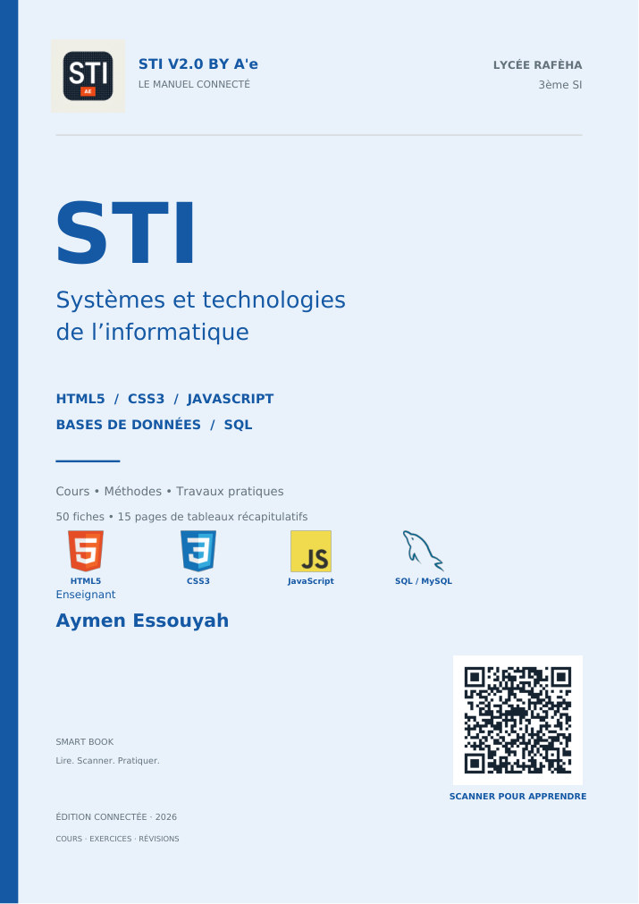
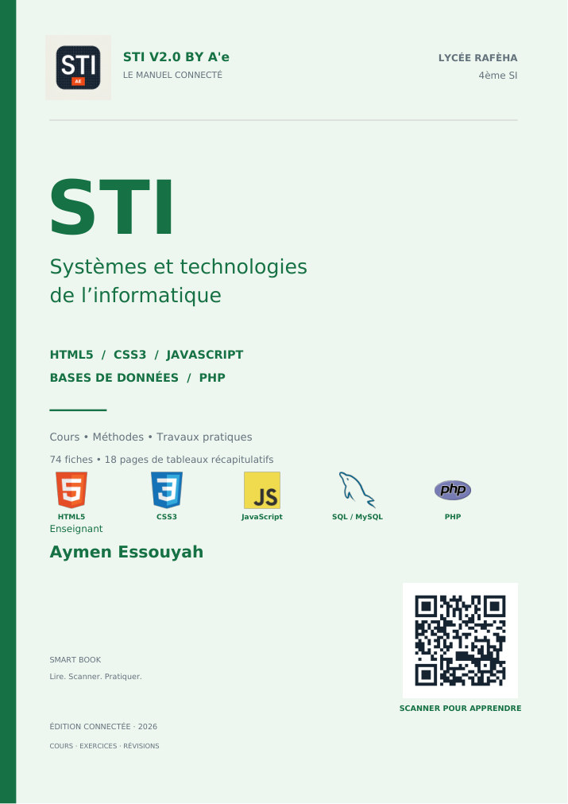

# STI V2.0 — « Le web de A à Z » — Refonte UI/UX complète

> Design issu de **`RR.html`** (design system + page d'accueil), appliqué à **toutes** les pages :
> cours, quiz, outils, glossaire et nouveau tableau de bord. Le contenu et les fonctionnalités
> du site de référence sont conservés : les pages historiques gardent leur HTML, leurs ancres
> (Smart Book) et leurs scripts ; seul le design change.
>
> Lycée Raféha · 3<sup>ème</sup> &amp; 4<sup>ème</sup> SI · M. Aymen Essouyah.

---

## 1. Arborescence

```text
STiV2.0/
├── index.html                        ← NOUVELLE page d'accueil (design RR.html)
├── index-origine.html                ← copie intégrale de l'ancien index (contenu + scripts conservés)
├── dashboard.html                    ← NOUVEAU tableau de bord de l'abonné
├── glossaire.html                    ← NOUVEAU glossaire FR · EN · AR
├── glossaire-origine.html            ← copie intégrale de l'ancien glossaire
├── 404.html · portail.html · admin.html · carte-visite.html
├── bac-pratique.html · pieges-bac.html · memo-veille-bac.html · outils-js-bac.html
├── revision-erreurs.html · nouveautes.html · livre-smart.html · ma-fiche-revision.html
├── assets/
│   ├── css/
│   │   ├── theme.css                 ← ★ NOUVEAU design system (3 thèmes, tous les composants)
│   │   └── … (css historiques conservés)
│   ├── js/
│   │   ├── config.js                 ← INCHANGÉ (window.STI_AUTH)
│   │   ├── supabase-umd.js           ← INCHANGÉ
│   │   ├── acces.js                  ← INCHANGÉ (verrou, mode GOLD)
│   │   ├── sync-progressions.js      ← INCHANGÉ (table sti_progressions)
│   │   ├── profil.js                 ← ★ NOUVEAU : unique couche localStorage / « profilAbonne »
│   │   ├── app.js                    ← ★ NOUVEAU : toute l'interface et les interactions
│   │   ├── glossaire-terms.js        ← NOUVEAU : 75 termes extraits de l'ancien glossaire
│   │   └── … (scripts historiques conservés)
│   ├── videos/[matiere]-cours.mp4 …  (8 vidéos .mp4 locales, chemins remplaçables)
│   ├── audio/ · images/ · fonts/ · data/nouveautes.json
├── cours/
│   ├── html5.html · css3.html · javascript.html · sql.html · php.html
│   │     └── UNE page par matière : onglets 📘 Cours · ✍️ Exercices · 📎 Annexes · 🎥 Vidéos
│   │         (le cours d'origine est enveloppé, toutes les ancres restent valides)
│   └── … (fiches, récapitulatifs, annexes — thème appliqué)
├── quiz/
│   ├── html-css.html · javascript.html · sql.html · php.html · tableaux.html · pp.html
│   │     └── quiz d'origine INTACTS + nouvel en-tête / pied de page / 3 thèmes
├── exercices/
│   ├── html5.html · css3.html · javascript.html · sql.html · php.html · index.html
│   │     └── NOUVELLES redirections vers cours/<matiere>.html#exercices
│   ├── series-exercices.html · resume-fonctions-standards.html (thème appliqué)
│   └── html-css/ · javascript/ · sql/ · php/  (tous les TP conservés tels quels)
├── documents/ · projets/ · supabase/ · tests/ · sw.js · manifest.webmanifest
└── DESIGN-STI-V2.md                  ← ce document
```

**Fichiers créés** (code complet ci-dessous, un bloc par fichier) :
`assets/css/theme.css`, `assets/js/profil.js`, `assets/js/app.js`,
`assets/js/glossaire-terms.js`, `index.html`, `dashboard.html`, `glossaire.html`,
les 6 redirections `exercices/*.html`, plus le **pont de design** injecté dans les 35 pages
historiques (un seul bloc, identique sur chaque page).
`index-origine.html` et `glossaire-origine.html` sont des copies octet pour octet des originaux.

---

## 2. Chaîne de chargement (ordre imposé, sur chaque page)

```html
<link rel="stylesheet" href="assets/css/theme.css">
<script src="assets/js/config.js" defer></script>
<script src="assets/js/supabase-umd.js" defer></script>
<script src="assets/js/acces.js" defer></script>
<script src="assets/js/sync-progressions.js" defer></script>
<script src="assets/js/profil.js"></script>   <!-- bloquant : thème appliqué AVANT la peinture -->
<script src="assets/js/app.js" defer></script>
```

`profil.js` est le seul script non différé : il lit `sti-profil-abonne` et pose
`data-theme` dès le `<head>`, donc **aucun flash** de thème. Un `MutationObserver` neutralise
ensuite l'ancien thème sombre universel réinjecté par `acces.js` (le script n'est pas modifié).

---

## 3. `assets/css/theme.css` — Fichier 1 — Design system complet

```css
/* ============================================================================
   STI V2.0 — « Le web de A à Z » — DESIGN SYSTEM (assets/css/theme.css)
   Lycée Raféha · 3ème & 4ème SI · Aymen Essouyah
   ----------------------------------------------------------------------------
   Style SaaS / EdTech, glassmorphism léger, HTML5 + CSS3 natif, sans framework.
   Toutes les couleurs passent par des variables : 3 modes d'affichage
   data-theme="sombre | clair | intermediaire" sur <html>.
   Code commenté en français. Aucune ressource externe (polices locales).
   ========================================================================== */

/* ---------------------------------------------------------------------------
   0. POLICES LOCALES (offline, aucun appel Google Fonts)
   ------------------------------------------------------------------------- */
@font-face{font-family:"STI Inter";src:url("../fonts/inter-var.woff2") format("woff2");font-weight:100 900;font-display:swap}
@font-face{font-family:"STI Display";src:url("../fonts/manrope-latin.woff2") format("woff2");font-weight:400 800;font-display:swap}
@font-face{font-family:"STI Mono";src:url("../fonts/jetbrains-mono-var.woff2") format("woff2");font-weight:100 800;font-display:swap}

/* ---------------------------------------------------------------------------
   1. VARIABLES DU DESIGN SYSTEM — :root = mode SOMBRE (par défaut)
   ------------------------------------------------------------------------- */
:root,
[data-theme="sombre"],
[data-theme="dark"]{                 /* alias legacy : acces.js écrit parfois "dark" */
  color-scheme:dark;

  /* Surfaces */
  --bg:#0d1526; --bg-soft:#101b2f; --surface:#152238; --surface-2:#1b2b45;
  --surface-3:#22344f; --border:#26374f; --border-soft:rgba(255,255,255,.08);
  --glass:rgba(21,34,56,.72);

  /* Texte */
  --text:#e9eefb; --text-muted:#a7b6ce; --text-dim:#7488a5;

  /* Accents par matière */
  --html:#ff7a2f; --css:#38bdf8; --js:#f2c94c; --sql:#2fd48a; --php:#a97bff;
  --accent:#4f8cff; --accent-2:#2fd48a; --gold:#f5c451;

  /* Dégradés */
  --grad-hero:linear-gradient(120deg,#ff7a2f 0%,#f2c94c 22%,#2fd48a 48%,#38bdf8 72%,#a97bff 100%);
  --grad-cta:linear-gradient(120deg,#4f8cff,#38bdf8);
  --grad-dark:linear-gradient(180deg,rgba(255,255,255,.05),rgba(255,255,255,0));

  /* Ombres */
  --shadow-sm:0 2px 10px rgba(3,10,25,.35);
  --shadow-md:0 14px 34px rgba(3,10,25,.42);
  --shadow-lg:0 30px 70px rgba(3,10,25,.55);
  --shadow-glow:0 12px 40px rgba(79,140,255,.28);
}

/* ---------------------------------------------------------------------------
   2. MODE CLAIR — fond blanc cassé, texte foncé, accents assombris (contraste)
   ------------------------------------------------------------------------- */
[data-theme="clair"],
[data-theme="light"]{                /* alias legacy */
  color-scheme:light;
  --bg:#f7f9fd; --bg-soft:#eef2fa; --surface:#ffffff; --surface-2:#f2f5fb;
  --surface-3:#e4ebf6; --border:#d9e2f0; --border-soft:rgba(13,21,38,.10);
  --glass:rgba(255,255,255,.78);
  --text:#132038; --text-muted:#4b5c76; --text-dim:#6b7c96;
  --html:#d95a12; --css:#0b7dbe; --js:#9a6b00; --sql:#0e8358; --php:#6f3fd0;
  --accent:#2456cc; --accent-2:#0e8358; --gold:#a97400;
  --grad-cta:linear-gradient(120deg,#2456cc,#0b7dbe);
  --grad-dark:linear-gradient(180deg,rgba(13,21,38,.04),rgba(13,21,38,0));
  --shadow-sm:0 2px 10px rgba(20,40,80,.07);
  --shadow-md:0 14px 34px rgba(20,40,80,.10);
  --shadow-lg:0 30px 70px rgba(20,40,80,.14);
  --shadow-glow:0 12px 40px rgba(36,86,204,.20);
}

/* ---------------------------------------------------------------------------
   3. MODE INTERMÉDIAIRE — gris-bleu moyen, contraste modéré
   ------------------------------------------------------------------------- */
[data-theme="intermediaire"]{
  color-scheme:light;
  --bg:#8593ab; --bg-soft:#7f8da5; --surface:#e8edf6; --surface-2:#dbe2ee;
  --surface-3:#c9d3e3; --border:#aebbd0; --border-soft:rgba(18,29,50,.14);
  --glass:rgba(232,237,246,.80);
  --text:#18243a; --text-muted:#33425c; --text-dim:#4a5b76;
  --html:#b3480f; --css:#0a6599; --js:#806000; --sql:#0a7150; --php:#5e37ac;
  --accent:#1f4aa8; --accent-2:#0a7150; --gold:#8a6300;
  --grad-cta:linear-gradient(120deg,#1f4aa8,#0a6599);
  --grad-dark:linear-gradient(180deg,rgba(18,29,50,.05),rgba(18,29,50,0));
  --shadow-sm:0 2px 10px rgba(18,29,50,.16);
  --shadow-md:0 14px 34px rgba(18,29,50,.20);
  --shadow-lg:0 30px 70px rgba(18,29,50,.28);
  --shadow-glow:0 12px 40px rgba(31,74,168,.22);
}

/* Variables communes (indépendantes du thème) */
:root{
  --font-display:"STI Display","STI Inter",system-ui,sans-serif;
  --font-body:"STI Inter",system-ui,-apple-system,sans-serif;
  --font-mono:"STI Mono",ui-monospace,SFMono-Regular,monospace;
  --fs-xs:.78rem; --fs-sm:.88rem; --fs-base:1rem; --fs-md:1.125rem;
  --fs-lg:1.35rem; --fs-xl:clamp(1.65rem,2.2vw,2.15rem);
  --fs-2xl:clamp(2.1rem,4.4vw,3.25rem); --fs-hero:clamp(2.65rem,7.4vw,5.2rem);
  --sp-1:.25rem; --sp-2:.5rem; --sp-3:.75rem; --sp-4:1rem;
  --sp-5:1.5rem; --sp-6:2rem; --sp-7:2.75rem; --sp-8:4rem; --sp-9:6rem;
  --r-sm:.5rem; --r-md:.85rem; --r-lg:1.25rem; --r-xl:1.75rem; --r-full:999px;
  --ease-out:cubic-bezier(.22,.75,.28,1);
  --ease-spring:cubic-bezier(.2,1.25,.35,1);
  --t-fast:.18s; --t-med:.35s; --t-slow:.7s;
  --header-h:74px; --max-w:1240px; --radius-ring:3px;
}

/* ---------------------------------------------------------------------------
   4. BASE / RESET
   ------------------------------------------------------------------------- */
*,*::before,*::after{box-sizing:border-box}
html{scroll-behavior:smooth;scroll-padding-top:calc(var(--header-h) + 18px);-webkit-text-size-adjust:100%}
body{margin:0}
body.sti-v2{
  background:var(--bg);color:var(--text);font-family:var(--font-body);
  font-size:calc(var(--fs-base) * var(--echelle-texte,1));line-height:1.65;
  overflow-x:hidden;min-height:100vh;
  transition:background var(--t-med) var(--ease-out),color var(--t-med) var(--ease-out);
}
body.sti-v2 img,body.sti-v2 video{max-width:100%;display:block}
a{color:inherit;text-decoration:none}
button,input,textarea,select{font:inherit;color:inherit}
h1,h2,h3,h4,h5{font-family:var(--font-display);line-height:1.14;letter-spacing:-.02em;margin:0 0 var(--sp-3);font-weight:700}
p{margin:0 0 var(--sp-4)}
ul{margin:0;padding:0;list-style:none}
small{font-size:var(--fs-xs)}
:focus-visible{outline:3px solid var(--css);outline-offset:3px;border-radius:var(--radius-ring)}
::selection{background:color-mix(in srgb,var(--accent) 40%,transparent);color:var(--text)}

.container{width:min(100% - 2.5rem,var(--max-w));margin-inline:auto}
.section{padding-block:clamp(3.25rem,7vw,6rem);position:relative}
.section--soft{background:var(--bg-soft)}
.grad-text{background:var(--grad-hero);background-size:220% 100%;-webkit-background-clip:text;background-clip:text;color:transparent;animation:gradShift 9s linear infinite}
@keyframes gradShift{0%{background-position:0% 50%}100%{background-position:220% 50%}}
.sr-only{position:absolute;width:1px;height:1px;padding:0;margin:-1px;overflow:hidden;clip:rect(0,0,0,0);white-space:nowrap;border:0}

/* Section : titres */
.section-head{max-width:760px;margin-bottom:var(--sp-7)}
.eyebrow{display:inline-flex;align-items:center;gap:.55rem;font-size:var(--fs-xs);font-weight:700;letter-spacing:.16em;text-transform:uppercase;color:var(--accent);background:color-mix(in srgb,var(--accent) 12%,transparent);border:1px solid color-mix(in srgb,var(--accent) 28%,transparent);padding:.42rem .95rem;border-radius:var(--r-full);margin-bottom:var(--sp-4)}
.eyebrow .dot{width:7px;height:7px;border-radius:50%;background:currentColor;box-shadow:0 0 0 4px color-mix(in srgb,var(--accent) 18%,transparent);animation:pulseDot 2.4s var(--ease-out) infinite}
@keyframes pulseDot{0%,100%{opacity:1;transform:scale(1)}50%{opacity:.45;transform:scale(.72)}}
.section-title{font-size:var(--fs-2xl)}
.section-sub{color:var(--text-muted);font-size:var(--fs-md);margin:0}

/* ---------------------------------------------------------------------------
   5. BOUTONS
   ------------------------------------------------------------------------- */
.btn{--btn-bg:var(--surface-2);--btn-fg:var(--text);position:relative;display:inline-flex;align-items:center;justify-content:center;gap:.6rem;padding:.85rem 1.6rem;border-radius:var(--r-full);font-weight:600;font-size:var(--fs-sm);letter-spacing:.01em;background:var(--btn-bg);color:var(--btn-fg);border:1px solid var(--border);cursor:pointer;overflow:hidden;transition:transform var(--t-fast) var(--ease-spring),box-shadow var(--t-med) var(--ease-out),background var(--t-med) var(--ease-out),border-color var(--t-med) var(--ease-out)}
.btn:hover{transform:translateY(-2px);box-shadow:var(--shadow-md)}
.btn:active{transform:translateY(0) scale(.985)}
.btn--primary{background:var(--grad-cta);color:#fff;border-color:transparent;box-shadow:var(--shadow-glow)}
[data-theme="sombre"] .btn--primary,[data-theme="dark"] .btn--primary{color:#051527}
.btn--primary:hover{box-shadow:0 18px 46px color-mix(in srgb,var(--accent) 42%,transparent)}
.btn--ghost{background:transparent}
.btn--ghost:hover{background:var(--surface-2);border-color:var(--accent)}
.btn--sm{padding:.58rem 1.15rem;font-size:var(--fs-xs)}
.btn--block{width:100%}
.btn .ico{width:18px;height:18px;flex:none}
.btn--primary::after{content:"";position:absolute;inset:0;background:linear-gradient(105deg,transparent 25%,rgba(255,255,255,.45) 50%,transparent 72%);transform:translateX(-120%);transition:transform .75s var(--ease-out)}
.btn--primary:hover::after{transform:translateX(120%)}
.icon-btn{width:42px;height:42px;flex:none;border-radius:12px;background:var(--surface-2);border:1px solid var(--border);display:grid;place-items:center;cursor:pointer;transition:transform var(--t-fast) var(--ease-spring),background var(--t-fast),border-color var(--t-fast)}
.icon-btn:hover{transform:translateY(-2px);border-color:var(--accent);background:var(--surface-3)}
.icon-btn svg{width:19px;height:19px;stroke:currentColor;fill:none;stroke-width:1.8;stroke-linecap:round;stroke-linejoin:round}
.kbd{font-family:var(--font-mono);font-size:.7rem;padding:.22rem .5rem;border-radius:6px;background:var(--surface-2);border:1px solid var(--border);color:var(--text-muted)}

/* ---------------------------------------------------------------------------
   6. BADGES / CARTES / ALERTES
   ------------------------------------------------------------------------- */
.badge{display:inline-flex;align-items:center;gap:.4rem;padding:.32rem .78rem;border-radius:var(--r-full);font-size:var(--fs-xs);font-weight:700;letter-spacing:.03em;background:var(--surface-2);border:1px solid var(--border);color:var(--text-muted);white-space:nowrap}
.badge--html{background:color-mix(in srgb,var(--html) 14%,transparent);border-color:color-mix(in srgb,var(--html) 38%,transparent);color:color-mix(in srgb,var(--html) 72%,var(--text))}
.badge--css{background:color-mix(in srgb,var(--css) 14%,transparent);border-color:color-mix(in srgb,var(--css) 38%,transparent);color:color-mix(in srgb,var(--css) 72%,var(--text))}
.badge--js{background:color-mix(in srgb,var(--js) 16%,transparent);border-color:color-mix(in srgb,var(--js) 40%,transparent);color:color-mix(in srgb,var(--js) 72%,var(--text))}
.badge--sql{background:color-mix(in srgb,var(--sql) 14%,transparent);border-color:color-mix(in srgb,var(--sql) 38%,transparent);color:color-mix(in srgb,var(--sql) 72%,var(--text))}
.badge--php{background:color-mix(in srgb,var(--php) 14%,transparent);border-color:color-mix(in srgb,var(--php) 38%,transparent);color:color-mix(in srgb,var(--php) 72%,var(--text))}
.badge--gold{background:color-mix(in srgb,var(--gold) 16%,transparent);border-color:color-mix(in srgb,var(--gold) 45%,transparent);color:color-mix(in srgb,var(--gold) 70%,var(--text))}
.badge--nouveau{background:color-mix(in srgb,var(--html) 18%,transparent);border-color:color-mix(in srgb,var(--html) 45%,transparent);color:color-mix(in srgb,var(--html) 75%,var(--text))}

.card{position:relative;background:var(--surface);border:1px solid var(--border);border-radius:var(--r-lg);padding:var(--sp-6);overflow:hidden;transition:transform var(--t-med) var(--ease-out),border-color var(--t-med) var(--ease-out),box-shadow var(--t-med) var(--ease-out),background var(--t-med) var(--ease-out)}
.card::before{content:"";position:absolute;inset:0;background:radial-gradient(420px 220px at var(--mx,50%) var(--my,0%),color-mix(in srgb,var(--accent) 16%,transparent),transparent 70%);opacity:0;transition:opacity var(--t-med) var(--ease-out);pointer-events:none}
.card:hover{transform:translateY(-5px);border-color:color-mix(in srgb,var(--accent) 42%,var(--border));box-shadow:var(--shadow-lg)}
.card:hover::before{opacity:1}
.card--flat:hover{transform:none;box-shadow:none;border-color:var(--border)}
.card--flat:hover::before{opacity:0}
.card__head{display:flex;align-items:center;justify-content:space-between;gap:1rem;margin-bottom:var(--sp-4)}
.card__title{font-size:var(--fs-lg);margin:0}

.alert{display:flex;gap:.9rem;align-items:flex-start;padding:1rem 1.25rem;border-radius:var(--r-md);background:var(--surface-2);border:1px solid var(--border);border-inline-start:4px solid var(--accent);font-size:var(--fs-sm);color:var(--text-muted)}
.alert--tip{border-inline-start-color:var(--sql)}
.alert--warn{border-inline-start-color:var(--js)}
.alert--gold{border-inline-start-color:var(--gold)}
.alert strong{color:var(--text)}
.alert svg{width:22px;height:22px;flex:none;stroke:var(--accent);fill:none;stroke-width:1.9;stroke-linecap:round;stroke-linejoin:round}

/* ---------------------------------------------------------------------------
   7. PROGRESSION : barre + anneau
   ------------------------------------------------------------------------- */
.progress{height:8px;border-radius:var(--r-full);background:var(--surface-3);overflow:hidden;position:relative}
.progress__fill{height:100%;width:0;border-radius:inherit;background:var(--bar,var(--grad-cta));transition:width 1.25s var(--ease-out)}
.progress--lg{height:12px}
.ring{--pct:0;--ring-color:var(--accent);width:var(--ring-size,108px);height:var(--ring-size,108px);border-radius:50%;display:grid;place-items:center;background:conic-gradient(var(--ring-color) calc(var(--pct) * 1%),var(--surface-3) 0);position:relative;flex:none}
.ring::before{content:"";position:absolute;inset:10px;border-radius:50%;background:var(--surface)}
.ring__label{position:relative;font-family:var(--font-display);font-size:1.15rem;font-weight:700;color:var(--text)}
.ring__label small{display:block;text-align:center;font-size:.62rem;color:var(--text-dim);font-weight:600;letter-spacing:.08em;text-transform:uppercase}

/* ---------------------------------------------------------------------------
   8. BLOCS DE CODE
   ------------------------------------------------------------------------- */
.codeblock{background:#0b1424;border:1px solid rgba(255,255,255,.10);border-radius:var(--r-md);overflow:hidden;color:#cfe0f5}
.codeblock__bar{display:flex;align-items:center;gap:.4rem;padding:.6rem .9rem;background:rgba(255,255,255,.045);border-bottom:1px solid rgba(255,255,255,.08)}
.codeblock__bar i{width:10px;height:10px;border-radius:50%}
.codeblock__bar i:nth-child(1){background:#ff5f57}
.codeblock__bar i:nth-child(2){background:#febc2e}
.codeblock__bar i:nth-child(3){background:#28c840}
.codeblock__bar span{margin-inline-start:auto;color:#8fa3c4;font-family:var(--font-mono);font-size:.72rem}
.codeblock pre{margin:0;padding:1.15rem 1.25rem;overflow-x:auto;color:#cfe0f5;font-family:var(--font-mono);font-size:.82rem;line-height:1.7}
.codeblock__copy{margin-inline-start:auto;background:rgba(255,255,255,.08);border:1px solid rgba(255,255,255,.16);color:#cfe0f5;font-size:.7rem;padding:.28rem .7rem;border-radius:var(--r-full);cursor:pointer}
.t-tag{color:#ff8b5e}.t-attr{color:#7ee0c4}.t-str{color:#f2c94c}.t-com{color:#6f83a0;font-style:italic}.t-key{color:#bd9bff}.t-fn{color:#67cdfb}

/* ---------------------------------------------------------------------------
   9. ONGLETS
   ------------------------------------------------------------------------- */
.tabs{display:inline-flex;gap:.3rem;padding:.35rem;background:var(--surface-2);border:1px solid var(--border);border-radius:var(--r-full);position:relative;flex-wrap:wrap}
.tab{position:relative;z-index:1;padding:.62rem 1.35rem;border:0;background:transparent;border-radius:var(--r-full);cursor:pointer;font-size:var(--fs-sm);font-weight:600;color:var(--text-muted);transition:color var(--t-med) var(--ease-out)}
.tab[aria-selected="true"]{color:#fff}
[data-theme="clair"] .tab[aria-selected="true"],[data-theme="light"] .tab[aria-selected="true"],[data-theme="intermediaire"] .tab[aria-selected="true"]{color:#fff}
[data-theme="sombre"] .tab[aria-selected="true"],[data-theme="dark"] .tab[aria-selected="true"]{color:#051527}
.tabs__thumb{position:absolute;top:.35rem;bottom:.35rem;left:0;background:var(--grad-cta);border-radius:var(--r-full);transition:transform var(--t-med) var(--ease-spring),width var(--t-med) var(--ease-spring);z-index:0}
.tab-panel{animation:panelIn .45s var(--ease-out) both}
.tab-panel[hidden]{display:none}
@keyframes panelIn{from{opacity:0;transform:translateY(14px)}to{opacity:1;transform:none}}

/* ---------------------------------------------------------------------------
   10. MODALES + PALETTE DE RECHERCHE
   ------------------------------------------------------------------------- */
.modal{position:fixed;inset:0;z-index:120;display:grid;place-items:center;padding:1.25rem;background:rgba(5,12,24,.72);backdrop-filter:blur(8px);opacity:0;visibility:hidden;transition:opacity var(--t-med) var(--ease-out),visibility var(--t-med)}
.modal.is-open{opacity:1;visibility:visible}
.modal__box{width:min(100%,var(--modal-w,540px));max-height:min(88vh,900px);overflow:auto;background:var(--surface);border:1px solid var(--border);border-radius:var(--r-lg);padding:var(--sp-6);box-shadow:var(--shadow-lg);position:relative;transform:translateY(26px) scale(.96);transition:transform var(--t-med) var(--ease-spring)}
.modal.is-open .modal__box{transform:none}
.modal__close{position:absolute;top:1rem;inset-inline-end:1rem;width:38px;height:38px;border-radius:50%;background:var(--surface-2);border:1px solid var(--border);cursor:pointer;display:grid;place-items:center;z-index:2}
.modal--video{--modal-w:960px}
.modal__video{width:100%;border-radius:var(--r-md);background:#000;aspect-ratio:16/9;object-fit:contain}
.palette{--modal-w:640px;align-self:start;margin-top:9vh}
.palette input{width:100%;padding:1rem 1.2rem;border-radius:var(--r-md);background:var(--surface-2);border:1px solid var(--border);font-size:var(--fs-md);outline:none}
.palette__list{max-height:46vh;overflow:auto;margin-top:var(--sp-4);display:grid;gap:.4rem}
.palette__item{display:flex;align-items:center;gap:.85rem;width:100%;text-align:start;padding:.8rem 1rem;border-radius:var(--r-md);background:transparent;border:1px solid transparent;cursor:pointer}
.palette__item:hover,.palette__item:focus-visible{background:var(--surface-2);border-color:var(--border)}
.palette__item .em{font-size:1.25rem;width:28px;text-align:center}
.palette__item small{display:block;color:var(--text-dim)}
.palette__empty{padding:1rem;color:var(--text-dim);font-size:var(--fs-sm)}

/* ---------------------------------------------------------------------------
   11. EN-TÊTE STICKY + NAVIGATION
   ------------------------------------------------------------------------- */
.scroll-progress{position:fixed;top:0;left:0;height:3px;width:100%;transform-origin:0 50%;transform:scaleX(0);background:var(--grad-hero);z-index:110}
.site-header{position:sticky;top:0;z-index:100;min-height:var(--header-h);display:flex;align-items:center;background:var(--glass);backdrop-filter:saturate(180%) blur(16px);-webkit-backdrop-filter:saturate(180%) blur(16px);border-bottom:1px solid transparent;transition:border-color var(--t-med) var(--ease-out),background var(--t-med) var(--ease-out)}
.site-header.is-stuck{border-bottom-color:var(--border);box-shadow:var(--shadow-sm)}
.header-inner{display:flex;align-items:center;gap:var(--sp-4);width:min(100% - 2rem,var(--max-w));margin-inline:auto;padding-block:.55rem;flex-wrap:wrap}
.brand{display:flex;align-items:center;gap:.7rem;flex:none}
.brand__mark{width:42px;height:42px;border-radius:13px;flex:none;background:var(--grad-hero);display:grid;place-items:center;font-family:var(--font-display);font-weight:800;color:#0d1526;font-size:.9rem;box-shadow:0 10px 26px rgba(79,140,255,.25)}
.brand__text{display:flex;flex-direction:column;line-height:1.12}
.brand__name{font-family:var(--font-display);font-weight:800;font-size:1.02rem;letter-spacing:-.01em}
.brand__tag{font-size:.66rem;color:var(--text-dim);letter-spacing:.13em;text-transform:uppercase}
.nav{margin-inline:auto;display:flex;align-items:center;gap:.2rem;flex-wrap:wrap}
.nav a{position:relative;padding:.5rem .8rem;border-radius:var(--r-full);font-size:var(--fs-sm);font-weight:600;color:var(--text-muted);transition:color var(--t-fast),background var(--t-fast)}
.nav a::after{content:"";position:absolute;left:.8rem;right:.8rem;bottom:.22rem;height:2px;background:var(--accent);border-radius:2px;transform:scaleX(0);transform-origin:left;transition:transform var(--t-med) var(--ease-spring)}
.nav a:hover{color:var(--text);background:var(--surface-2)}
.nav a:hover::after,.nav a.is-active::after{transform:scaleX(1)}
.nav a.is-active{color:var(--text)}
.header-actions{display:flex;align-items:center;gap:.5rem;flex:none;margin-inline-start:auto}
.burger{display:none}
.mobile-menu{position:fixed;top:var(--header-h);left:0;right:0;z-index:99;background:var(--bg-soft);border-bottom:1px solid var(--border);padding:1rem 1.25rem 1.5rem;transform:translateY(-12px);opacity:0;visibility:hidden;transition:opacity var(--t-med),transform var(--t-med),visibility var(--t-med);box-shadow:var(--shadow-md)}
.mobile-menu.is-open{transform:none;opacity:1;visibility:visible}
.mobile-menu a{display:block;padding:.85rem 1rem;border-radius:var(--r-md);color:var(--text-muted);font-weight:600;border-bottom:1px solid var(--border-soft)}
.mobile-menu a:hover{background:var(--surface-2);color:var(--text)}

/* Sélecteur à 3 modes (en-tête + tableau de bord) */
.modes{display:inline-flex;gap:2px;padding:3px;background:var(--surface-2);border:1px solid var(--border);border-radius:var(--r-full)}
.modes button{width:32px;height:30px;display:grid;place-items:center;border:0;background:transparent;border-radius:var(--r-full);cursor:pointer;font-size:.85rem;color:var(--text-dim);transition:background var(--t-fast),color var(--t-fast),transform var(--t-fast)}
.modes button:hover{color:var(--text);transform:translateY(-1px)}
.modes button[aria-pressed="true"]{background:var(--surface);color:var(--accent);box-shadow:var(--shadow-sm)}
.modes--large button{width:auto;height:auto;padding:.65rem 1.1rem;font-size:var(--fs-sm);font-weight:700;gap:.45rem}
.modes--large button .em{font-size:1rem}

/* ---------------------------------------------------------------------------
   12. BADGE ABONNÉ + PANNEAU LATÉRAL
   ------------------------------------------------------------------------- */
.sub-badge{display:flex;align-items:center;gap:.55rem;padding:.32rem .7rem .32rem .35rem;border:1px solid var(--border);background:var(--surface-2);border-radius:var(--r-full);cursor:pointer;transition:border-color var(--t-fast),transform var(--t-fast);max-width:220px}
.sub-badge:hover{border-color:var(--gold);transform:translateY(-1px)}
.avatar{width:34px;height:34px;border-radius:50%;flex:none;display:grid;place-items:center;background:var(--grad-cta);color:#fff;font-family:var(--font-display);font-weight:800;font-size:.82rem;overflow:hidden}
.avatar img{width:100%;height:100%;object-fit:cover}
.avatar--gold{background:linear-gradient(135deg,var(--gold),#e08b18);color:#2a1a00}
.sub-badge__txt{display:flex;flex-direction:column;line-height:1.15;text-align:start;min-width:0}
.sub-badge__name{font-size:.78rem;font-weight:700;white-space:nowrap;overflow:hidden;text-overflow:ellipsis;max-width:110px}
.sub-badge__star{font-size:.66rem;font-weight:700;color:var(--gold)}
.sub-badge--guest{padding:.55rem 1rem;font-size:.75rem;font-weight:700;gap:.4rem}

.side-panel{position:fixed;top:0;inset-inline-end:0;bottom:0;width:min(100%,390px);z-index:130;background:var(--surface);border-inline-start:1px solid var(--border);box-shadow:var(--shadow-lg);padding:var(--sp-6);overflow:auto;transform:translateX(102%);transition:transform var(--t-med) var(--ease-spring);visibility:hidden}
[dir="rtl"] .side-panel{transform:translateX(-102%)}
.side-panel.is-open{transform:none;visibility:visible}
.side-panel__backdrop{position:fixed;inset:0;z-index:125;background:rgba(5,12,24,.55);backdrop-filter:blur(3px);opacity:0;visibility:hidden;transition:opacity var(--t-med),visibility var(--t-med)}
.side-panel__backdrop.is-open{opacity:1;visibility:visible}
.side-panel__head{display:flex;align-items:center;gap:1rem;margin-bottom:var(--sp-6)}
.side-panel__close{margin-inline-start:auto}
.side-panel__section{margin-bottom:var(--sp-6)}
.side-panel__section h4{font-size:var(--fs-xs);text-transform:uppercase;letter-spacing:.14em;color:var(--text-dim);margin-bottom:var(--sp-3)}
.link-row{display:flex;align-items:center;gap:.8rem;padding:.75rem .9rem;border-radius:var(--r-md);background:var(--surface-2);border:1px solid var(--border);margin-bottom:.5rem;font-size:var(--fs-sm);font-weight:600;transition:transform var(--t-fast),border-color var(--t-fast)}
.link-row:hover{transform:translateX(3px);border-color:var(--accent)}
.link-row .em{font-size:1.1rem}
.link-row .end{margin-inline-start:auto;color:var(--text-dim);font-size:var(--fs-xs)}

/* ---------------------------------------------------------------------------
   13. HERO + STATISTIQUES
   ------------------------------------------------------------------------- */
.hero{position:relative;overflow:hidden;padding-block:clamp(2.5rem,6vw,4.75rem) clamp(3rem,7vw,5.5rem)}
.hero__grid{position:absolute;inset:0;background-image:linear-gradient(var(--border-soft) 1px,transparent 1px),linear-gradient(90deg,var(--border-soft) 1px,transparent 1px);background-size:68px 68px;-webkit-mask-image:radial-gradient(ellipse 90% 75% at 50% 12%,#000 12%,transparent 78%);mask-image:radial-gradient(ellipse 90% 75% at 50% 12%,#000 12%,transparent 78%);opacity:.8}
.hero__glow{position:absolute;width:760px;height:760px;border-radius:50%;top:-320px;inset-inline-end:-180px;background:radial-gradient(circle,color-mix(in srgb,var(--accent) 20%,transparent),transparent 66%);pointer-events:none}
.hero__glow--2{top:auto;bottom:-380px;inset-inline-end:auto;inset-inline-start:-220px;background:radial-gradient(circle,color-mix(in srgb,var(--html) 16%,transparent),transparent 66%)}
.hero-inner{position:relative;display:grid;grid-template-columns:1.06fr .94fr;gap:clamp(2rem,5vw,4.25rem);align-items:center}
.hero h1{font-size:var(--fs-hero);letter-spacing:-.035em;margin-bottom:var(--sp-5)}
.hero h1 .line{display:block;overflow:hidden}
.hero h1 .line>span{display:inline-block;transform:translateY(105%);animation:lineUp .95s var(--ease-out) forwards}
.hero h1 .line:nth-child(1)>span{animation-delay:.05s}
.hero h1 .line:nth-child(2)>span{animation-delay:.18s}
@keyframes lineUp{to{transform:none}}
.hero__lead{font-size:clamp(1.02rem,1.6vw,1.22rem);color:var(--text-muted);max-width:38rem;margin-bottom:var(--sp-6);opacity:0;animation:fadeUp .8s var(--ease-out) .38s forwards}
.hero__cta{display:flex;flex-wrap:wrap;gap:.85rem;opacity:0;animation:fadeUp .8s var(--ease-out) .52s forwards}
@keyframes fadeUp{from{opacity:0;transform:translateY(20px)}to{opacity:1;transform:none}}
.hero__meta{display:flex;flex-wrap:wrap;gap:1.65rem;margin-top:var(--sp-7);opacity:0;animation:fadeUp .8s var(--ease-out) .66s forwards}
.hero__meta div{display:flex;flex-direction:column}
.hero__meta strong{font-family:var(--font-display);font-size:1.5rem;letter-spacing:-.02em}
.hero__meta span{font-size:var(--fs-xs);color:var(--text-dim);text-transform:uppercase;letter-spacing:.1em}
.editor{border-radius:var(--r-lg);transform:rotateY(-8deg) rotateX(4deg);box-shadow:var(--shadow-lg);animation:fadeUp 1s var(--ease-out) .3s both;transition:transform .8s var(--ease-out)}
.hero__visual:hover .editor{transform:rotateY(-3deg) rotateX(1deg) translateY(-6px)}
.editor pre{min-height:240px}
.editor .code-line{opacity:0;transform:translateX(-10px);display:block}
.js .editor .code-line{animation:codeIn .55s var(--ease-out) forwards}
@keyframes codeIn{to{opacity:1;transform:none}}
.cursor-blink{display:inline-block;width:8px;height:1.05em;background:var(--js);vertical-align:-2px;margin-inline-start:.25rem;animation:blink 1.05s steps(2,start) infinite}
@keyframes blink{50%{opacity:0}}
.hero__visual{position:relative;perspective:1200px}
.chip{position:absolute;display:flex;align-items:center;gap:.5rem;padding:.55rem .95rem;border-radius:var(--r-full);background:var(--surface);border:1px solid var(--border);font-family:var(--font-mono);font-size:.75rem;font-weight:500;box-shadow:var(--shadow-md);animation:floaty 6s ease-in-out infinite}
.chip i{width:9px;height:9px;border-radius:50%;display:block}
.chip--1{top:-22px;inset-inline-start:-18px}
.chip--2{top:34%;inset-inline-end:-26px;animation-delay:-1.6s}
.chip--3{bottom:-20px;inset-inline-start:12%;animation-delay:-3.1s}
@keyframes floaty{0%,100%{transform:translateY(0) rotate(0)}50%{transform:translateY(-15px) rotate(-1.4deg)}}

.stats{display:grid;grid-template-columns:repeat(4,1fr);gap:1px;background:var(--border);border:1px solid var(--border);border-radius:var(--r-lg);overflow:hidden}
.stat{background:var(--surface);padding:var(--sp-6) var(--sp-5);text-align:center;position:relative;overflow:hidden;transition:background var(--t-med)}
.stat:hover{background:var(--surface-2)}
.stat__num{font-family:var(--font-display);font-size:clamp(2rem,4vw,2.85rem);letter-spacing:-.03em;line-height:1;background:var(--grad-cta);-webkit-background-clip:text;background-clip:text;color:transparent}
.stat__label{color:var(--text-muted);font-size:var(--fs-sm);margin-top:.55rem}
.stat__bar{position:absolute;bottom:0;left:0;height:3px;width:100%;background:var(--grad-hero);transform:scaleX(0);transform-origin:left;transition:transform 1s var(--ease-out)}
.stat.is-visible .stat__bar{transform:scaleX(1)}
.stat--video .stat__num{background:var(--grad-hero)}

/* ---------------------------------------------------------------------------
   14. VIDÉOS (priorité du design)
   ------------------------------------------------------------------------- */
.feature-video{display:grid;grid-template-columns:1.15fr .85fr;gap:0;overflow:hidden;padding:0}
.feature-video__poster{position:relative;min-height:330px;background:radial-gradient(700px 320px at 20% 10%,color-mix(in srgb,var(--css) 28%,transparent),transparent 65%),linear-gradient(135deg,#101b2f,#22344f);display:grid;place-items:center;overflow:hidden}
.feature-video__poster::after{content:"";position:absolute;inset:0;background-image:linear-gradient(var(--border-soft) 1px,transparent 1px),linear-gradient(90deg,var(--border-soft) 1px,transparent 1px);background-size:44px 44px;opacity:.5}
.feature-video__poster img{position:absolute;inset:0;width:100%;height:100%;object-fit:cover;opacity:.42}
.feature-video__body{padding:clamp(1.75rem,3vw,2.75rem);display:flex;flex-direction:column;justify-content:center}
.play-btn{position:relative;z-index:2;width:84px;height:84px;border-radius:50%;display:grid;place-items:center;border:0;cursor:pointer;background:var(--grad-cta);color:#fff;box-shadow:0 18px 44px rgba(79,140,255,.45);transition:transform var(--t-fast) var(--ease-spring),box-shadow var(--t-med)}
.play-btn:hover{transform:scale(1.09);box-shadow:0 22px 56px rgba(79,140,255,.6)}
.play-btn::before,.play-btn::after{content:"";position:absolute;inset:-10px;border-radius:50%;border:2px solid color-mix(in srgb,var(--accent) 45%,transparent);animation:ripple 2.6s var(--ease-out) infinite}
.play-btn::after{animation-delay:1.3s}
@keyframes ripple{0%{transform:scale(.85);opacity:.9}100%{transform:scale(1.45);opacity:0}}
.play-btn svg{width:30px;height:30px;fill:currentColor;margin-inline-start:4px}
.play-btn--sm{width:52px;height:52px;box-shadow:0 10px 26px rgba(3,10,25,.35)}
.play-btn--sm svg{width:19px;height:19px}
.play-btn--sm::before,.play-btn--sm::after{inset:-7px}

.videos-grid{display:grid;grid-template-columns:repeat(3,1fr);gap:var(--sp-5)}
.video-card{padding:0;overflow:hidden;display:flex;flex-direction:column;cursor:pointer;background:var(--surface);border:1px solid var(--border);border-radius:var(--r-lg);transition:transform var(--t-med) var(--ease-out),border-color var(--t-med),box-shadow var(--t-med)}
.video-card:hover{transform:translateY(-6px);border-color:var(--vc,var(--accent));box-shadow:var(--shadow-lg)}
.video-card__thumb{position:relative;aspect-ratio:16/9;background:linear-gradient(135deg,var(--surface-2),var(--surface-3));overflow:hidden;display:grid;place-items:center}
.video-card__thumb img{position:absolute;inset:0;width:100%;height:100%;object-fit:cover;opacity:.72;transition:transform .8s var(--ease-out),opacity .5s}
.video-card:hover .video-card__thumb img{transform:scale(1.08);opacity:.9}
.video-card__thumb::after{content:"";position:absolute;inset:0;background:linear-gradient(180deg,transparent 35%,rgba(5,12,24,.75))}
.video-card__thumb .play-btn--sm{z-index:2}
.video-card__duration{position:absolute;bottom:10px;inset-inline-end:10px;z-index:3;background:rgba(5,12,24,.78);color:#fff;font-family:var(--font-mono);font-size:.68rem;padding:.22rem .5rem;border-radius:6px}
.video-card__badge{position:absolute;top:10px;inset-inline-start:10px;z-index:3}
.video-card__body{padding:var(--sp-5);flex:1;display:flex;flex-direction:column;gap:.5rem}
.video-card__body h3{font-size:1.05rem;margin:0}
.video-card__body p{font-size:var(--fs-xs);color:var(--text-muted);margin:0;flex:1}
.video-card__foot{display:flex;align-items:center;justify-content:space-between;gap:.5rem;font-size:.72rem;color:var(--text-dim)}
.video-card.is-vue .video-card__thumb::before{content:"✓ Vu";position:absolute;top:10px;inset-inline-end:10px;z-index:3;background:var(--sql);color:#06251a;font-weight:800;padding:.2rem .5rem;border-radius:6px;font-size:.68rem}
.video-thumb-fallback{position:absolute;inset:0;display:grid;place-items:center;font-size:3.4rem;opacity:.45;background:radial-gradient(circle at 30% 20%,color-mix(in srgb,var(--vc,var(--accent)) 45%,transparent),transparent 70%)}

/* ---------------------------------------------------------------------------
   15. CARTES MATIÈRES / OUTILS / QUIZ
   ------------------------------------------------------------------------- */
.subjects{display:grid;grid-template-columns:repeat(3,1fr);gap:var(--sp-5)}
.subject{padding:0;display:flex;flex-direction:column;--vc:var(--accent)}
.subject__media{position:relative;height:150px;overflow:hidden;border-bottom:1px solid var(--border);background:radial-gradient(circle at 25% 20%,color-mix(in srgb,var(--vc) 45%,transparent),transparent 65%),linear-gradient(135deg,var(--surface-2),var(--surface-3));display:grid;place-items:center}
.subject__media .em{font-size:3.6rem;filter:drop-shadow(0 10px 18px rgba(0,0,0,.28))}
.subject__media::after{content:"";position:absolute;inset:0;background:linear-gradient(180deg,transparent 40%,var(--surface) 100%)}
.subject__badge{position:absolute;top:12px;inset-inline-start:12px;z-index:2}
.subject__body{padding:var(--sp-5);display:flex;flex-direction:column;flex:1;gap:.65rem}
.subject h3{font-size:1.22rem;display:flex;align-items:center;gap:.6rem;margin:0}
.subject__desc{color:var(--text-muted);font-size:var(--fs-sm);flex:1;margin:0}
.subject__foot{display:flex;align-items:center;justify-content:space-between;gap:.75rem;flex-wrap:wrap}
.subject__link{display:inline-flex;align-items:center;gap:.5rem;font-weight:700;font-size:var(--fs-sm);color:var(--accent)}
.subject__link svg{width:17px;height:17px;transition:transform var(--t-med) var(--ease-spring)}
.subject:hover .subject__link svg{transform:translateX(5px)}
[dir="rtl"] .subject__link svg{transform:scaleX(-1)}
.subject__progress{margin-top:.35rem}
.subject__progress .row{display:flex;justify-content:space-between;font-size:var(--fs-xs);color:var(--text-dim);margin-bottom:.5rem}
.subject--locked{position:relative}
.subject--locked .subject__media::before{content:"🔒";position:absolute;z-index:3;inset:0;display:grid;place-items:center;font-size:2.4rem;background:rgba(5,12,24,.45)}

.tools-grid{display:grid;grid-template-columns:repeat(4,1fr);gap:var(--sp-5)}
.tool{text-align:start;cursor:pointer;padding:var(--sp-5);display:flex;flex-direction:column;gap:.5rem}
.tool__icon{width:52px;height:52px;border-radius:15px;display:grid;place-items:center;margin-bottom:var(--sp-3);font-size:1.45rem;background:var(--surface-2);border:1px solid var(--border);transition:transform var(--t-med) var(--ease-spring),background var(--t-med)}
.tool:hover .tool__icon{transform:translateY(-4px) rotate(-5deg);background:color-mix(in srgb,var(--tc,var(--accent)) 14%,var(--surface-2))}
.tool h3{font-size:1.05rem;margin:0}
.tool p{font-size:var(--fs-sm);color:var(--text-muted);margin:0;flex:1}
.tool__tag{font-size:.68rem;color:var(--text-dim);text-transform:uppercase;letter-spacing:.1em;font-weight:700}

.quiz-grid{display:grid;grid-template-columns:repeat(2,1fr);gap:var(--sp-5)}
.quiz-card{display:flex;gap:1.15rem;align-items:flex-start;padding:var(--sp-5)}
.quiz-card__idx{font-family:var(--font-display);font-size:1.6rem;font-weight:800;color:var(--qc,var(--accent));opacity:.6;line-height:1;flex:none}
.quiz-card h3{font-size:1.12rem;margin:0 0 .35rem}
.quiz-card p{font-size:var(--fs-sm);color:var(--text-muted);margin-bottom:.85rem}
.quiz-card__meta{display:flex;gap:.5rem;flex-wrap:wrap}

/* Filtres par catégorie */
.filters{display:flex;gap:.5rem;flex-wrap:wrap;margin-bottom:var(--sp-6)}
.filter-chip{padding:.5rem 1rem;border-radius:var(--r-full);border:1px solid var(--border);background:var(--surface-2);color:var(--text-muted);font-size:var(--fs-sm);font-weight:600;cursor:pointer;transition:all var(--t-fast)}
.filter-chip:hover{color:var(--text);border-color:var(--accent)}
.filter-chip.is-active{background:var(--grad-cta);color:#fff;border-color:transparent}
[data-theme="sombre"] .filter-chip.is-active,[data-theme="dark"] .filter-chip.is-active{color:#051527}
.is-filtered-out{display:none!important}

/* Flashcards */
.flashcard{perspective:1100px;cursor:pointer;min-height:215px;padding:0}
.flashcard__inner{position:relative;width:100%;height:100%;min-height:215px;transform-style:preserve-3d;transition:transform .72s var(--ease-spring)}
.flashcard.is-flipped .flashcard__inner{transform:rotateY(180deg)}
.flashcard__face{position:absolute;inset:0;backface-visibility:hidden;-webkit-backface-visibility:hidden;border-radius:var(--r-lg);border:1px solid var(--border);background:var(--surface);padding:var(--sp-6);display:flex;flex-direction:column;justify-content:center;gap:.5rem}
.flashcard__face--back{transform:rotateY(180deg);background:var(--surface-2)}
.flashcard__hint{position:absolute;bottom:12px;inset-inline-end:16px;font-size:var(--fs-xs);color:var(--text-dim)}

/* Accordéon */
.accordion{display:grid;gap:.85rem}
.acc-item{background:var(--surface);border:1px solid var(--border);border-radius:var(--r-md);overflow:hidden;transition:border-color var(--t-med),background var(--t-med)}
.acc-item.is-open{border-color:color-mix(in srgb,var(--accent) 45%,var(--border));background:var(--surface-2)}
.acc-btn{width:100%;display:flex;align-items:center;gap:1rem;padding:1.05rem 1.25rem;background:transparent;border:0;text-align:start;cursor:pointer;font-weight:700}
.acc-btn .num{font-family:var(--font-mono);font-size:.75rem;color:var(--accent);background:color-mix(in srgb,var(--accent) 13%,transparent);padding:.28rem .55rem;border-radius:var(--r-sm);flex:none}
.acc-btn .chev{margin-inline-start:auto;width:20px;height:20px;flex:none;stroke:var(--text-muted);fill:none;stroke-width:2;transition:transform var(--t-med)}
.acc-item.is-open .chev{transform:rotate(180deg)}
.acc-panel{overflow:hidden;max-height:0;transition:max-height var(--t-med) var(--ease-out)}
.acc-panel p{padding:0 1.35rem 1.35rem;margin:0;color:var(--text-muted);font-size:var(--fs-sm)}

/* Listes / tableaux */
.list-rows{display:grid;gap:.6rem}
.list-row{display:flex;align-items:center;gap:.9rem;padding:.8rem 1rem;border-radius:var(--r-md);background:var(--surface-2);border:1px solid var(--border);transition:transform var(--t-fast),border-color var(--t-fast)}
.list-row:hover{transform:translateX(3px);border-color:var(--accent)}
.list-row .em{font-size:1.2rem;width:26px;text-align:center;flex:none}
.list-row__txt{flex:1;min-width:0}
.list-row__txt strong{display:block;font-size:var(--fs-sm)}
.list-row__txt small{color:var(--text-dim);display:block;overflow:hidden;text-overflow:ellipsis;white-space:nowrap}
.list-row__end{font-size:var(--fs-xs);color:var(--text-dim);white-space:nowrap}
.empty{padding:2rem;text-align:center;color:var(--text-dim);border:1px dashed var(--border);border-radius:var(--r-md);font-size:var(--fs-sm)}
.table{width:100%;border-collapse:collapse;font-size:var(--fs-sm)}
.table th,.table td{padding:.75rem .9rem;border-bottom:1px solid var(--border);text-align:start}
.table th{font-size:.7rem;text-transform:uppercase;letter-spacing:.12em;color:var(--text-dim)}

/* ---------------------------------------------------------------------------
   16. TABLEAU DE BORD
   ------------------------------------------------------------------------- */
.dash-hero{display:flex;align-items:center;gap:1.25rem;flex-wrap:wrap;padding:var(--sp-6);border-radius:var(--r-xl);background:radial-gradient(700px 300px at 10% 0%,color-mix(in srgb,var(--accent) 22%,transparent),transparent 65%),var(--surface);border:1px solid var(--border);margin-bottom:var(--sp-6)}
.dash-hero .avatar{width:64px;height:64px;font-size:1.35rem}
.dash-hero h1{font-size:var(--fs-xl);margin:0 0 .25rem}
.dash-hero p{color:var(--text-muted);font-size:var(--fs-sm);margin:0}
.dash-hero__end{margin-inline-start:auto;display:flex;gap:.6rem;flex-wrap:wrap;align-items:center}
.dash-grid{display:grid;grid-template-columns:repeat(12,1fr);gap:var(--sp-5)}
.dash-col-8{grid-column:span 8}.dash-col-6{grid-column:span 6}.dash-col-4{grid-column:span 4}.dash-col-12{grid-column:span 12}
.dash-card{background:var(--surface);border:1px solid var(--border);border-radius:var(--r-lg);padding:var(--sp-6)}
.dash-card h2,.dash-card h3{margin:0 0 var(--sp-4);font-size:var(--fs-lg)}
.dash-card__head{display:flex;align-items:center;justify-content:space-between;gap:1rem;margin-bottom:var(--sp-4)}
.dash-card__head h2{margin:0}
.dash-stat{display:flex;align-items:center;gap:1rem}
.dash-stat .ring{--ring-size:86px}
.dash-stat__txt strong{display:block;font-family:var(--font-display);font-size:1.5rem}
.dash-stat__txt span{color:var(--text-muted);font-size:var(--fs-sm)}
.dash-progress-list{display:grid;gap:1rem}
.dash-progress-list .row{display:flex;justify-content:space-between;font-size:var(--fs-sm);margin-bottom:.4rem}
.dash-progress-list .row span:last-child{color:var(--text-dim);font-size:var(--fs-xs)}
.pref-row{display:flex;align-items:center;justify-content:space-between;gap:1rem;padding:.85rem 0;border-bottom:1px solid var(--border-soft);flex-wrap:wrap}
.pref-row:last-child{border-bottom:0}
.pref-row__label{font-size:var(--fs-sm);font-weight:700}
.pref-row__label small{display:block;color:var(--text-dim);font-weight:500}
.seg{display:inline-flex;gap:.3rem;padding:.25rem;background:var(--surface-2);border:1px solid var(--border);border-radius:var(--r-full);flex-wrap:wrap}
.seg button{padding:.42rem .85rem;border:0;border-radius:var(--r-full);background:transparent;color:var(--text-muted);font-size:.76rem;font-weight:700;cursor:pointer}
.seg button[aria-pressed="true"]{background:var(--grad-cta);color:#fff}
[data-theme="sombre"] .seg button[aria-pressed="true"],[data-theme="dark"] .seg button[aria-pressed="true"]{color:#051527}

/* ---------------------------------------------------------------------------
   17. MANUELS / CTA / PIED DE PAGE
   ------------------------------------------------------------------------- */
.manuals{display:grid;grid-template-columns:repeat(2,1fr);gap:var(--sp-5)}
.book-card{padding:0;overflow:hidden;display:grid;grid-template-columns:150px 1fr;gap:var(--sp-5)}
.book-card__cover{position:relative;background:linear-gradient(135deg,var(--surface-2),var(--surface-3));overflow:hidden}
.book-card__cover img{width:100%;height:100%;object-fit:cover;transition:transform .9s var(--ease-out)}
.book-card:hover .book-card__cover img{transform:scale(1.07)}
.book-card__body{padding:var(--sp-5) var(--sp-5) var(--sp-5) 0}
.book-card h3{font-size:1.3rem}
.book-card p{font-size:var(--fs-sm);color:var(--text-muted)}
.book-card__meta{display:flex;gap:.5rem;flex-wrap:wrap;margin:var(--sp-4) 0}
.cta-band{position:relative;overflow:hidden;border-radius:var(--r-xl);padding:clamp(2.5rem,5vw,4rem);background:radial-gradient(900px 340px at 12% 10%,color-mix(in srgb,var(--accent) 22%,transparent),transparent 62%),radial-gradient(760px 320px at 92% 92%,color-mix(in srgb,var(--html) 18%,transparent),transparent 62%),var(--surface);border:1px solid var(--border)}
.cta-band h2{font-size:clamp(1.95rem,3.6vw,2.85rem);max-width:20ch}
.cta-band p{color:var(--text-muted);max-width:54ch;font-size:var(--fs-md)}
.site-footer{background:var(--bg-soft);border-top:1px solid var(--border);padding-block:var(--sp-8) var(--sp-5);margin-top:var(--sp-8)}
.footer-grid{display:grid;grid-template-columns:1.5fr 1fr 1fr 1.25fr;gap:var(--sp-7)}
.footer-col h4{font-size:var(--fs-xs);text-transform:uppercase;letter-spacing:.13em;color:var(--text-dim);margin-bottom:var(--sp-4)}
.footer-col li{margin-bottom:.7rem}
.footer-col a{color:var(--text-muted);font-size:var(--fs-sm);display:inline-flex;align-items:center;gap:.55rem;transition:color var(--t-fast),transform var(--t-fast)}
.footer-col a:hover{color:var(--accent);transform:translateX(4px)}
.footer-col a .bullet{width:5px;height:5px;border-radius:50%;background:var(--accent);opacity:.6;flex:none}
.footer-contact li{display:flex;align-items:flex-start;gap:.7rem;color:var(--text-muted);font-size:var(--fs-sm);margin-bottom:.7rem}
.qr-card{display:flex;gap:1rem;align-items:center;background:var(--surface);border:1px solid var(--border);border-radius:var(--r-lg);padding:1rem}
.qr-card img{width:104px;height:104px;border-radius:var(--r-md);background:#fff;padding:6px;flex:none}
.qr-card p{margin:0;font-size:var(--fs-xs);color:var(--text-muted)}
.qr-card strong{display:block;color:var(--text);font-size:var(--fs-sm);margin-bottom:.3rem}
.footer-bottom{margin-top:var(--sp-7);padding-top:var(--sp-5);border-top:1px solid var(--border);display:flex;flex-wrap:wrap;gap:1rem;align-items:center;justify-content:space-between;font-size:var(--fs-xs);color:var(--text-dim)}
.to-top{position:fixed;bottom:22px;inset-inline-end:22px;z-index:95;width:46px;height:46px;border-radius:14px;background:var(--accent);border:0;color:#fff;cursor:pointer;display:grid;place-items:center;box-shadow:var(--shadow-md);opacity:0;visibility:hidden;transform:translateY(14px);transition:opacity var(--t-med),transform var(--t-med),visibility var(--t-med)}
.to-top.is-visible{opacity:1;visibility:visible;transform:none}

/* Nouveautés / conseils */
.news-item{display:flex;gap:1rem;padding:1rem;border-radius:var(--r-md);background:var(--surface-2);border:1px solid var(--border);margin-bottom:.7rem}
.news-item .em{font-size:1.5rem}
.news-item h4{margin:0 0 .25rem;font-size:var(--fs-sm)}
.news-item p{margin:0;font-size:var(--fs-xs);color:var(--text-muted)}
.news-item time{font-size:.68rem;color:var(--text-dim);white-space:nowrap}
.tips-grid{display:grid;grid-template-columns:repeat(3,1fr);gap:var(--sp-5)}
.tip{display:flex;gap:1rem;padding:var(--sp-5)}
.tip .em{font-size:1.7rem;flex:none}
.tip h4{margin:0 0 .35rem;font-size:var(--fs-base)}
.tip p{font-size:var(--fs-sm);color:var(--text-muted);margin:0}

/* ---------------------------------------------------------------------------
   18. PAGES « CONTENU CLASSIQUE » (pont de compatibilité)
   ------------------------------------------------------------------------- */
/* Les pages historiques gardent tout leur HTML et leurs scripts : on ajoute
   seulement la classe .sti-legacy au <body>, theme.css et app.js. */
body.sti-legacy{background:var(--bg)!important;color:var(--text)!important;font-family:var(--font-body);font-size:calc(var(--fs-base) * var(--echelle-texte,1));transition:background var(--t-med),color var(--t-med)}
body.sti-legacy a{color:inherit}
body.sti-legacy h1,body.sti-legacy h2,body.sti-legacy h3,body.sti-legacy h4{font-family:var(--font-display)}
body.sti-legacy main,body.sti-legacy .container,body.sti-legacy .wrap{max-width:var(--max-w);margin-inline:auto}
body.sti-legacy input,body.sti-legacy textarea,body.sti-legacy select{background:var(--surface);color:var(--text);border:1px solid var(--border);border-radius:var(--r-sm);padding:.55rem .75rem}
body.sti-legacy :focus-visible{outline:3px solid var(--css);outline-offset:2px}
/* L'ancienne roue d'accès est remplacée par le badge abonné du nouvel en-tête. */
#sti-roue-wrap,#sti-universal-theme-btn{display:none!important}
/* Barre mobile historique : laissée visible (fonctionnalité), mais harmonisée. */
#sti-bnav{background:var(--glass)!important;backdrop-filter:blur(14px);border-top:1px solid var(--border)!important}

/* Coquille des pages matière : onglets autour du contenu d'origine. */
.sti-course-shell{padding-block:var(--sp-6)}
.sti-course-head{display:flex;align-items:center;gap:1rem;flex-wrap:wrap;margin-bottom:var(--sp-5)}
.sti-course-head h1{font-size:var(--fs-xl);margin:0}
.sti-course-tabs{display:flex;gap:.4rem;flex-wrap:wrap;margin-bottom:var(--sp-5)}
.sti-course-panel{background:var(--surface);border:1px solid var(--border);border-radius:var(--r-lg);padding:var(--sp-5)}
.sti-course-panel[hidden]{display:none}
.sti-course-panel--cours{padding:clamp(.75rem,2vw,1.75rem);background:var(--surface);color:var(--text)}
.sti-course-panel--cours a{color:var(--accent)}
.sti-course-panel--cours img{max-width:100%}
.sti-course-panel--cours pre{overflow:auto;background:var(--bg-soft);padding:1rem;border-radius:var(--r-md)}
.sti-course-panel--cours video{max-width:100%}
.sti-course-panel--cours table{display:block;overflow-x:auto}
.sti-legacy-frame{width:100%;min-height:70vh;border:0;border-radius:var(--r-md);background:var(--surface)}
/* La barre d'outils d'origine du cours (plan des chapitres) reste fonctionnelle :
   elle se cale sous notre en-tête sticky au lieu de passer derrière. */
.sti-course-panel--cours > header[class*="sticky"]{top:var(--header-h)!important;z-index:20}
.sti-course-panel--cours #stix-nav{z-index:60!important}

/* ---------------------------------------------------------------------------
   19. ANIMATIONS D'APPARITION
   ------------------------------------------------------------------------- */
.js .reveal{opacity:0;transform:translateY(28px)}
.js .reveal.is-visible{opacity:1;transform:none;transition:opacity .78s var(--ease-out) var(--d,0s),transform .78s var(--ease-out) var(--d,0s)}
.js .reveal-scale{opacity:0;transform:scale(.95)}
.js .reveal-scale.is-visible{opacity:1;transform:none;transition:opacity .8s var(--ease-out),transform .8s var(--ease-spring)}

/* ---------------------------------------------------------------------------
   20. RESPONSIVE (mobile first amélioré)
   ------------------------------------------------------------------------- */
@media (max-width:1260px){
  .header-actions .btn--hide-sm{display:none}
  .nav a{padding:.5rem .6rem;font-size:.82rem}
  #stiBadgeSlot .sub-badge__name{max-width:82px}
}
@media (max-width:1100px){
  .subjects,.videos-grid{grid-template-columns:repeat(2,1fr)}
  .tools-grid{grid-template-columns:repeat(2,1fr)}
  .footer-grid{grid-template-columns:1fr 1fr;gap:var(--sp-6)}
  .dash-col-8,.dash-col-4,.dash-col-6{grid-column:span 6}
}
@media (max-width:960px){
  .nav{display:none}
  .burger{display:grid}
  .hero-inner{grid-template-columns:1fr;gap:3rem}
  .hero__visual{max-width:560px;margin-inline:auto;width:100%}
  .editor{transform:none}
  .manuals{grid-template-columns:1fr}
  .feature-video{grid-template-columns:1fr}
  .feature-video__poster{min-height:230px}
  .tips-grid{grid-template-columns:repeat(2,1fr)}
  .header-inner .modes{order:3}
}
@media (max-width:720px){
  :root{--header-h:66px}
  .stats{grid-template-columns:repeat(2,1fr)}
  .subjects,.videos-grid,.tools-grid,.quiz-grid,.tips-grid{grid-template-columns:1fr}
  .footer-grid{grid-template-columns:1fr}
  .dash-col-8,.dash-col-4,.dash-col-6{grid-column:span 12}
  .hero__meta{gap:1.25rem}
  .brand__tag{display:none}
  .chip--2{inset-inline-end:-8px}.chip--1{inset-inline-start:-8px}
  .book-card{grid-template-columns:110px 1fr}
  .section{padding-block:2.75rem}
  .header-actions .btn--hide-sm{display:none}
}
@media (max-width:460px){
  .btn{width:100%}
  .hero__cta{flex-direction:column}
  .stats{grid-template-columns:1fr 1fr}
  .header-actions .hide-xs{display:none}
  .sub-badge--guest{font-size:.69rem;padding:.5rem .65rem;max-width:160px;white-space:normal;line-height:1.2}
  .sub-badge__name{max-width:80px}
  .header-inner{gap:.45rem}
}

/* ---------------------------------------------------------------------------
   21. RTL (arabe) + ACCESSIBILITÉ
   ------------------------------------------------------------------------- */
[dir="rtl"] .footer-col a:hover{transform:translateX(-4px)}
[dir="rtl"] .subject:hover .subject__link svg,[dir="rtl"] .list-row:hover{transform:scaleX(-1) translateX(5px)}
[dir="rtl"] .progress__fill{transform-origin:right}
[dir="rtl"] .palette__item{text-align:start}
@media (prefers-reduced-motion:reduce){
  *,*::before,*::after{animation-duration:.001ms!important;animation-iteration-count:1!important;transition-duration:.12s!important;scroll-behavior:auto!important}
  .js .reveal,.js .reveal-scale{opacity:1!important;transform:none!important}
  .hero h1 .line>span,.hero__lead,.hero__cta,.hero__meta{opacity:1!important;transform:none!important}
}
@media print{.site-header,.to-top,.side-panel,.modal,.scroll-progress,#sti-roue-wrap{display:none!important}body.sti-v2{background:#fff;color:#000}}
```

## 4. `assets/js/profil.js` — Fichier 2 — Couche de données « profilAbonne »

```js
/* ============================================================================
   STI V2.0 — COUCHE DE DONNÉES DE L'ABONNÉ (assets/js/profil.js)
   ----------------------------------------------------------------------------
   C'est LE SEUL fichier du nouveau design qui parle à localStorage.
   Toutes les données de l'élève vivent dans UN SEUL objet « profilAbonne »,
   sérialisé en JSON sous la clé « sti-profil-abonne ». Le préfixe « sti- » est
   obligatoire : sync-progressions.js copie automatiquement les clés « sti-* »
   vers la table cloud « sti_progressions » quand une session Supabase existe.
   Sans session, tout fonctionne localement (principe d'origine respecté).

   STRUCTURE DU PROFIL (documentation officielle) :
   {
     prenom: "Aymen",                         // prénom affiché dans le badge
     nom: "",                                 // nom (facultatif)
     theme: "sombre",                         // sombre | clair | intermediaire
     langue: "fr",                            // fr | en | ar
     tailleTexte: "normal",                  // petit | normal | grand
     derniereLecture: {                       // reprise de lecture
       matiere: "html5", chapitre: "Les balises", pourcent: 35, url: "cours/html5.html"
     },
     progression: { html5:0, css3:0, javascript:0, sql:0, php:0 }, // 0 → 5 chapitres révisés
     quiz: [ { matiere:"sql", score:14, total:20, date:"2026-10-27", erreurs:[] } ],
     videos: { vues:["html5-cours"], derniere:{ id:"css3-cours", temps:0 } },
     notes: [ { atelier:"TP1 HTML", note:16, date:"2026-10-20" } ],
     nouveautesLues: ["v478"]
   }

   API PUBLIQUE (window.STIProfil) :
     chargerProfil()                  → objet complet (toujours valide)
     sauvegarderProfil(profil)       → persiste + notifie l'interface
     mettreAJour("quiz", valeur)     → met à jour un chemin (« a.b.c » ou tableau)
     reinitialiser()                 → profil vierge
     ... + quelques utilitaires de lecture d'état (session / GOLD) qui ne font
         QUE lire ce que acces.js et supabase-umd.js ont déjà calculé.
   ========================================================================== */
(function () {
  'use strict';

  var CLE = 'sti-profil-abonne';            // préfixe « sti- » → synchronisé
  var THEMES = ['sombre', 'clair', 'intermediaire'];
  var LANGUES = ['fr', 'en', 'ar'];
  var TAILLES = { petit: .9, normal: 1, grand: 1.15 };
  var cache = null;                          // copie mémoire du profil

  /* Objet vierge : toute nouvelle clé doit être ajoutée ici. */
  function profilVierge() {
    return {
      prenom: '',
      nom: '',
      theme: 'sombre',
      langue: 'fr',
      tailleTexte: 'normal',
      derniereLecture: { matiere: '', chapitre: '', pourcent: 0, url: '' },
      progression: { html5: 0, css3: 0, javascript: 0, sql: 0, php: 0 },
      quiz: [],
      videos: { vues: [], derniere: null },
      notes: [],
      nouveautesLues: []
    };
  }

  /* Fusion défensive : garantit la structure même si le JSON est ancien/altéré. */
  function normaliser(p) {
    var v = profilVierge();
    if (!p || typeof p !== 'object') return v;
    ['prenom', 'nom', 'theme', 'langue', 'tailleTexte'].forEach(function (k) {
      if (typeof p[k] === 'string') v[k] = p[k];
    });
    if (THEMES.indexOf(v.theme) === -1) v.theme = 'sombre';
    if (LANGUES.indexOf(v.langue) === -1) v.langue = 'fr';
    if (!TAILLES[v.tailleTexte]) v.tailleTexte = 'normal';
    if (p.derniereLecture && typeof p.derniereLecture === 'object') {
      v.derniereLecture = {
        matiere: String(p.derniereLecture.matiere || ''),
        chapitre: String(p.derniereLecture.chapitre || ''),
        pourcent: Math.max(0, Math.min(100, Number(p.derniereLecture.pourcent) || 0)),
        url: String(p.derniereLecture.url || '')
      };
    }
    if (p.progression && typeof p.progression === 'object') {
      Object.keys(v.progression).forEach(function (m) {
        v.progression[m] = Math.max(0, Math.min(5, Number(p.progression[m]) || 0));
      });
    }
    if (Array.isArray(p.quiz)) v.quiz = p.quiz.slice(-40).filter(function (q) { return q && typeof q === 'object'; });
    if (p.videos && typeof p.videos === 'object') {
      v.videos.vues = Array.isArray(p.videos.vues) ? p.videos.vues.slice(-200) : [];
      v.videos.derniere = (p.videos.derniere && typeof p.videos.derniere === 'object') ? p.videos.derniere : null;
    }
    if (Array.isArray(p.notes)) v.notes = p.notes.slice(-40);
    if (Array.isArray(p.nouveautesLues)) v.nouveautesLues = p.nouveautesLues.slice(-100);
    return v;
  }

  /* ---------- 1. LECTURE / ÉCRITURE (seul endroit autorisé) ---------- */
  function chargerProfil() {
    if (cache) return cache;
    var brut = null;
    try { brut = localStorage.getItem(CLE); } catch (e) { /* stockage bloqué */ }
    var p = null;
    if (brut) { try { p = JSON.parse(brut); } catch (e) { p = null; } }
    if (!p) {
      /* Migration douce : on récupère l'ancien thème et d'éventuels scores de
         quiz déjà écrits par les scripts historiques, sans toucher à leur code. */
      p = {};
      try {
        var t = localStorage.getItem('sti-theme') || '';
        if (t === 'dark') p.theme = 'sombre';
        else if (t === 'light') p.theme = 'clair';
        var hs = localStorage.getItem('js_quiz_high_score');
        if (hs && Number(hs) > 0) p.quiz = [{ matiere: 'javascript', score: Number(hs), total: 20, date: '', erreurs: [] }];
      } catch (e) {}
    }
    cache = normaliser(p);
    return cache;
  }

  function sauvegarderProfil(profil) {
    cache = normaliser(profil || cache || {});
    try { localStorage.setItem(CLE, JSON.stringify(cache)); } catch (e) { /* quota / privé */ }
    /* Événement interne : permet à app.js de rafraîchir badge & tableau de bord. */
    try { window.dispatchEvent(new CustomEvent('sti:profil', { detail: cache })); } catch (e) {}
    return cache;
  }

  /* met à jour un chemin : "theme", "progression.sql", "videos.vues", … */
  function mettreAJour(chemin, valeur) {
    var p = chargerProfil();
    var morceaux = String(chemin || '').split('.').filter(Boolean);
    if (!morceaux.length) return p;
    var cible = p;
    for (var i = 0; i < morceaux.length - 1; i++) {
      var k = morceaux[i];
      if (typeof cible[k] !== 'object' || cible[k] === null || Array.isArray(cible[k])) cible[k] = {};
      cible = cible[k];
    }
    cible[morceaux[morceaux.length - 1]] = valeur;
    return sauvegarderProfil(p);
  }

  function reinitialiser() {
    cache = profilVierge();
    try { localStorage.removeItem(CLE); } catch (e) {}
    return sauvegarderProfil(cache);
  }

  /* ---------- 2. PRÉFÉRENCES ---------- */
  function appliquerPreferences() {
    var p = chargerProfil();
    var r = document.documentElement;
    r.setAttribute('data-theme', p.theme);          // sombre | clair | intermediaire
    r.style.setProperty('--echelle-texte', TAILLES[p.tailleTexte] || 1);
    r.setAttribute('lang', p.langue);
    r.setAttribute('dir', p.langue === 'ar' ? 'rtl' : 'ltr');
    return p;
  }

  /* Antiflash : ce fichier est chargé (defer) après acces.js ; le petit script
     inline du <head> pose déjà data-theme. Ici on confirme la valeur et on
     neutralise l'ancien thème sombre universel si acces.js l'a réinjecté. */
  function garderTheme() {
    var p = chargerProfil();
    var r = document.documentElement;
    if (r.getAttribute('data-theme') !== p.theme) r.setAttribute('data-theme', p.theme);
    var legacy = document.getElementById('sti-sombre-css-v372');
    if (legacy) legacy.disabled = true;
    ['dark', 'light'].forEach(function (c) {
      if (p.theme !== 'sombre' || c !== 'dark') r.classList.remove(c + '-mode');
    });
  }

  /* ---------- 3. ÉTAT DE SESSION / GOLD (lecture seule) ----------
     On ne recalcule RIEN : on lit uniquement ce que les scripts conservés
     (acces.js, supabase-umd.js) exposent déjà. Aucune clé ni URL n'est écrite
     ici, tout passe par window.STI_AUTH. */
  function estGold() {
    try {
      if (window.__STI_GOLD === true) return true;
      if (document.documentElement.classList.contains('sti-gold')) return true;
      if (document.body && document.body.classList.contains('sti-gold')) return true;
    } catch (e) {}
    return false;
  }

  function session() {
    var sb = window.__STI_SB_CLIENT || (window.supabase && window.supabase.__stiClient);
    if (sb && sb.auth && typeof sb.auth.getSession === 'function') {
      try {
        var r = sb.auth.getSession();
        if (r && typeof r.then === 'function') {
          return r.then(function (x) { return (x && x.data && x.data.session) || null; }).catch(function () { return null; });
        }
        return (r && r.data && r.data.session) || null;
      } catch (e) { return null; }
    }
    return null;
  }

  /* Résume l'état abonné pour l'interface : ne fait que lire. */
  function etatAbonne(donneesSession) {
    var p = chargerProfil();
    var s = donneesSession || null;
    var meta = (s && s.user && (s.user.user_metadata || s.user.metadata)) || {};
    var email = (s && s.user && s.user.email) || '';
    var prenom = String(meta.prenom || meta.first_name || p.prenom || '').trim();
    var nom = String(meta.nom || meta.last_name || p.nom || '').trim();
    var connecte = Boolean(s && s.user) || estGold();
    var affiche = prenom || (email ? email.split('@')[0] : '');
    return {
      connecte: connecte,
      gold: estGold(),
      prenom: prenom,
      nom: nom,
      email: email,
      affiche: affiche,
      initiales: initiales((prenom + ' ' + nom).trim() || affiche || 'STI'),
      photo: String(meta.photo_url || meta.avatar_url || '')
    };
  }

  function initiales(texte) {
    var mots = String(texte || 'STI').trim().split(/\s+/).filter(Boolean);
    if (!mots.length) return 'STI';
    if (mots.length === 1) return mots[0].slice(0, 2).toUpperCase();
    return (mots[0][0] + mots[mots.length - 1][0]).toUpperCase();
  }

  /* ---------- 4. RACCOURCIS MÉTIER (utilisés par app.js) ---------- */
  function marquerVideoVue(id, temps) {
    var p = chargerProfil();
    if (p.videos.vues.indexOf(id) === -1) p.videos.vues.push(id);
    p.videos.derniere = { id: id, temps: Math.round(Number(temps) || 0), date: new Date().toISOString().slice(0, 10) };
    return sauvegarderProfil(p);
  }
  function enregistrerQuiz(matiere, score, total, erreurs) {
    var p = chargerProfil();
    p.quiz.push({
      matiere: matiere, score: Number(score) || 0, total: Number(total) || 20,
      date: new Date().toISOString().slice(0, 10), erreurs: erreurs || []
    });
    p.quiz = p.quiz.slice(-40);
    return sauvegarderProfil(p);
  }
  function totalErreurs() {
    return chargerProfil().quiz.reduce(function (n, q) { return n + (Array.isArray(q.erreurs) ? q.erreurs.length : 0); }, 0);
  }

  /* Déconnexion : on délègue au client Supabase déjà créé par acces.js
     (aucun calcul de session, aucune clé écrite ici). */
  function deconnecter() {
    var cfg = window.STI_AUTH || {};
    var sb = window.__STI_SB_CLIENT;
    var fin = function () {
      var racine = cfg.RACINE || './';
      window.location.href = racine + 'portail.html#deconnecte';
    };
    try {
      if (sb && sb.auth && typeof sb.auth.signOut === 'function') {
        var r = sb.auth.signOut();
        if (r && typeof r.then === 'function') r.then(fin).catch(fin);
        else setTimeout(fin, 250);
        setTimeout(fin, 1800); /* filet de sécurité si le réseau ne répond pas */
        return;
      }
    } catch (e) {}
    fin();
  }

  /* Export public */
  window.STIProfil = {
    CLE: CLE,
    THEMES: THEMES,
    LANGUES: LANGUES,
    TAILLES: TAILLES,
    chargerProfil: chargerProfil,
    sauvegarderProfil: sauvegarderProfil,
    mettreAJour: mettreAJour,
    reinitialiser: reinitialiser,
    appliquerPreferences: appliquerPreferences,
    garderTheme: garderTheme,
    estGold: estGold,
    session: session,
    etatAbonne: etatAbonne,
    initiales: initiales,
    marquerVideoVue: marquerVideoVue,
    enregistrerQuiz: enregistrerQuiz,
    totalErreurs: totalErreurs,
    deconnecter: deconnecter
  };

  /* Application immédiate des préférences, dès l'exécution du script. */
  try {
    appliquerPreferences();
    if (document.readyState === 'loading') {
      document.addEventListener('DOMContentLoaded', garderTheme, { once: true });
    } else {
      garderTheme();
    }
    /* acces.js peut réécrire data-theme après nous : on surveille l'attribut. */
    if (window.MutationObserver) {
      var r = document.documentElement;
      var observer = new MutationObserver(function () {
        var p = chargerProfil();
        if (r.getAttribute('data-theme') !== p.theme) r.setAttribute('data-theme', p.theme);
        var l = document.getElementById('sti-sombre-css-v372');
        if (l) l.disabled = true;
      });
      observer.observe(r, { attributes: true, attributeFilter: ['data-theme', 'class'] });
    }
  } catch (e) { /* repli silencieux */ }
})();
```

## 5. `assets/js/app.js` — Fichier 3 — Application et catalogue de contenu

```js
/* ============================================================================
   STI V2.0 — « Le web de A à Z » — APPLICATION (assets/js/app.js)
   ----------------------------------------------------------------------------
   JavaScript natif, sans framework. Chargé après config.js, supabase-umd.js,
   acces.js, sync-progressions.js puis profil.js (ordre imposé par le verrou).
   Ce fichier NE touche JAMAIS le stockage navigateur : toutes les données passent par
   window.STIProfil. Il ne recalcule ni la session ni le statut GOLD : il lit
   uniquement ce que acces.js et supabase-umd.js exposent déjà. Aucune URL ni
   clé Supabase n'est écrite ici (tout vient de window.STI_AUTH.RACINE).
   Aucune image externe : emojis, SVG intégrés et médias locaux uniquement.
   ========================================================================== */
(function () {
  'use strict';

  /* -------------------------------------------------------------------------
     0. UTILITAIRES
     ---------------------------------------------------------------------- */
  var $ = function (s, c) { return (c || document).querySelector(s); };
  var $$ = function (s, c) { return Array.prototype.slice.call((c || document).querySelectorAll(s)); };
  var P = window.STIProfil;
  var REDUIT = window.matchMedia && window.matchMedia('(prefers-reduced-motion: reduce)').matches;
  var ROOT = (window.STI_AUTH && window.STI_AUTH.RACINE) ? window.STI_AUTH.RACINE : './';
  function u(chemin) { return ROOT + String(chemin || '').replace(/^\/+/, ''); }
  function esc(s) {
    return String(s == null ? '' : s).replace(/&/g, '&amp;').replace(/</g, '&lt;')
      .replace(/>/g, '&gt;').replace(/"/g, '&quot;').replace(/'/g, '&#39;');
  }
  function el(html) { var d = document.createElement('div'); d.innerHTML = html.trim(); return d.firstElementChild; }
  function svg(path) { return '<svg viewBox="0 0 24 24" fill="none" stroke="currentColor" stroke-width="1.9" stroke-linecap="round" stroke-linejoin="round" aria-hidden="true">' + path + '</svg>'; }
  function toast(msg) {
    var t = $('#stiToast');
    if (!t) {
      t = el('<div id="stiToast" role="status" aria-live="polite"></div>');
      t.style.cssText = 'position:fixed;bottom:26px;left:50%;transform:translateX(-50%) translateY(20px);z-index:200;background:var(--surface);color:var(--text);border:1px solid var(--border);border-radius:999px;padding:.7rem 1.3rem;box-shadow:var(--shadow-lg);font-size:.85rem;opacity:0;transition:.3s;pointer-events:none';
      document.body.appendChild(t);
    }
    t.textContent = msg; t.style.opacity = '1'; t.style.transform = 'translateX(-50%)';
    clearTimeout(t._timer); t._timer = setTimeout(function () { t.style.opacity = '0'; t.style.transform = 'translateX(-50%) translateY(20px)'; }, 2400);
  }

  /* -------------------------------------------------------------------------
     1. CATALOGUE DES MATIÈRES (un accent par matière)
     ---------------------------------------------------------------------- */
  var MATIERES = {
    html5:      { nom: 'HTML5',      emoji: '🧱', varc: '--html', badge: '🎥 1 vidéo & audio', nb: 1, cours: 'cours/html5.html',      quiz: 'quiz/html-css.html',  desc: 'Balises sémantiques, formulaires, tableaux, images et multimédia : la structure de vos pages.' },
    css3:       { nom: 'CSS3',       emoji: '🎨', varc: '--css',  badge: '🎥 3 vidéos & audio', nb: 3, cours: 'cours/css3.html',       quiz: 'quiz/html-css.html',  desc: 'Sélecteurs, box model, Flexbox, Grid, animations et responsive design.' },
    javascript: { nom: 'JavaScript', emoji: '⚡', varc: '--js',   badge: '🎥 1 vidéo & audio', nb: 1, cours: 'cours/javascript.html', quiz: 'quiz/javascript.html',desc: 'Variables, conditions, boucles, fonctions, tableaux, dates et manipulation du DOM.' },
    sql:        { nom: 'SQL',        emoji: '🗄️', varc: '--sql',  badge: '🎥 1 vidéo & audio', nb: 1, cours: 'cours/sql.html',        quiz: 'quiz/sql.html',       desc: 'Modèle relationnel, SELECT, WHERE, jointures, GROUP BY et agrégations.' },
    php:        { nom: 'PHP',        emoji: '🐘', varc: '--php',  badge: '🎥 2 vidéos & audio', nb: 2, cours: 'cours/php.html',        quiz: 'quiz/php.html',       desc: 'Syntaxe PHP, formulaires, sessions, MySQL et CRUD — réservé à la 4ème SI.' }
  };
  var ORDRE = ['html5', 'css3', 'javascript', 'sql', 'php'];
  /* Catégories du filtre d'accueil : HTML5 + CSS3 partagent « htmlcss ». */
  function tech(m) { return (m === 'html5' || m === 'css3') ? 'htmlcss' : (m === 'javascript' ? 'js' : m); }

  /* -------------------------------------------------------------------------
     2. VIDÉOS — chemins faciles à remplacer.
        Convention : déposez « assets/videos/[matiere]-cours.mp4 » puis
        remplacez simplement la propriété src ci-dessous. Les posters sont
        locaux (assets/images/…). « audio » est la piste vocale synchronisée.
     ---------------------------------------------------------------------- */
  var VIDEOS = [
    { id:'html5-cours', matiere:'html5', titre:'HTML5 — Les balises essentielles', duree:'12:40', src:'assets/videos/html5-cours.mp4', poster:'', audio:'assets/audio/html5-cours.mp3', desc:'Structure d’une page, titres, liens, images et formulaires expliqués pas à pas.' },
    { id:'css3-cours', matiere:'css3', titre:'CSS3 — Cours complet synchronisé', duree:'24:15', src:'assets/videos/css3-cours-v9-sync.mp4', poster:'assets/images/css3-cours-v9-sync-poster.jpg', audio:'assets/audio/css3-cours.mp3', desc:'Le cours de référence, avec guide-ligne et écoute vocale synchronisée.' },
    { id:'css-animee', matiere:'css3', titre:'CSS3 — Les animations', duree:'08:30', src:'assets/videos/css-animee.mp4', poster:'', audio:'assets/audio/css-animee.mp3', desc:'Transitions, keyframes et transformations : donnez vie à vos pages.' },
    { id:'css-positionnement', matiere:'css3', titre:'CSS3 — Le positionnement', duree:'09:12', src:'assets/videos/css-positionnement.mp4', poster:'', audio:'assets/audio/css-positionnement.mp3', desc:'Static, relative, absolute, fixed, float, flex et grid en pratique.' },
    { id:'javascript-cours', matiere:'javascript', titre:'JavaScript — Cours complet', duree:'18:05', src:'assets/videos/javascript-cours.mp4', poster:'', audio:'assets/audio/javascript-cours.mp3', desc:'Variables, fonctions, événements et DOM, du premier script au projet.' },
    { id:'sql-cours', matiere:'sql', titre:'SQL — Initiation aux requêtes', duree:'16:20', src:'assets/videos/sql-cours-v7.mp4', poster:'assets/images/sql-initiation-poster.jpg', audio:'assets/audio/sql-cours.mp3', desc:'Créer une base, interroger avec SELECT, filtrer et trier les résultats.' },
    { id:'php-cours', matiere:'php', titre:'PHP — Cours complet', duree:'20:10', src:'assets/videos/php-cours.mp4', poster:'', audio:'assets/audio/php-cours.mp3', desc:'Variables, formulaires, sessions et connexion à une base MySQL.' },
    { id:'php-guichet', matiere:'php', titre:'PHP — Projet guichet pas à pas', duree:'14:35', src:'assets/videos/php-guichet-v10.mp4', poster:'assets/images/php-guichet-v10-poster.jpg', audio:'', desc:'Étude de cas complète : un guichet dynamique HTML → PHP → SQL.' }
  ];
  var VIDEO_UNE = VIDEOS[1]; /* « Vidéo à la une » du hero */
  function videoParId(id) { for (var i = 0; i < VIDEOS.length; i++) if (VIDEOS[i].id === id) return VIDEOS[i]; return null; }

  /* -------------------------------------------------------------------------
     3. EXERCICES & ANNEXES (tous les fichiers du site de référence restent)
     ---------------------------------------------------------------------- */
  var EXERCICES = {
    html5: [
      ['🎯', 'Séries & exercices (toutes matières)', 'exercices/series-exercices.html'],
      ['📄', 'TP1 CSS — mise en page', 'exercices/html-css/TP1-css.pdf.html'],
      ['📄', 'TP2 CSS — positionnement', 'exercices/html-css/TP2-css.pdf.html'],
      ['📄', 'TP3 CSS — mise en forme', 'exercices/html-css/TP3-css.pdf.html'],
      ['🧩', 'Activité 1 & 2 — position et animation', 'exercices/html-css/activite1-2-position-animation-css3.pdf.html'],
      ['📝', 'Formulaire d’inscription', 'exercices/html-css/formulaire-inscription.pdf.html'],
      ['🗓️', 'Emploi du temps en tableau', 'exercices/html-css/emploi-temps/emploidutemps.html'],
      ['💡', 'Box-shadow & text-shadow', 'exercices/html-css/box-shadow-text-shadow-css3.html'],
      ['🏫', 'Projet STI0 — sondage & statistiques', 'projets/sti0/index.html']
    ],
    css3: [
      ['🎯', 'Séries & exercices (toutes matières)', 'exercices/series-exercices.html'],
      ['📄', 'TP1 CSS — sélecteurs', 'exercices/html-css/TP1-css.pdf.html'],
      ['📄', 'TP2 CSS — positionnement', 'exercices/html-css/TP2-css.pdf.html'],
      ['📄', 'TP3 CSS — mise en page', 'exercices/html-css/TP3-css.pdf.html'],
      ['🧩', 'Activité 1 & 2 — animation CSS3', 'exercices/html-css/activite1-2-position-animation-css3.pdf.html'],
      ['🌊', 'Positionnement animé (module interactif)', 'Positionnement-animee/index.html'],
      ['🌍', 'Projet Explore Tunisie — float & flex', 'projets/site-tunisie/index.html'],
      ['💳', 'Projet carte bancaire', 'projets/carte-bancaire/enonce-tp-carte-bancaire.html']
    ],
    javascript: [
      ['🎯', 'Séries & exercices (toutes matières)', 'exercices/series-exercices.html'],
      ['1️⃣', 'TP1 JavaScript + corrigé', 'exercices/javascript/Tp1-js.html'],
      ['2️⃣', 'TP2 JavaScript + corrigé', 'exercices/javascript/Tp2-js.html'],
      ['3️⃣', 'TP3 JavaScript + corrigé', 'exercices/javascript/Tp3-js.html'],
      ['4️⃣', 'TP4 JavaScript + corrigé', 'exercices/javascript/Tp4-js.html'],
      ['5️⃣', 'TP5 JavaScript + corrigé', 'exercices/javascript/Tp5-js.html'],
      ['🏆', 'Les 37 défis JavaScript', 'exercices/javascript/js-37-defis-tt.html'],
      ['🔤', 'Résumé des fonctions standards', 'exercices/resume-fonctions-standards.html'],
      ['🛠️', 'Atelier des 10 fonctions de contrôle du Bac', 'outils-js-bac.html']
    ],
    sql: [
      ['🎯', 'Séries & exercices (toutes matières)', 'exercices/series-exercices.html'],
      ['📘', 'Comment construire une requête SQL', 'exercices/sql/CommentConstruireunerequêteSQL.html'],
      ['1️⃣', 'TP1 base de données', 'exercices/sql/Tp1-bd.html'],
      ['2️⃣', 'TP2 base de données', 'exercices/sql/Tp2-bd.html'],
      ['3️⃣', 'TP3 base de données (corrigé)', 'exercices/sql/Tp3-Correction-bd.html'],
      ['🔗', 'TP jointures, sous-requêtes & GROUP BY', 'exercices/sql/Tp-BD-Jointure-sous-requetes-Group-By.html'],
      ['📊', 'TP GROUP BY', 'exercices/sql/Tp-GroupBy-bd.html'],
      ['🗓️', 'TP dates, SSR, jointures & groupes', 'exercices/sql/Tp-date-ssr-j-gp-bd.html'],
      ['🧪', 'Atelier SQL 3 fenêtres', 'exercices/sql/atelier_sql_3_fenetres.html'],
      ['▶️', 'Série 4.2 GestLocation (vidéo)', 'exercices/sql/Série 4.2 - GestLocation - Vidéo.mp4']
    ],
    php: [
      ['🎯', 'Séries & exercices (toutes matières)', 'exercices/series-exercices.html'],
      ['1️⃣', 'TP1 PHP + corrigé', 'exercices/php/Tp1-php.html'],
      ['2️⃣', 'TP2 PHP + corrigé', 'exercices/php/Tp2-php.html'],
      ['3️⃣', 'TP3 PHP + corrigé', 'exercices/php/Tp3-php.html'],
      ['4️⃣', 'TP4 PHP + corrigé', 'exercices/php/Tp4-php.html'],
      ['5️⃣', 'TP5 PHP + corrigé', 'exercices/php/Tp5-php.html'],
      ['🐞', 'Débogage PHP Bac', 'exercices/php/debogage-php-bac.html'],
      ['🔀', 'Ordre d’exécution PHP Bac', 'exercices/php/ordre-php-bac.html'],
      ['🧭', 'Sondage — parcours pas à pas', 'exercices/php/sondage-parcours-pas-a-pas.html'],
      ['📊', 'Statistiques PHP animées', 'exercices/php/statphpanimee.html']
    ]
  };
  var ANNEXES = {
    html5: [
      ['📕', 'Annexe HTML5 (PDF)', 'documents/annexes/annexe-html5.pdf'],
      ['📖', 'Annexe HTML5 — lecture en ligne', 'documents/annexes/annexe-html5.pdf.html'],
      ['🧾', 'Fiche de révision HTML5', 'cours/fiche-revision-html5.html'],
      ['🌸', 'Annexe fleuriste HTML5', 'cours/annexe-fleuriste-html5.html'],
      ['📚', 'Document complet 3ème SI', 'documents/complet/complet-3eme-si.pdf']
    ],
    css3: [
      ['📘', 'Annexe CSS3 (PDF)', 'documents/annexes/annexe-css3.pdf'],
      ['📖', 'Annexe CSS3 — lecture en ligne', 'documents/annexes/annexe-css3.pdf.html'],
      ['🧾', 'Fiche synthèse globale CSS3', 'cours/courscss3.html'],
      ['📐', 'Annexe CSS3 (module positionnement)', 'Positionnement-animee/uploads/Annexe CSS3 By A.E.pdf'],
      ['📚', 'Document complet 4ème SI — cours', 'documents/complet/complet-4eme-si-cours.pdf']
    ],
    javascript: [
      ['📗', 'Annexe JavaScript (PDF)', 'documents/annexes/annexe-javascript.pdf'],
      ['📖', 'Annexe JavaScript — lecture en ligne', 'documents/annexes/annexe-javascript.pdf.html'],
      ['🧾', 'Récapitulatif JavaScript STI', 'cours/Recap-JavaScript-STI.html'],
      ['🔤', 'Résumé des fonctions standards', 'exercices/resume-fonctions-standards.html'],
      ['🧠', 'Mémo A4 — veille du Bac', 'memo-veille-bac.html']
    ],
    sql: [
      ['📙', 'Annexe SQL (PDF)', 'documents/annexes/annexe-sql.pdf'],
      ['📖', 'Annexe SQL — lecture en ligne', 'documents/annexes/annexe-sql.pdf.html'],
      ['🧾', 'Bases LDD / LMD / LCD', 'cours/sql-bases-ldd-lmd-lcd.html'],
      ['🔑', 'Contraintes SQL', 'cours/sql-contraintes.html'],
      ['📝', 'Guide texte — construire une requête', 'documents/sql/Documentation-Construire-Requete-SQL-Guide-Texte.pdf'],
      ['🗃️', 'Bases d’exercices (.sql)', 'documents/bd/ecole.sql']
    ],
    php: [
      ['📓', 'Annexe PHP (PDF)', 'documents/annexes/annexe-php.pdf'],
      ['📖', 'Annexe PHP — lecture en ligne', 'documents/annexes/annexe-php.pdf.html'],
      ['🧾', 'Récapitulatif PHP', 'cours/PHP-recap.html'],
      ['🔌', 'PHP & MySQLi', 'cours/php-mysqli.html'],
      ['🧠', 'Fiche mémento synthèse', 'documents/complet/fiche-memento-synthese.html']
    ]
  };

  /* -------------------------------------------------------------------------
     4. OUTILS & QUIZ (les fonctions window.* sont fournies par acces.js)
     ---------------------------------------------------------------------- */
  var OUTILS = [
    { em:'🎓', titre:'Atelier Bac', desc:'Sujets types, corrigés détaillés et chronomètre.', url:'bac-pratique.html', couleur:'--html', tech:'htmlcss' },
    { em:'⚠️', titre:'Les 25 Pièges du Bac', desc:'Les erreurs à éviter absolument le jour J.', url:'pieges-bac.html', couleur:'--php', tech:'php' },
    { em:'🧠', titre:'Mémo A4 (veille du Bac)', desc:'La fiche de révision express à imprimer.', url:'memo-veille-bac.html', couleur:'--sql', tech:'sql' },
    { em:'🛠️', titre:'Atelier JavaScript Bac', desc:'Les 10 fonctions de contrôle + générateur.', url:'outils-js-bac.html', couleur:'--js', tech:'js' },
    { em:'🃏', titre:'Flashcards Bac STI', desc:'Cartes recto/verso trilingues FR · EN · AR.', fn:'ouvrirFlashcardsSTI', couleur:'--css', tech:'htmlcss' },
    { em:'💻', titre:'Bac à sable Code', desc:'Testez HTML, CSS et JS en direct, hors-ligne.', fn:'ouvrirSandboxSTI', couleur:'--js', tech:'js' },
    { em:'🖥️', titre:'Console JavaScript', desc:'Écrivez et exécutez votre code JS.', fn:'ouvrirConsoleNavigateurSTI', couleur:'--js', tech:'js' },
    { em:'🐞', titre:'Chasse aux erreurs', desc:'Débogage Bac : trouvez les 3 erreurs classiques.', fn:'ouvrirChasseErreursSTI', couleur:'--html', tech:'htmlcss' },
    { em:'📝', titre:'Examen Blanc (/20)', desc:'Épreuve chronométrée avec radar de compétences.', fn:'ouvrirExamenBlancSTI', couleur:'--sql', tech:'sql' },
    { em:'📋', titre:'Constructeur Table / Form / Flex', desc:'Générez tableaux, formulaires et Flexbox.', fn:'ouvrirConstructeurVisuelSTI', couleur:'--css', tech:'htmlcss' },
    { em:'🗄️', titre:'Labo SQL (Mini-phpMyAdmin)', desc:'SELECT, jointures, GROUP BY, INSERT, UPDATE.', fn:'ouvrirSimulateurSqlSTI', couleur:'--sql', tech:'sql' },
    { em:'🔤', titre:'Chaînes & ASCII JavaScript', desc:'charAt, substring, indexOf, charCodeAt.', fn:'ouvrirLaboChainesAsciiSTI', couleur:'--js', tech:'js' },
    { em:'🔗', titre:'Form ➜ PHP ➜ SQL', desc:'Simulateur du parcours $_POST puis INSERT.', fn:'ouvrirSimulateurFormPhpSqlSTI', couleur:'--php', tech:'php' },
    { em:'🗂️', titre:'Fichiers TP du professeur', desc:'Coffre des fichiers .sql, .zip, .html, .php.', fn:'ouvrirCoffreTpEleveSTI', couleur:'--php', tech:'php' },
    { em:'📖', titre:'Scanner mon livre', desc:'Smart Book 3ème SI (72 p.) & 4ème SI (100 p.).', url:'livre-smart.html', couleur:'--accent', tech:'all' },
    { em:'📇', titre:'Glossaire FR · EN · AR', desc:'Tout le vocabulaire technique traduit.', url:'glossaire.html', couleur:'--accent', tech:'all' }
  ];
  var QUIZ = [
    { n:'01', titre:'HTML5 & CSS3', desc:'Balisage, formulaires, sélecteurs, box model, responsive.', url:'quiz/html-css.html', couleur:'--html', tech:'htmlcss', meta:['Auto-corrigé','30 questions','15 min'] },
    { n:'02', titre:'JavaScript', desc:'Types, opérateurs, boucles, fonctions, tableaux, DOM.', url:'quiz/javascript.html', couleur:'--js', tech:'js', meta:['Auto-corrigé','35 questions','20 min'] },
    { n:'03', titre:'SQL', desc:'SELECT, WHERE, jointures, GROUP BY et agrégations.', url:'quiz/sql.html', couleur:'--sql', tech:'sql', meta:['Auto-corrigé','25 questions','18 min'] },
    { n:'04', titre:'PHP', desc:'Variables, superglobales, sessions, requêtes préparées.', url:'quiz/php.html', couleur:'--php', tech:'php', meta:['Auto-corrigé','28 questions','22 min'] },
    { n:'🔁', titre:'Révision « Mes erreurs »', desc:'Rejouez uniquement les questions que vous avez ratées.', url:'revision-erreurs.html', couleur:'--accent', tech:'all', meta:['Ciblé','1 244 questions'] },
    { n:'📊', titre:'Quiz des tableaux', desc:'Tableaux HTML, JS et SQL — réservé aux abonnés.', url:'quiz/tableaux.html', couleur:'--gold', tech:'all', meta:['⭐ Abonnés','Réservé'] }
  ];

  /* Catalogue de la recherche globale (Ctrl+K) */
  var RECHERCHE = (function () {
    var r = [];
    ORDRE.forEach(function (m) {
      r.push({ em: MATIERES[m].emoji, t: 'Cours ' + MATIERES[m].nom, s: 'Cours · exercices · annexes · vidéos', u: u(MATIERES[m].cours) });
    });
    ['html-css', 'javascript', 'sql', 'php'].forEach(function (q) {
      r.push({ em: '🧠', t: 'Quiz ' + q.replace('-', ' & ').toUpperCase(), s: 'Quiz auto-corrigé', u: u('quiz/' + q + '.html') });
    });
    OUTILS.forEach(function (o) { r.push({ em: o.em, t: o.titre, s: o.desc, u: o.url ? u(o.url) : '', fn: o.fn }); });
    [['dashboard.html', '📊', 'Tableau de bord'], ['glossaire.html', '📇', 'Glossaire FR · EN · AR'],
     ['nouveautes.html', '🆕', 'Nouveautés'], ['carte-visite.html', '🪪', 'Carte de visite'],
     ['ma-fiche-revision.html', '🧾', 'Ma fiche de révision'], ['portail.html', '🔑', 'Connexion abonné']
    ].forEach(function (x) { r.push({ em: x[1], t: x[2], s: 'Page STI V2.0', u: u(x[0]) }); });
    return r;
  })();

  /* -------------------------------------------------------------------------
     5. TRADUCTIONS LÉGÈRES DE L'INTERFACE (FR · EN · AR)
     ---------------------------------------------------------------------- */
  var I18N = {
    fr: { accueil:'Accueil', matieres:'Matières', videos:'Vidéos', quiz:'Quiz', outils:'Outils', conseils:'Conseils', contact:'Contact', installer:'Installer', commencer:'Commencer', tableau:'Tableau de bord' },
    en: { accueil:'Home', matieres:'Subjects', videos:'Videos', quiz:'Quizzes', outils:'Tools', conseils:'Tips', contact:'Contact', installer:'Install', commencer:'Start', tableau:'Dashboard' },
    ar: { accueil:'الرئيسية', matieres:'المواد', videos:'الفيديوهات', quiz:'اختبارات', outils:'الأدوات', conseils:'نصائح', contact:'اتصال', installer:'تثبيت', commencer:'ابدأ', tableau:'لوحة التحكم' }
  };
  function traduire() {
    var dico = I18N[P.chargerProfil().langue] || I18N.fr;
    $$('[data-i18n]').forEach(function (n) {
      var cle = n.getAttribute('data-i18n');
      if (dico[cle] && n.getAttribute('data-i18n-keep') !== '1') n.textContent = dico[cle];
    });
  }

  /* -------------------------------------------------------------------------
     6. EN-TÊTE, PIED DE PAGE, PANNEAUX ET MODALES (coquille commune)
     ---------------------------------------------------------------------- */
  function headerHTML() {
    return '' +
    '<div class="scroll-progress" id="scrollProgress" aria-hidden="true"></div>' +
    '<header class="site-header" id="siteHeader"><div class="header-inner">' +
      '<a class="brand" href="' + u('index.html') + '" aria-label="STI V2.0 — accueil">' +
        '<span class="brand__mark" aria-hidden="true">STI</span><span class="brand__text">' +
        '<span class="brand__name">STI V2.0</span><span class="brand__tag">Le web de A à Z</span></span></a>' +
      '<nav class="nav" aria-label="Navigation principale">' +
        '<a href="' + u('index.html') + '" data-nav="index" data-i18n="accueil">Accueil</a>' +
        '<a href="' + u('index.html#matieres') + '" data-nav="matieres" data-i18n="matieres">Matières</a>' +
        '<a href="' + u('index.html#videos') + '" data-nav="videos" data-i18n="videos">Vidéos</a>' +
        '<a href="' + u('index.html#quiz') + '" data-nav="quiz" data-i18n="quiz">Quiz</a>' +
        '<a href="' + u('index.html#outils') + '" data-nav="outils" data-i18n="outils">Outils</a>' +
        '<a href="' + u('index.html#conseils') + '" data-nav="conseils" data-i18n="conseils">Conseils</a>' +
        '<a href="#contact" data-nav="contact" data-i18n="contact">Contact</a>' +
      '</nav>' +
      '<div class="header-actions">' +
        '<button class="icon-btn hide-xs" id="stiSearchBtn" type="button" aria-label="Rechercher (Ctrl+K)" title="Rechercher (Ctrl+K)">' + svg('<circle cx="11" cy="11" r="7"/><path d="M20 20l-3.6-3.6"/>') + '</button>' +
        '<button class="btn btn--ghost btn--sm btn--hide-sm" id="stiInstallBtn" type="button" data-i18n="installer">⤓ Installer</button>' +
        '<div class="modes" role="group" aria-label="Mode d’affichage">' +
          '<button type="button" data-theme-choice="sombre" title="Mode sombre" aria-label="Mode sombre" aria-pressed="true">🌙</button>' +
          '<button type="button" data-theme-choice="clair" title="Mode clair" aria-label="Mode clair" aria-pressed="false">☀️</button>' +
          '<button type="button" data-theme-choice="intermediaire" title="Mode intermédiaire" aria-label="Mode intermédiaire" aria-pressed="false">◐</button>' +
        '</div>' +
        '<div id="stiBadgeSlot"></div>' +
        '<button class="icon-btn burger" id="burger" type="button" aria-label="Ouvrir le menu" aria-expanded="false">' + svg('<path d="M4 7h16M4 12h16M4 17h16"/>') + '</button>' +
      '</div></div></header>' +
    '<div class="mobile-menu" id="mobileMenu">' +
      '<a href="' + u('index.html') + '" data-i18n="accueil">Accueil</a>' +
      '<a href="' + u('index.html#matieres') + '" data-i18n="matieres">Matières</a>' +
      '<a href="' + u('index.html#videos') + '" data-i18n="videos">Vidéos</a>' +
      '<a href="' + u('index.html#quiz') + '" data-i18n="quiz">Quiz</a>' +
      '<a href="' + u('index.html#outils') + '" data-i18n="outils">Outils</a>' +
      '<a href="' + u('dashboard.html') + '" data-i18n="tableau">Tableau de bord</a>' +
      '<a href="' + u('glossaire.html') + '">Glossaire FR · EN · AR</a>' +
      '<a href="#contact" data-i18n="contact">Contact</a>' +
    '</div>';
  }

  function footerHTML() {
    return '' +
    '<footer class="site-footer"><div class="container"><div class="footer-grid">' +
      '<div class="footer-col"><a class="brand" href="' + u('index.html') + '" style="margin-bottom:1rem">' +
        '<span class="brand__mark">STI</span><span class="brand__text"><span class="brand__name">STI V2.0</span><span class="brand__tag">Le web de A à Z</span></span></a>' +
        '<p style="color:var(--text-muted);font-size:var(--fs-sm);max-width:34ch">Plateforme éducative du Lycée Raféha pour les classes de 3<sup>ème</sup> et 4<sup>ème</sup> Sciences de l’Informatique. Réalisée par <strong>Aymen Essouyah</strong>.</p>' +
        '<div style="display:flex;gap:.5rem;flex-wrap:wrap;margin-top:1.2rem">' +
          '<a class="badge" href="' + u('dashboard.html') + '">📊 Tableau de bord</a>' +
          '<a class="badge" href="' + u('portail.html') + '">🔑 Espace abonné</a></div></div>' +
      '<div class="footer-col"><h4>Matières</h4><ul>' + ORDRE.map(function (m) {
        return '<li><a href="' + u(MATIERES[m].cours) + '"><span class="bullet" style="background:var(' + MATIERES[m].varc + ')"></span> ' + esc(MATIERES[m].nom) + '</a></li>';
      }).join('') + '<li><a href="' + u('glossaire.html') + '"><span class="bullet"></span> Glossaire FR · EN · AR</a></li></ul></div>' +
      '<div class="footer-col"><h4>Ressources</h4><ul>' +
        '<li><a href="' + u('quiz/html-css.html') + '"><span class="bullet"></span> Quiz interactifs</a></li>' +
        '<li><a href="' + u('bac-pratique.html') + '"><span class="bullet"></span> Atelier Bac</a></li>' +
        '<li><a href="' + u('pieges-bac.html') + '"><span class="bullet"></span> 25 Pièges du Bac</a></li>' +
        '<li><a href="' + u('memo-veille-bac.html') + '"><span class="bullet"></span> Mémo A4</a></li>' +
        '<li><a href="' + u('outils-js-bac.html') + '"><span class="bullet"></span> Atelier JavaScript</a></li>' +
        '<li><a href="' + u('exercices/series-exercices.html') + '"><span class="bullet"></span> Séries d’exercices</a></li>' +
        '<li><a href="' + u('nouveautes.html') + '"><span class="bullet"></span> Nouveautés</a></li></ul></div>' +
      '<div class="footer-col"><h4>Contact</h4><ul class="footer-contact">' +
        '<li>✉️ <a href="mailto:aymenessouyah@gmail.com">aymenessouyah@gmail.com</a></li>' +
        '<li>🏫 Lycée Raféha — Département SI</li>' +
        '<li>🪪 <a href="' + u('carte-visite.html') + '">Carte de visite du professeur</a></li>' +
        '<li>📱 <button class="btn btn--ghost btn--sm" type="button" data-modal-open="modalContact">QR code & contact</button></li>' +
      '</ul><div class="qr-card">' +
        '<p><strong>📱 Scannez-moi !</strong>Accédez à STI V2.0 directement depuis votre téléphone.</p></div></div>' +
    '</div><div class="footer-bottom"><span>© <span id="year">' + new Date().getFullYear() + '</span> STI V2.0 — Le web de A à Z · Lycée Raféha · Aymen Essouyah.</span>' +
      '<span>Design system V2.0 · HTML5 · CSS3 · JavaScript natif · <a href="' + u('index-origine.html') + '" style="color:var(--accent)">Version classique</a></span></div></div></footer>';
  }

  function overlayHTML() {
    return '' +
    /* Panneau latéral de l'abonné */
    '<div class="side-panel__backdrop" id="stiPanelBackdrop"></div>' +
    '<aside class="side-panel" id="stiPanel" role="dialog" aria-modal="true" aria-label="Espace abonné"><div id="stiPanelContent"></div></aside>' +
    /* Palette de recherche Ctrl+K */
    '<div class="modal" id="modalSearch" role="dialog" aria-modal="true" aria-label="Recherche globale"><div class="modal__box palette">' +
      '<input type="search" id="stiSearchInput" placeholder="Rechercher un cours, un quiz, un outil…" aria-label="Rechercher dans la plateforme">' +
      '<div style="display:flex;gap:.5rem;align-items:center;margin-top:.75rem;color:var(--text-dim);font-size:.75rem"><span class="kbd">Entrée</span> ouvrir · <span class="kbd">Échap</span> fermer</div>' +
      '<div class="palette__list" id="stiSearchResults"></div></div></div>' +
    /* Lecteur vidéo */
    '<div class="modal modal--video" id="modalVideo" role="dialog" aria-modal="true" aria-label="Lecteur vidéo"><div class="modal__box" style="position:relative">' +
      '<button class="modal__close" type="button" data-modal-close aria-label="Fermer">✕</button>' +
      '<div id="stiVideoWrap"></div><h3 id="stiVideoTitle" style="margin-top:1rem;font-size:var(--fs-lg)"></h3>' +
      '<p id="stiVideoDesc" style="color:var(--text-muted);font-size:var(--fs-sm);margin:0"></p></div></div>' +
    /* Modale Contact + QR code */
    '<div class="modal" id="modalContact" role="dialog" aria-modal="true" aria-labelledby="stiContactTitle"><div class="modal__box" style="position:relative">' +
      '<button class="modal__close" type="button" data-modal-close aria-label="Fermer">✕</button>' +
      '<span class="badge badge--gold" style="margin-bottom:1rem">📬 Contact</span>' +
      '<h3 id="stiContactTitle" style="font-size:var(--fs-xl)">STI by AE V2.0</h3>' +
      '<p style="color:var(--text-muted);font-size:var(--fs-sm)">👨‍🏫 M. Aymen Essouyah · Lycée Raféha<br>✉️ <a href="mailto:aymenessouyah@gmail.com" style="color:var(--accent);font-weight:700">aymenessouyah@gmail.com</a></p>' +
      '<div class="qr-card">' +
      '<p><strong>📱 Scanner-moi !</strong>Flashez ce code pour ouvrir la plateforme sur votre téléphone. <a href="' + u('carte-visite.html') + '" style="color:var(--accent)">Carte de visite complète →</a></p></div>' +
      '<button class="btn btn--primary btn--sm" type="button" data-modal-close style="margin-top:1.25rem">Compris</button></div></div>' +
    /* Modale d'installation (PWA) */
    '<div class="modal" id="modalInstall" role="dialog" aria-modal="true" aria-labelledby="stiInstallTitle"><div class="modal__box" style="position:relative">' +
      '<button class="modal__close" type="button" data-modal-close aria-label="Fermer">✕</button>' +
      '<h3 id="stiInstallTitle" style="font-size:var(--fs-xl)">⤓ Installer l’application</h3>' +
      '<p style="color:var(--text-muted);font-size:var(--fs-sm)">Sur ordinateur : menu du navigateur → « Installer STI V2.0 ». Sur mobile : « Partager » → « Sur l’écran d’accueil ». L’application fonctionne ensuite hors connexion.</p>' +
      '<button class="btn btn--primary btn--sm" type="button" id="stiInstallGo">Installer maintenant</button></div></div>' +
    '<button class="to-top" id="toTop" type="button" aria-label="Retour en haut">' + svg('<path d="M12 19V5M6 11l6-6 6 6"/>') + '</button>';
  }

  function injecterCoquille() {
    var body = document.body;
    if (!body) return;
    body.classList.add('sti-v2');
    if (!$('#siteHeader')) {
      var h = el('<div>' + headerHTML() + '</div>');
      while (h.firstChild) body.insertBefore(h.firstChild, body.firstChild);
    }
    if (!$('.site-footer')) body.insertAdjacentHTML('beforeend', footerHTML());
    if (!$('#stiPanel')) body.insertAdjacentHTML('beforeend', overlayHTML());
    if (!$('#contact')) {
      var c = document.createElement('span'); c.id = 'contact'; c.setAttribute('aria-hidden', 'true');
      var f = $('.site-footer'); if (f && f.parentNode) f.parentNode.insertBefore(c, f);
    }
  }

  /* -------------------------------------------------------------------------
     7. TROIS MODES D'AFFICHAGE (sombre · clair · intermédiaire)
     ---------------------------------------------------------------------- */
  function initThemes() {
    function peindre() {
      var t = P.chargerProfil().theme;
      $$('[data-theme-choice],[data-theme-segment]').forEach(function (b) {
        var v = b.getAttribute('data-theme-choice') || b.getAttribute('data-theme-segment');
        b.setAttribute('aria-pressed', String(v === t));
      });
    }
    $$('[data-theme-choice],[data-theme-segment]').forEach(function (b) {
      b.addEventListener('click', function () {
        var t = b.getAttribute('data-theme-choice') || b.getAttribute('data-theme-segment');
        P.mettreAJour('theme', t);
        P.appliquerPreferences(); P.garderTheme(); peindre();
        toast(({ sombre:'🌙 Mode sombre', clair:'☀️ Mode clair', intermediaire:'◐ Mode intermédiaire' })[t] || t);
      });
    });
    peindre();
    window.addEventListener('sti:profil', peindre);
  }

  /* -------------------------------------------------------------------------
     8. BADGE ABONNÉ + PANNEAU LATÉRAL
     ---------------------------------------------------------------------- */
  var etat = null;
  function rendreBadge(e) {
    etat = e || etat || P.etatAbonne(null);
    var slot = $('#stiBadgeSlot'); if (!slot) return;
    if (etat.connecte) {
      var photo = etat.photo ? '' : esc(etat.initiales);
      slot.innerHTML = '<button class="sub-badge" id="stiBadgeBtn" type="button" aria-label="Ouvrir mon espace abonné">' +
        '<span class="avatar' + (etat.gold ? ' avatar--gold' : '') + '">' + photo + '</span>' +
        '<span class="sub-badge__txt"><span class="sub-badge__name">' + esc(etat.affiche || 'Abonné') + '</span>' +
        '<span class="sub-badge__star">⭐ Abonné' + (etat.gold ? ' GOLD' : '') + '</span></span></button>';
    } else {
      slot.innerHTML = '<a class="sub-badge sub-badge--guest" href="' + u('portail.html') + '">🔑 Se connecter / Devenir abonné</a>';
    }
    var btn = $('#stiBadgeBtn');
    if (btn) btn.addEventListener('click', function () {
      if (document.body.getAttribute('data-page') === 'accueil') ouvrirPanel();
      else window.location.href = u('dashboard.html');
    });
  }
  function initBadge() {
    rendreBadge(P.etatAbonne(null));
    try {
      var s = P.session();
      if (s && typeof s.then === 'function') s.then(function (sess) { if (sess) rendreBadge(P.etatAbonne(sess)); });
    } catch (e) {}
    setTimeout(function () { rendreBadge(P.etatAbonne(null)); }, 1600); /* GOLD activé après coup par acces.js */
    window.addEventListener('sti:profil', function () { rendreBadge(etat); });
  }

  function panelHTML() {
    var p = P.chargerProfil();
    var e = etat || P.etatAbonne(null);
    var lecture = p.derniereLecture || {};
    var revises = ORDRE.reduce(function (n, m) { return n + (p.progression[m] || 0); }, 0);
    var nbVues = (p.videos.vues || []).length;
    return '<div class="side-panel__head"><span class="avatar avatar--gold" style="width:46px;height:46px">' + esc(e.initiales) + '</span>' +
      '<div><strong style="display:block">' + esc(e.affiche || 'Mon espace') + '</strong><span class="sub-badge__star">⭐ Abonné</span></div>' +
      '<button class="icon-btn side-panel__close" id="stiPanelClose" type="button" aria-label="Fermer le panneau">✕</button></div>' +
      '<div class="side-panel__section"><h4>Mon activité</h4>' +
        '<div class="link-row">📖 <span>Reprise de lecture</span><span class="end">' + esc(lecture.chapitre || 'À découvrir') + '</span></div>' +
        '<div class="link-row">📈 <span>Chapitres révisés</span><span class="end">' + revises + ' / 25</span></div>' +
        '<div class="link-row">🎥 <span>Vidéos vues</span><span class="end">' + nbVues + ' / ' + VIDEOS.length + '</span></div>' +
        '<div class="link-row">🧠 <span>Mes quiz</span><span class="end">' + p.quiz.length + '</span></div></div>' +
      '<div class="side-panel__section"><h4>Accès rapide</h4>' +
        '<a class="link-row" href="' + u('dashboard.html') + '">📊 <span>Tableau de bord complet</span><span class="end">→</span></a>' +
        '<a class="link-row" href="' + u('revision-erreurs.html') + '">🔁 <span>Rejouer mes erreurs</span><span class="end">→</span></a>' +
        '<a class="link-row" href="' + u('quiz/tableaux.html') + '">📊 <span>Quiz des tableaux</span><span class="end">⭐</span></a>' +
        '<a class="link-row" href="' + u('nouveautes.html') + '">🆕 <span>Nouveautés</span><span class="end">→</span></a></div>' +
      '<div class="side-panel__section"><h4>Préférences rapides</h4>' +
        '<div class="pref-row"><span class="pref-row__label">Mode d’affichage<small>Sombre · Clair · Intermédiaire</small></span>' +
        '<div class="seg">' + P.THEMES.map(function (t, i) {
          return '<button type="button" data-theme-segment="' + t + '" aria-pressed="' + (p.theme === t) + '">' + ['🌙', '☀️', '◐'][i] + '</button>';
        }).join('') + '</div></div></div>' +
      '<button class="btn btn--ghost btn--block btn--sm" type="button" id="stiLogoutBtn">🚪 Se déconnecter</button>';
  }
  function ouvrirPanel() {
    var pan = $('#stiPanel'), fond = $('#stiPanelBackdrop');
    if (!pan) return;
    $('#stiPanelContent').innerHTML = panelHTML();
    pan.classList.add('is-open'); fond.classList.add('is-open');
    $('#stiPanelClose').addEventListener('click', fermerPanel);
    $('#stiLogoutBtn').addEventListener('click', function () { P.deconnecter(); });
    $$('#stiPanelContent [data-theme-segment]').forEach(function (b) {
      b.addEventListener('click', function () {
        P.mettreAJour('theme', b.getAttribute('data-theme-segment'));
        P.appliquerPreferences(); P.garderTheme(); ouvrirPanel();
      });
    });
    setTimeout(function () { $('#stiPanelClose').focus(); }, 60);
  }
  function fermerPanel() {
    var pan = $('#stiPanel'), fond = $('#stiPanelBackdrop');
    if (pan) pan.classList.remove('is-open');
    if (fond) fond.classList.remove('is-open');
  }
  function initPanel() {
    var fond = $('#stiPanelBackdrop');
    if (fond) fond.addEventListener('click', fermerPanel);
    document.addEventListener('keydown', function (e) { if (e.key === 'Escape') fermerPanel(); });
  }

  /* -------------------------------------------------------------------------
     9. RECHERCHE GLOBALE (Ctrl+K) + FILTRES PAR CATÉGORIE
     ---------------------------------------------------------------------- */
  function initRecherche() {
    var input = $('#stiSearchInput'), liste = $('#stiSearchResults');
    if (!input || !liste) return;
    function rendre(q) {
      q = (q || '').trim().toLowerCase();
      var items = RECHERCHE.filter(function (x) {
        return !q || (x.t + ' ' + x.s).toLowerCase().indexOf(q) !== -1;
      }).slice(0, 12);
      liste.innerHTML = items.length ? items.map(function (x, i) {
        return '<button class="palette__item" type="button" data-idx="' + RECHERCHE.indexOf(x) + '" ' + (i === 0 ? 'data-first="1"' : '') + '>' +
          '<span class="em">' + x.em + '</span><span><strong>' + esc(x.t) + '</strong><small>' + esc(x.s) + '</small></span></button>';
      }).join('') : '<div class="palette__empty">Aucun résultat. Essayez « SQL », « quiz », « vidéo »…</div>';
      $$('.palette__item', liste).forEach(function (b) {
        b.addEventListener('click', function () { ouvrirResultat(RECHERCHE[Number(b.getAttribute('data-idx'))]); });
      });
    }
    function ouvrirResultat(x) {
      if (!x) return;
      fermerModales();
      if (x.fn && typeof window[x.fn] === 'function') { try { window[x.fn](); return; } catch (e) {} }
      if (x.u) window.location.href = x.u;
    }
    input.addEventListener('input', function () { rendre(input.value); });
    input.addEventListener('keydown', function (e) {
      if (e.key === 'ArrowDown') { e.preventDefault(); var n = $$('.palette__item', liste)[1] || $('.palette__item', liste); if (n) n.focus(); }
      if (e.key === 'Enter') { e.preventDefault(); var f = $('.palette__item', liste); if (f) f.click(); }
    });
    var bouton = $('#stiSearchBtn');
    if (bouton) bouton.addEventListener('click', function () { rendre(''); ouvrirModal('modalSearch'); setTimeout(function () { input.focus(); }, 60); });
    document.addEventListener('keydown', function (e) {
      if ((e.ctrlKey || e.metaKey) && (e.key === 'k' || e.key === 'K')) {
        e.preventDefault(); rendre(''); ouvrirModal('modalSearch'); setTimeout(function () { input.focus(); input.select(); }, 60);
      }
    });
    rendre('');
  }

  function initFiltres() {
    var chips = $$('[data-filter]').filter(function (c) { return !c.closest('#glossaireFiltres'); });
    if (!chips.length) return;
    chips.forEach(function (chip) {
      chip.addEventListener('click', function () {
        var f = chip.getAttribute('data-filter');
        chips.forEach(function (c) { c.classList.toggle('is-active', c === chip); });
        $$('.filterable').forEach(function (item) {
          var tech = item.getAttribute('data-tech') || 'all';
          item.classList.toggle('is-filtered-out', f !== 'all' && tech !== f && tech !== 'all');
        });
        var visibles = $$('.filterable:not(.is-filtered-out)').length;
        var empty = $('#filterEmpty'); if (empty) empty.hidden = visibles > 0;
      });
    });
  }

  /* -------------------------------------------------------------------------
     10. MODALES
     ---------------------------------------------------------------------- */
  var dernierFocus = null;
  function ouvrirModal(id) {
    var m = document.getElementById(id); if (!m) return;
    dernierFocus = document.activeElement;
    m.classList.add('is-open'); document.body.style.overflow = 'hidden';
    var f = m.querySelector('button,input,[href]'); if (f) setTimeout(function () { f.focus(); }, 50);
  }
  function fermerModales() {
    $$('.modal.is-open').forEach(function (m) { m.classList.remove('is-open'); });
    document.body.style.overflow = '';
    /* On arrête aussi la vidéo pour ne pas laisser le son en fond. */
    var v = $('#stiVideoWrap video'); if (v) { try { v.pause(); } catch (e) {} }
    if (dernierFocus && dernierFocus.focus) dernierFocus.focus();
  }
  function initModales() {
    document.addEventListener('click', function (e) {
      if (!e.target.closest) return;
      var open = e.target.closest('[data-modal-open]');
      if (open) { e.preventDefault(); ouvrirModal(open.getAttribute('data-modal-open')); return; }
      if (e.target.closest('[data-modal-close]')) { e.preventDefault(); fermerModales(); return; }
      if (e.target.classList.contains('modal')) fermerModales();
    });
    document.addEventListener('keydown', function (e) { if (e.key === 'Escape') { fermerModales(); fermerMenu(); } });
  }

  /* -------------------------------------------------------------------------
     11. VIDÉOS : vignettes, une à la une, lecteur
     ---------------------------------------------------------------------- */
  function badgeMatiere(m) {
    var cls = { html5:'badge--html', css3:'badge--css', javascript:'badge--js', sql:'badge--sql', php:'badge--php' }[m];
    return '<span class="badge ' + cls + '">' + esc(MATIERES[m].nom) + '</span>';
  }
  function vignette(v) {
    var m = MATIERES[v.matiere];
    var visuelles = v.poster
      ? ''
      : '<div class="video-thumb-fallback">' + m.emoji + '</div>';
    var vue = P.chargerProfil().videos.vues.indexOf(v.id) !== -1;
    return '<article class="video-card filterable' + (vue ? ' is-vue' : '') + '" data-tech="' + tech(v.matiere) + '" data-video-id="' + v.id + '" style="--vc:var(' + m.varc + ')" tabindex="0" role="button" aria-label="Lire la vidéo ' + esc(v.titre) + '">' +
      '<div class="video-card__thumb">' + visuelles +
        badgeMatiere(v.matiere).replace('class="badge', 'class="badge video-card__badge') +
        '<button class="play-btn play-btn--sm" type="button" tabindex="-1" aria-hidden="true"><svg viewBox="0 0 24 24"><path d="M8 5v14l11-7z"/></svg></button>' +
        '<span class="video-card__duration">' + esc(v.duree) + '</span></div>' +
      '<div class="video-card__body"><h3>' + esc(v.titre) + '</h3><p>' + esc(v.desc) + '</p>' +
        '<div class="video-card__foot"><span>🎬 .mp4' + (v.audio ? ' · 🔊 audio' : '') + '</span><span>▶ Regarder</span></div></div></article>';
  }
  function brancherVideos(contexte) {
    $$('[data-video-id]', contexte).forEach(function (b) {
      b.addEventListener('click', function (e) {
        e.stopPropagation();
        var card = b.closest('.video-card');
        lireVideo(b.getAttribute('data-video-id') || (card && card.getAttribute('data-video-id')));
      });
    });
    $$('.video-card', contexte).forEach(function (c) {
      c.addEventListener('keydown', function (e) {
        if (e.key === 'Enter' || e.key === ' ') { e.preventDefault(); lireVideo(c.getAttribute('data-video-id')); }
      });
    });
  }
  function initVideos() {
    var grille = $('#videosSlot');
    if (grille) grille.innerHTML = VIDEOS.map(vignette).join('');
    var une = $('#featureVideoSlot');
    if (une) {
      var v = VIDEO_UNE, m = MATIERES[v.matiere];
      une.innerHTML = '<article class="card feature-video reveal" style="--vc:var(' + m.varc + ')">' +
        '<div class="feature-video__poster">' + (v.poster ? '' : '') +
          '<button class="play-btn" type="button" data-video-id="' + v.id + '" aria-label="Lire ' + esc(v.titre) + '"><svg viewBox="0 0 24 24"><path d="M8 5v14l11-7z"/></svg></button></div>' +
        '<div class="feature-video__body"><span class="eyebrow"><span class="dot"></span> Vidéo à la une</span>' +
          '<h2 style="font-size:var(--fs-xl)">' + esc(v.titre) + '</h2>' +
          '<p style="color:var(--text-muted);font-size:var(--fs-sm)">' + esc(v.desc) + '</p>' +
          '<div style="display:flex;gap:.5rem;flex-wrap:wrap;margin-bottom:1.25rem">' + badgeMatiere(v.matiere) +
            '<span class="badge">⏱ ' + esc(v.duree) + '</span><span class="badge">🔊 Audio synchronisé</span></div>' +
          '<div><button class="btn btn--primary" type="button" data-video-id="' + v.id + '">▶ Regarder la vidéo</button> ' +
          '<a class="btn btn--ghost" href="' + u(m.cours) + '">Voir le cours</a></div></div></article>';
    }
    brancherVideos(document);
  }

  function lireVideo(id) {
    var v = videoParId(id); if (!v) return;
    var wrap = $('#stiVideoWrap'); if (!wrap) return;
    /* <video> avec controls, preload="metadata" et poster : chemin remplaçable. */
    wrap.innerHTML = '<video class="modal__video" controls preload="metadata" playsinline ' +
      (v.poster ? 'poster="' + u(v.poster) + '" ' : '') + 'src="' + u(v.src) + '">Votre navigateur ne lit pas la vidéo.</video>' +
      (v.audio ? '<p style="margin-top:.6rem"><a class="badge badge--gold" href="' + u(v.audio) + '">🔊 Écouter la version audio</a></p>' : '');
    $('#stiVideoTitle').textContent = v.titre;
    $('#stiVideoDesc').textContent = v.desc + ' — ' + MATIERES[v.matiere].nom + ' · ' + v.duree;
    ouvrirModal('modalVideo');
    var video = $('video', wrap);
    if (video) {
      video.addEventListener('ended', function () {
        P.marquerVideoVue(v.id, video.currentTime);
        P.mettreAJour('derniereLecture', {
          matiere: v.matiere, chapitre: v.titre, pourcent: 100, url: MATIERES[v.matiere].cours
        });
        toast('✅ Vidéo marquée comme vue');
      }, { once: true });
      /* play() renvoie une Promesse (ou rien sur certains navigateurs) : on garde. */
      var lecture = null;
      try { lecture = video.play(); } catch (e) {}
      if (lecture && typeof lecture.catch === 'function') lecture.catch(function () {});
    }
  }

  /* -------------------------------------------------------------------------
     12. CARTES MATIÈRES / OUTILS / QUIZ (contenu de l'accueil)
     ---------------------------------------------------------------------- */
  function initCartes() {
    var slot = $('#matieresSlot');
    if (slot) {
      var p = P.chargerProfil();
      slot.innerHTML = ORDRE.map(function (m, i) {
        var M = MATIERES[m];
        var pr = Math.round((p.progression[m] || 0) / 5 * 100);
        var lock = m === 'php' ? ' subject--locked' : '';
        return '<article class="card subject filterable reveal' + lock + '" data-tech="' + tech(m) + '" style="--vc:var(' + M.varc + ');--d:' + (i * .06) + 's">' +
          '<div class="subject__media"><span class="em">' + M.emoji + '</span><span class="badge subject__badge" style="border-color:var(' + M.varc + ');color:var(' + M.varc + ')">' + M.nom + '</span></div>' +
          '<div class="subject__body"><h3>' + M.emoji + ' ' + M.nom + '</h3><p class="subject__desc">' + esc(M.desc) + '</p>' +
          '<div class="subject__progress"><div class="row"><span>Progression du cours</span><span>' + pr + '%</span></div>' +
            '<div class="progress"><div class="progress__fill" data-progress="' + pr + '" style="--bar:linear-gradient(90deg,var(' + M.varc + '),var(--accent))"></div></div></div>' +
          '<div class="subject__foot"><a class="subject__link" href="' + u(M.cours) + '">Ouvrir la matière ' + svg('<path d="M5 12h14M13 6l6 6-6 6"/>') + '</a>' +
            '<span class="badge">' + M.badge + '</span></div>' +
          (m === 'php' ? '<span class="badge badge--gold" style="margin-top:.6rem">🔒 Réservé à la 4<sup>ème</sup> SI</span>' : '') +
          '</div></article>';
      }).join('');
    }
    var outils = $('#outilsSlot');
    if (outils) outils.innerHTML = OUTILS.map(function (o, i) {
      var attrs = o.url ? 'href="' + u(o.url) + '"' : 'href="#" data-outil-fn="' + o.fn + '"';
      return '<a class="card tool filterable reveal" ' + attrs + ' data-tech="' + o.tech + '" style="--tc:var(' + o.couleur + ');--d:' + (i % 4 * .05) + 's">' +
        '<span class="tool__icon">' + o.em + '</span><h3>' + esc(o.titre) + '</h3><p>' + esc(o.desc) + '</p><span class="tool__tag">Outil en ligne</span></a>';
    }).join('');
    $$('[data-outil-fn]').forEach(function (a) {
      a.addEventListener('click', function (e) {
        e.preventDefault();
        var fn = a.getAttribute('data-outil-fn');
        if (typeof window[fn] === 'function') window[fn]();
        else toast('🔧 Ouvre cet outil depuis la version classique du site.');
      });
    });
    var quiz = $('#quizSlot');
    if (quiz) quiz.innerHTML = QUIZ.map(function (q, i) {
      return '<a class="card quiz-card filterable reveal" href="' + u(q.url) + '" data-tech="' + q.tech + '" style="--qc:var(' + q.couleur + ');--d:' + (i * .05) + 's">' +
        '<span class="quiz-card__idx">' + q.n + '</span><span><h3>' + esc(q.titre) + '</h3><p>' + esc(q.desc) + '</p>' +
        '<span class="quiz-card__meta">' + q.meta.map(function (x) { return '<span class="badge">' + esc(x) + '</span>'; }).join('') + '</span></span></a>';
    }).join('');
  }

  /* -------------------------------------------------------------------------
     13. NOUVEAUTÉS (badge NOUVEAU, journal JSON existant)
     ---------------------------------------------------------------------- */
  function initNouveautes() {
    var slot = $('#newsSlot'); if (!slot) return;
    var p = P.chargerProfil();
    function afficher(liste) {
      var items = (liste || []).slice(0, 4);
      slot.innerHTML = items.length ? items.map(function (n) {
        var lu = p.nouveautesLues.indexOf(n.version) !== -1;
        return '<article class="news-item"><span class="em">' + esc(n.icone || '🆕') + '</span><div style="flex:1">' +
          '<h4>' + esc(n.titre) + ' ' + (lu ? '' : '<span class="badge badge--nouveau">NOUVEAU</span>') + '</h4>' +
          '<p>' + esc(String(n.resume || '').slice(0, 150)) + (String(n.resume || '').length > 150 ? '…' : '') + '</p></div>' +
          '<time>' + esc(n.date || '') + '</time></article>';
      }).join('') : '<div class="empty">Journal des nouveautés indisponible hors ligne. <a href="' + u('nouveautes.html') + '" style="color:var(--accent)">Voir l’historique →</a></div>';
      var lues = p.nouveautesLues.slice();
      items.forEach(function (n) { if (lues.indexOf(n.version) === -1) lues.push(n.version); });
      if (lues.length !== p.nouveautesLues.length) P.mettreAJour('nouveautesLues', lues.slice(-100));
    }
    fetch(u('assets/data/nouveautes.json')).then(function (r) { return r.json(); }).then(afficher).catch(function () { afficher([]); });
  }

  /* -------------------------------------------------------------------------
     14. TABLEAU DE BORD
     ---------------------------------------------------------------------- */
  function initDashboard() {
    var root = $('#dashboardRoot'); if (!root) return;
    var p = P.chargerProfil();
    var e = etat || P.etatAbonne(null);
    var totalRevises = ORDRE.reduce(function (n, m) { return n + (p.progression[m] || 0); }, 0);
    var lecture = p.derniereLecture || {};
    var vues = p.videos.vues || [];
    var derniereVideo = (p.videos.derniere && videoParId(p.videos.derniere.id)) || null;
    var moyenneQuiz = p.quiz.length ? Math.round(p.quiz.reduce(function (n, q) { return n + (q.score / (q.total || 20)) * 20; }, 0) / p.quiz.length * 10) / 10 : null;
    var moyenneNotes = p.notes.length ? Math.round(p.notes.reduce(function (n, x) { return n + Number(x.note || 0); }, 0) / p.notes.length * 10) / 10 : null;

    root.innerHTML = '' +
      '<div class="dash-hero reveal"><span class="avatar avatar--gold">' + esc(e.initiales) + '</span>' +
        '<div><h1>Bonjour ' + esc(e.affiche || 'à toi') + ' 👋</h1><p>Voici ta progression sur « Le web de A à Z » — Lycée Raféha · 3<sup>ème</sup> &amp; 4<sup>ème</sup> SI.</p></div>' +
        '<div class="dash-hero__end"><span class="badge badge--gold">⭐ Abonné' + (e.gold ? ' GOLD' : '') + '</span>' +
        '<span class="badge">' + totalRevises + ' / 25 chapitres révisés</span></div></div>' +

      '<div class="dash-grid">' +
        '<section class="dash-card dash-col-8 reveal"><div class="dash-card__head"><h2>▶️ Reprise de lecture</h2><a class="btn btn--ghost btn--sm" href="' + u('index.html#videos') + '">Toutes les vidéos</a></div>' +
          '<div class="dash-stat"><div class="ring" style="--pct:' + (lecture.pourcent || 0) + ';--ring-color:var(--accent)"><span class="ring__label">' + (lecture.pourcent || 0) + '%<small>lu</small></span></div>' +
          '<div class="dash-stat__txt"><strong>' + esc(lecture.chapitre || 'Commence par un cours') + '</strong>' +
          '<span>' + (lecture.matiere ? esc((MATIERES[lecture.matiere] || {}).nom || lecture.matiere) : 'Aucune lecture en cours') + '</span>' +
          '<div style="margin-top:.8rem;display:flex;gap:.5rem;flex-wrap:wrap"><a class="btn btn--primary btn--sm" href="' + u(lecture.url || 'cours/html5.html') + '">Reprendre</a>' +
          (derniereVideo ? '<button class="btn btn--ghost btn--sm" type="button" data-video-id="' + derniereVideo.id + '">▶ Reprendre la vidéo</button>' : '') + '</div></div></div></section>' +

        '<section class="dash-card dash-col-4 reveal"><h2>🎓 Ma cote / notes /20</h2>' +
          '<div class="dash-stat"><div class="ring" style="--pct:' + (moyenneNotes ? moyenneNotes * 5 : 0) + ';--ring-color:var(--gold)"><span class="ring__label">' + (moyenneNotes !== null ? moyenneNotes : '—') + '<small>/ 20</small></span></div>' +
          '<div class="dash-stat__txt"><strong>' + p.notes.length + ' copie(s)</strong><span>Notes envoyées au professeur</span></div></div>' +
          '<button class="btn btn--ghost btn--sm btn--block" type="button" data-outil-fn="ouvrirCarnetNotesSTI" style="margin-top:1rem">📒 Ouvrir mon carnet de notes</button></section>' +

        '<section class="dash-card dash-col-8 reveal"><h2>📈 Progression par matière</h2><div class="dash-progress-list">' +
          ORDRE.map(function (m) {
            var n = p.progression[m] || 0, M = MATIERES[m];
            return '<div><div class="row"><span>' + M.emoji + ' <a href="' + u(M.cours) + '" style="font-weight:700">' + M.nom + '</a></span><span>' + n + ' / 5 révisés</span></div>' +
              '<div class="progress"><div class="progress__fill" data-progress="' + (n / 5 * 100) + '" style="--bar:linear-gradient(90deg,var(' + M.varc + '),var(--accent))"></div></div></div>';
          }).join('') + '</div></section>' +

        '<section class="dash-card dash-col-4 reveal"><div class="dash-card__head"><h2>🧠 Mes quiz</h2><span class="badge">' + p.quiz.length + '</span></div>' +
          '<p style="color:var(--text-muted);font-size:var(--fs-sm)">Moyenne : <strong>' + (moyenneQuiz !== null ? moyenneQuiz + ' / 20' : 'pas encore de score') + '</strong></p>' +
          (p.quiz.length ? '<div class="list-rows" style="max-height:190px;overflow:auto">' + p.quiz.slice().reverse().slice(0, 6).map(function (q) {
            return '<div class="list-row"><span class="em">🧠</span><span class="list-row__txt"><strong>' + esc((MATIERES[q.matiere] || {}).nom || q.matiere) + '</strong><small>' + esc(q.date || '') + '</small></span><span class="list-row__end">' + q.score + '/' + q.total + '</span></div>';
          }).join('') + '</div>' : '<div class="empty">Lance un quiz pour voir tes scores ici.</div>') +
          '<a class="btn btn--primary btn--sm btn--block" href="' + u('revision-erreurs.html') + '" style="margin-top:1rem">🔁 Rejouer mes erreurs (' + P.totalErreurs() + ')</a></section>' +

        '<section class="dash-card dash-col-6 reveal"><div class="dash-card__head"><h2>🎥 Mes vidéos</h2><span class="badge badge--css">' + vues.length + ' / ' + VIDEOS.length + ' vues</span></div>' +
          '<div class="progress" style="margin-bottom:1rem"><div class="progress__fill" data-progress="' + Math.round(vues.length / VIDEOS.length * 100) + '"></div></div>' +
          '<div class="list-rows">' + VIDEOS.slice(0, 5).map(function (v) {
            var vue = vues.indexOf(v.id) !== -1;
            return '<button class="list-row" type="button" data-video-id="' + v.id + '" style="width:100%;text-align:start;cursor:pointer">' +
              '<span class="em">' + (vue ? '✅' : '▶️') + '</span><span class="list-row__txt"><strong>' + esc(v.titre) + '</strong><small>' + esc(v.duree) + ' · ' + esc(MATIERES[v.matiere].nom) + '</small></span>' +
              '<span class="list-row__end">' + (vue ? 'Vu' : 'À voir') + '</span></button>';
          }).join('') + '</div></section>' +

        '<section class="dash-card dash-col-6 reveal"><h2>⭐ Contenus réservés aux abonnés</h2>' +
          '<div class="list-rows">' +
            '<a class="link-row" href="' + u('quiz/tableaux.html') + '">📊 <span>Quiz des tableaux</span><span class="end">Ouvrir →</span></a>' +
            '<a class="link-row" href="' + u('cours/php.html') + '">🐘 <span>Cours PHP — 4<sup>ème</sup> SI</span><span class="end">Ouvrir →</span></a>' +
            '<a class="link-row" href="' + u('bac-pratique.html') + '">🎓 <span>Atelier Épreuve Pratique Bac</span><span class="end">Ouvrir →</span></a>' +
          '</div><h3 style="margin-top:1.5rem;font-size:var(--fs-base)">🆕 Nouveautés non lues</h3><div id="dashNews"></div></section>' +

        '<section class="dash-card dash-col-6 reveal"><h2>📒 Mes notes envoyées au professeur</h2>' +
          (p.notes.length ? '<table class="table"><thead><tr><th>Atelier</th><th>Note</th><th>Date</th></tr></thead><tbody>' +
            p.notes.slice().reverse().map(function (x) { return '<tr><td>' + esc(x.atelier) + '</td><td><strong>' + esc(x.note) + ' / 20</strong></td><td>' + esc(x.date) + '</td></tr>'; }).join('') +
            '</tbody></table>' : '<div class="empty">Aucune note pour le moment. Envoie une copie depuis l’Atelier Bac pour la retrouver ici.</div>') + '</section>' +

        '<section class="dash-card dash-col-6 reveal"><h2>⚙️ Préférences</h2>' +
          '<div class="pref-row"><span class="pref-row__label">Mode d’affichage<small>Sombre · Clair · Intermédiaire</small></span><div class="seg">' +
            P.THEMES.map(function (t, i) { return '<button type="button" data-theme-segment="' + t + '" aria-pressed="' + (p.theme === t) + '">' + ['🌙 Sombre', '☀️ Clair', '◐ Intermédiaire'][i] + '</button>'; }).join('') + '</div></div>' +
          '<div class="pref-row"><span class="pref-row__label">Langue<small>FR · EN · AR (RTL automatique)</small></span><div class="seg">' +
            P.LANGUES.map(function (l) { return '<button type="button" data-langue="' + l + '" aria-pressed="' + (p.langue === l) + '">' + l.toUpperCase() + '</button>'; }).join('') + '</div></div>' +
          '<div class="pref-row"><span class="pref-row__label">Taille du texte<small>Petit · Normal · Grand</small></span><div class="seg">' +
            Object.keys(P.TAILLES).map(function (t) { return '<button type="button" data-taille="' + t + '" aria-pressed="' + (p.tailleTexte === t) + '">' + t + '</button>'; }).join('') + '</div></div>' +
          '<div style="display:flex;gap:.6rem;flex-wrap:wrap;margin-top:1.25rem"><button class="btn btn--ghost btn--sm" type="button" id="dashReset">♻️ Réinitialiser mon profil</button>' +
          '<button class="btn btn--ghost btn--sm" type="button" id="dashLogout">🚪 Se déconnecter</button></div></section>' +
      '</div>';

    $$('#dashboardRoot [data-video-id]').forEach(function (b) {
      b.addEventListener('click', function () { lireVideo(b.getAttribute('data-video-id')); });
    });
    $$('#dashboardRoot [data-outil-fn]').forEach(function (b) {
      b.addEventListener('click', function () { var f = b.getAttribute('data-outil-fn'); if (typeof window[f] === 'function') window[f](); else toast('📒 Carnet de notes disponible sur la version classique.'); });
    });
    $$('#dashboardRoot [data-theme-segment]').forEach(function (b) {
      b.addEventListener('click', function () {
        P.mettreAJour('theme', b.getAttribute('data-theme-segment')); P.appliquerPreferences(); P.garderTheme(); initDashboard(); initThemes();
      });
    });
    $$('#dashboardRoot [data-langue]').forEach(function (b) {
      b.addEventListener('click', function () { P.mettreAJour('langue', b.getAttribute('data-langue')); P.appliquerPreferences(); traduire(); initDashboard(); });
    });
    $$('#dashboardRoot [data-taille]').forEach(function (b) {
      b.addEventListener('click', function () { P.mettreAJour('tailleTexte', b.getAttribute('data-taille')); P.appliquerPreferences(); initDashboard(); });
    });
    var reset = $('#dashReset'); if (reset) reset.addEventListener('click', function () {
      if (window.confirm('Réinitialiser toutes tes données locales (progression, quiz, vidéos) ?')) { P.reinitialiser(); P.appliquerPreferences(); initDashboard(); toast('Profil réinitialisé'); }
    });
    var logout = $('#dashLogout'); if (logout) logout.addEventListener('click', function () { P.deconnecter(); });

    var dn = $('#dashNews');
    if (dn) fetch(u('assets/data/nouveautes.json')).then(function (r) { return r.json(); }).then(function (liste) {
      var nonLues = (liste || []).filter(function (n) { return p.nouveautesLues.indexOf(n.version) === -1; }).slice(0, 3);
      dn.innerHTML = nonLues.length ? nonLues.map(function (n) {
        return '<a class="link-row" href="' + u(n.lien || 'nouveautes.html') + '">' + esc(n.icone || '🆕') + ' <span>' + esc(String(n.titre).slice(0, 48)) + '…</span><span class="badge badge--nouveau">NOUVEAU</span></a>';
      }).join('') : '<div class="empty">Tout est à jour ✅ — <a href="' + u('nouveautes.html') + '" style="color:var(--accent)">voir l’historique</a></div>';
    }).catch(function () { dn.innerHTML = '<div class="empty">Journal indisponible hors ligne.</div>'; });
  }

  /* -------------------------------------------------------------------------
     15. COQUILLE « UNE PAGE PAR MATIÈRE » (par-dessus les cours historiques)
     ---------------------------------------------------------------------- */
  function listeLiens(items) {
    if (!items || !items.length) return '<div class="empty">Aucun élément pour le moment.</div>';
    return '<div class="list-rows">' + items.map(function (x) {
      var href = u(x[2]).replace(/ /g, '%20'); /* fichiers avec espaces encodés */
      return '<a class="list-row" href="' + href + '" target="_blank" rel="noopener"><span class="em">' + x[0] + '</span>' +
        '<span class="list-row__txt"><strong>' + esc(x[1]) + '</strong><small>' + esc(String(x[2]).split('/').pop()) + '</small></span>' +
        '<span class="list-row__end">Ouvrir →</span></a>';
    }).join('') + '</div>';
  }
  function videosMatiere(m) {
    var liste = VIDEOS.filter(function (v) { return v.matiere === m; });
    return '<div class="videos-grid" style="grid-template-columns:repeat(auto-fit,minmax(260px,1fr))">' + liste.map(vignette).join('') + '</div>' +
      '<div class="alert alert--tip" style="margin-top:1.25rem"><strong>Chemin des vidéos :</strong> remplacez simplement <code>assets/videos/' + m + '-cours.mp4</code> pour mettre à jour le cours filmé (poster et audio facultatifs).</div>';
  }
  function initCourseShell() {
    var m = document.documentElement.getAttribute('data-sti-matiere');
    if (!m || !MATIERES[m] || $('#stiCourseShell')) return;
    var M = MATIERES[m], body = document.body;
    var mesVideos = VIDEOS.filter(function (v) { return v.matiere === m; });

    /* On enveloppe le contenu d'origine SANS déplacer les <script> déjà exécutés. */
    var panelCours = document.createElement('div');
    panelCours.className = 'sti-course-panel sti-course-panel--cours tab-panel';
    panelCours.id = 'panel-cours';
    panelCours.setAttribute('role', 'tabpanel');
    Array.prototype.slice.call(body.children).forEach(function (node) {
      if (/^(SCRIPT|STYLE|LINK|NOSCRIPT)$/.test(node.tagName)) return;
      /* Les éléments injectés par acces.js (roue, modales, barre mobile…) restent
         au niveau du <body> : ils ne doivent pas être enfermés dans un onglet. */
      if (node.id && node.id.indexOf('sti-') === 0) return;
      if (node.classList && Array.prototype.some.call(node.classList, function (c) { return c.indexOf('sti-') === 0; })) return;
      if (node.id === 'contact') return;
      if (node.classList && (node.classList.contains('site-header') || node.classList.contains('site-footer') ||
          node.classList.contains('modal') || node.classList.contains('side-panel') ||
          node.classList.contains('side-panel__backdrop') || node.classList.contains('mobile-menu') ||
          node.classList.contains('scroll-progress') || node.classList.contains('to-top') ||
          node.id === 'stiToast' || node.id === 'stiLegacyHero')) return;
      panelCours.appendChild(node);
    });

    var shell = el('<div class="container sti-course-shell" id="stiCourseShell"></div>');
    shell.innerHTML =
      '<div class="sti-course-head"><span class="badge" style="border-color:var(' + M.varc + ');color:var(' + M.varc + ')">' + M.emoji + ' ' + M.nom + '</span>' +
        '<h1>' + M.nom + ' — cours, exercices, annexes & vidéos</h1>' +
        '<a class="btn btn--ghost btn--sm" href="' + u('index.html#matieres') + '">← Toutes les matières</a></div>' +
      '<div class="sti-course-tabs tabs" id="stiCourseTabs" role="tablist" aria-label="Sections de la matière"><div class="tabs__thumb" id="stiCourseThumb"></div>' +
        '<button class="tab" type="button" role="tab" data-panel="panel-cours" aria-selected="true">📘 Cours</button>' +
        '<button class="tab" type="button" role="tab" data-panel="panel-exercices" aria-selected="false" id="tabExercices">✍️ Exercices</button>' +
        '<button class="tab" type="button" role="tab" data-panel="panel-annexes" aria-selected="false">📎 Annexes</button>' +
        '<button class="tab" type="button" role="tab" data-panel="panel-videos" aria-selected="false">🎥 Vidéos (' + mesVideos.length + ')</button>' +
      '</div>' +
      '<div id="panel-exercices" class="sti-course-panel tab-panel" role="tabpanel" hidden>' +
        '<h2>✍️ Exercices & corrigés — ' + M.nom + '</h2><p style="color:var(--text-muted);font-size:var(--fs-sm)">Tous les exercices historiques restent accessibles. Les anciennes pages d’index renvoient désormais vers cet onglet.</p>' +
        listeLiens(EXERCICES[m]) + '</div>' +
      '<div id="panel-annexes" class="sti-course-panel tab-panel" role="tabpanel" hidden>' +
        '<h2>📎 Annexes & fiches — ' + M.nom + '</h2>' + listeLiens(ANNEXES[m]) + '</div>' +
      '<div id="panel-videos" class="sti-course-panel tab-panel" role="tabpanel" hidden>' +
        '<h2>🎥 Vidéos explicatives — ' + M.nom + '</h2>' + videosMatiere(m) + '</div>';

    var footer = $('.site-footer');
    if (footer) body.insertBefore(shell, footer); else body.appendChild(shell);
    shell.appendChild(panelCours);

    var tabs = $$('.tab', $('#stiCourseTabs')), thumb = $('#stiCourseThumb');
    function deplacer(t) {
      if (!thumb || !t) return;
      thumb.style.width = t.offsetWidth + 'px';
      thumb.style.transform = 'translateX(' + Math.max(t.offsetLeft - 6, 0) + 'px)';
    }
    function activer(t, changerHash) {
      tabs.forEach(function (x) {
        var ok = x === t;
        x.setAttribute('aria-selected', String(ok));
        var pan = document.getElementById(x.getAttribute('data-panel'));
        if (pan) pan.hidden = !ok;
      });
      deplacer(t);
      if (changerHash && t.id === 'tabExercices') history.replaceState(null, '', '#exercices');
    }
    tabs.forEach(function (t) { t.addEventListener('click', function () { activer(t, true); }); });
    requestAnimationFrame(function () { deplacer(tabs[0]); });
    window.addEventListener('resize', function () { deplacer($('.tab[aria-selected="true"]', $('#stiCourseTabs')) || tabs[0]); });
    brancherVideos($('#panel-videos'));
    if (location.hash === '#exercices') activer($('#tabExercices'), false);
    window.addEventListener('hashchange', function () { if (location.hash === '#exercices') activer($('#tabExercices'), false); });
  }

  /* Petit bandeau de titre pour les autres pages historiques (quiz, outils…) */
  function initLegacyHero() {
    if (document.documentElement.getAttribute('data-sti-matiere')) return;
    var titre = document.documentElement.getAttribute('data-sti-titre');
    if (!titre || $('#stiLegacyHero')) return;
    var hero = el('<div class="container" id="stiLegacyHero" style="padding-top:1.75rem;padding-bottom:.5rem">' +
      '<div style="display:flex;align-items:center;gap:.75rem;flex-wrap:wrap"><span class="badge badge--css">' + esc(titre) + '</span>' +
      '<a class="btn btn--ghost btn--sm" href="' + u('index.html') + '">← Accueil</a>' +
      '<a class="btn btn--ghost btn--sm" href="' + u('dashboard.html') + '">📊 Tableau de bord</a></div></div>');
    var header = $('#siteHeader');
    if (header && header.nextElementSibling) document.body.insertBefore(hero, header.nextElementSibling);
    else document.body.insertBefore(hero, document.body.firstElementChild);
  }

  /* -------------------------------------------------------------------------
     16. GLOSSAIRE TRILINGUE (données extraites de l'ancienne page)
     ---------------------------------------------------------------------- */
  function initGlossaire() {
    var grille = $('#glossaireGrille'); if (!grille || !window.STI_TERMES) return;
    var terme = '', matiere = 'all', champ = $('#glossaireSearch');
    function rendre() {
      var q = terme.trim().toLowerCase();
      var items = window.STI_TERMES.filter(function (t) {
        return (matiere === 'all' || t.m === matiere) && (!q || (t.fr + ' ' + t.en + ' ' + t.ar + ' ' + t.d).toLowerCase().indexOf(q) !== -1);
      });
      grille.innerHTML = items.length ? items.map(function (t) {
        var M = MATIERES[t.m] || MATIERES.html5;
        return '<article class="card reveal" style="--vc:var(' + M.varc + ')"><div style="display:flex;gap:.5rem;flex-wrap:wrap;margin-bottom:.75rem">' +
          badgeMatiere(t.m) + '<span class="badge">FR · EN · AR</span></div>' +
          '<h3 style="font-size:1.15rem">' + esc(t.fr) + '</h3>' +
          '<p style="font-size:var(--fs-sm);color:var(--text-muted);margin-bottom:.4rem"><strong>EN :</strong> ' + esc(t.en) + '</p>' +
          '<p style="font-size:var(--fs-md);margin-bottom:.6rem" lang="ar" dir="rtl">' + esc(t.ar) + '</p>' +
          '<p style="font-size:var(--fs-xs);color:var(--text-dim);margin:0">' + t.d + '</p></article>';
      }).join('') : '<div class="empty">Aucun terme ne correspond. Essayez un autre mot (français, anglais ou arabe).</div>';
      var c = $('#glossaireCount'); if (c) c.textContent = items.length + ' terme(s)';
    }
    if (champ) champ.addEventListener('input', function () { terme = champ.value; rendre(); });
    $$('#glossaireFiltres [data-filter]').forEach(function (b) {
      b.addEventListener('click', function () {
        $$('#glossaireFiltres [data-filter]').forEach(function (x) { x.classList.toggle('is-active', x === b); });
        matiere = b.getAttribute('data-filter'); rendre();
      });
    });
    rendre();
  }

  /* -------------------------------------------------------------------------
     17. COMPORTEMENTS GÉNÉRIQUES (scroll, onglets, accordéon, compteurs…)
     ---------------------------------------------------------------------- */
  function fermerMenu() {
    var m = $('#mobileMenu'), b = $('#burger');
    if (m) m.classList.remove('is-open');
    if (b) b.setAttribute('aria-expanded', 'false');
  }
  function initGenerique() {
    document.documentElement.classList.add('js');
    var barre = $('#scrollProgress'), header = $('#siteHeader'), toTop = $('#toTop'), tick = false;
    function scroll() {
      var y = window.pageYOffset || document.documentElement.scrollTop;
      var h = document.documentElement.scrollHeight - window.innerHeight;
      if (barre) barre.style.transform = 'scaleX(' + (h > 0 ? y / h : 0) + ')';
      if (header) header.classList.toggle('is-stuck', y > 12);
      if (toTop) toTop.classList.toggle('is-visible', y > 520);
      tick = false;
    }
    window.addEventListener('scroll', function () { if (!tick) { tick = true; requestAnimationFrame(scroll); } }, { passive: true });
    scroll();
    if (toTop) toTop.addEventListener('click', function () { window.scrollTo({ top: 0, behavior: REDUIT ? 'auto' : 'smooth' }); });
    var burger = $('#burger'), menu = $('#mobileMenu');
    if (burger && menu) {
      burger.addEventListener('click', function () { var o = menu.classList.toggle('is-open'); burger.setAttribute('aria-expanded', String(o)); });
      $$('a', menu).forEach(function (a) { a.addEventListener('click', fermerMenu); });
    }
    var ici = location.pathname.split('/').pop() || 'index.html';
    $$('.nav a').forEach(function (a) {
      if (a.getAttribute('href').indexOf(ici) !== -1 && ici !== 'index.html') a.classList.add('is-active');
    });
    /* Onglets génériques */
    $$('.tabs:not(#stiCourseTabs)').forEach(function (root) {
      var tabs = $$('.tab', root), thumb = $('.tabs__thumb', root);
      function move(t) { if (!thumb) return; thumb.style.width = t.offsetWidth + 'px'; thumb.style.transform = 'translateX(' + Math.max(t.offsetLeft - 6, 0) + 'px)'; }
      function go(t) {
        tabs.forEach(function (x) {
          var ok = x === t; x.setAttribute('aria-selected', String(ok));
          var pan = document.getElementById(x.getAttribute('aria-controls'));
          if (pan) pan.hidden = !ok;
        });
        move(t);
      }
      tabs.forEach(function (t) { t.addEventListener('click', function () { go(t); }); });
      var premier = $('.tab[aria-selected="true"]', root) || tabs[0];
      if (premier) requestAnimationFrame(function () { go(premier); });
      window.addEventListener('resize', function () { var a = $('.tab[aria-selected="true"]', root); if (a) move(a); });
    });
    /* Accordéon */
    $$('.acc-item').forEach(function (item) {
      var btn = $('.acc-btn', item), pan = $('.acc-panel', item);
      if (!btn || !pan) return;
      if (item.classList.contains('is-open')) pan.style.maxHeight = pan.scrollHeight + 'px';
      btn.addEventListener('click', function () {
        var ouvert = item.classList.contains('is-open');
        $$('.acc-item').forEach(function (o) {
          o.classList.remove('is-open'); $('.acc-panel', o).style.maxHeight = '0px'; $('.acc-btn', o).setAttribute('aria-expanded', 'false');
        });
        item.classList.toggle('is-open', !ouvert);
        btn.setAttribute('aria-expanded', String(!ouvert));
        pan.style.maxHeight = ouvert ? '0px' : pan.scrollHeight + 'px';
      });
    });
    /* Flashcards */
    $$('.flashcard').forEach(function (c) {
      function flip() { c.classList.toggle('is-flipped'); }
      c.addEventListener('click', flip);
      c.addEventListener('keydown', function (e) { if (e.key === 'Enter' || e.key === ' ') { e.preventDefault(); flip(); } });
    });
    /* Compteurs animés */
    function compte(n) {
      var cible = parseFloat(n.getAttribute('data-count')) || 0, suffixe = n.getAttribute('data-suffix') || '';
      var fmt = new Intl.NumberFormat('fr-FR');
      if (REDUIT) { n.textContent = fmt.format(cible) + suffixe; return; }
      var debut = performance.now(), duree = 1400;
      function step(t) {
        var p = Math.min((t - debut) / duree, 1), e = 1 - Math.pow(1 - p, 3);
        n.textContent = fmt.format(Math.round(cible * e)) + suffixe;
        if (p < 1) requestAnimationFrame(step);
      }
      requestAnimationFrame(step);
    }
    var observe = function (elements, fn, ratio) {
      if (!('IntersectionObserver' in window)) { elements.forEach(fn); return; }
      var io = new IntersectionObserver(function (es) {
        es.forEach(function (en) { if (en.isIntersecting) { fn(en.target); io.unobserve(en.target); } });
      }, { threshold: ratio || .12 });
      elements.forEach(function (x) { io.observe(x); });
    };
    observe($$('.reveal,.reveal-scale,.stat'), function (x) { x.classList.add('is-visible'); }, .12);
    observe($$('[data-count]'), compte, .5);
    observe($$('.progress__fill[data-progress]'), function (x) { x.style.width = (Number(x.getAttribute('data-progress')) || 0) + '%'; }, .3);
    /* Copie des blocs de code */
    $$('.codeblock').forEach(function (b) {
      var bar = $('.codeblock__bar', b), pre = $('pre', b); if (!bar || !pre) return;
      var btn = el('<button class="codeblock__copy" type="button">Copier</button>');
      bar.appendChild(btn);
      btn.addEventListener('click', function () {
        var txt = pre.innerText;
        var ok = function () { btn.textContent = 'Copié !'; setTimeout(function () { btn.textContent = 'Copier'; }, 1800); };
        if (navigator.clipboard) navigator.clipboard.writeText(txt).then(ok).catch(ok);
        else ok();
      });
    });
    /* Halo des cartes au survol */
    if (!REDUIT && window.matchMedia && window.matchMedia('(hover:hover)').matches) {
      $$('.card').forEach(function (c) {
        c.addEventListener('mousemove', function (e) {
          var r = c.getBoundingClientRect();
          c.style.setProperty('--mx', (e.clientX - r.left) + 'px');
          c.style.setProperty('--my', (e.clientY - r.top) + 'px');
        });
      });
    }
    var y = $('#year'); if (y) y.textContent = new Date().getFullYear();
  }

  /* -------------------------------------------------------------------------
     18. INSTALLATION PWA
     ---------------------------------------------------------------------- */
  var promptInstall = null;
  function initInstall() {
    window.addEventListener('beforeinstallprompt', function (e) { e.preventDefault(); promptInstall = e; });
    var btn = $('#stiInstallBtn');
    if (btn) btn.addEventListener('click', function () {
      if (promptInstall) { promptInstall.prompt(); promptInstall.userChoice.then(function () { promptInstall = null; }); }
      else ouvrirModal('modalInstall');
    });
    var go = $('#stiInstallGo');
    if (go) go.addEventListener('click', function () {
      if (promptInstall) promptInstall.prompt();
      else toast('Menu du navigateur → « Installer l’application ».');
    });
  }

  /* -------------------------------------------------------------------------
     19. PROGRESSION « X / 5 RÉVISÉS » (mémorisée à chaque entrée dans un cours)
     ---------------------------------------------------------------------- */
  function initProgression() {
    document.addEventListener('click', function (e) {
      var a = e.target.closest && e.target.closest('a[href*="cours/"]');
      if (!a) return;
      var m = (a.getAttribute('href').match(/(html5|css3|javascript|sql|php)/) || [])[1];
      if (!m) return;
      var p = P.chargerProfil();
      P.mettreAJour('derniereLecture', {
        matiere: m, chapitre: 'Cours ' + MATIERES[m].nom,
        pourcent: Math.max(p.derniereLecture.pourcent || 0, 10), url: a.getAttribute('href')
      });
    });
  }

  /* -------------------------------------------------------------------------
     20. INITIALISATION
     ---------------------------------------------------------------------- */
  function init() {
    injecterCoquille();
    P.appliquerPreferences(); P.garderTheme(); traduire();
    initGenerique();
    initThemes(); initModales(); initRecherche(); initFiltres();
    initBadge(); initPanel(); initInstall();
    initVideos(); initCartes(); initNouveautes(); initProgression();
    initCourseShell(); initLegacyHero(); initGlossaire(); initDashboard();
    window.addEventListener('sti:profil', traduire);
  }
  if (document.readyState === 'loading') document.addEventListener('DOMContentLoaded', init);
  else init();
})();
```

## 6. `assets/js/glossaire-terms.js` — Fichier 4 — Données du glossaire trilingue

```js
/* ============================================================================
   STI V2.0 — Données du glossaire trilingue FR · EN · AR
   Termes extraits tels quels de l'ancienne page glossaire.html (conservée dans
   glossaire-origine.html). Aucune modification du contenu pédagogique.
   ========================================================================== */
window.STI_TERMES = [
  /* ═══ HTML5 ═══ */
  { m:"html5", fr:"Balise", ar:"وسم", en:"Tag", d:"Mot-clé entre <code>&lt; &gt;</code> qui décrit un élément de la page : <code>&lt;p&gt;</code>, <code>&lt;h1&gt;</code>…" },
  { m:"html5", fr:"Élément", ar:"عنصر", en:"Element", d:"Ensemble formé par la balise ouvrante, le contenu et la balise fermante." },
  { m:"html5", fr:"Attribut", ar:"خاصية", en:"Attribute", d:"Information ajoutée dans la balise ouvrante : <code>href</code>, <code>src</code>, <code>alt</code>, <code>id</code>…" },
  { m:"html5", fr:"En-tête", ar:"ترويسة", en:"Header", d:"Partie haute de la page, souvent dans <code>&lt;header&gt;</code> : logo, titre, navigation." },
  { m:"html5", fr:"Pied de page", ar:"تذييل الصفحة", en:"Footer", d:"Partie basse de la page (<code>&lt;footer&gt;</code>) : copyright, contacts, liens utiles." },
  { m:"html5", fr:"Lien hypertexte", ar:"رابط تشعّبي", en:"Hyperlink", d:"Texte ou image cliquable (<code>&lt;a href=…&gt;</code>) qui mène vers une autre page ou section." },
  { m:"html5", fr:"Formulaire", ar:"استمارة / نموذج", en:"Form", d:"Zone de saisie (<code>&lt;form&gt;</code>) permettant à l'utilisateur d'envoyer des données." },
  { m:"html5", fr:"Champ de saisie", ar:"حقل إدخال", en:"Input field", d:"Case d'un formulaire où l'on tape ou choisit une valeur : <code>&lt;input&gt;</code>, <code>&lt;select&gt;</code>, <code>&lt;textarea&gt;</code>." },
  { m:"html5", fr:"Bouton", ar:"زر", en:"Button", d:"Élément cliquable qui déclenche une action : <code>&lt;button&gt;</code> ou <code>&lt;input type=\"submit\"&gt;</code>." },
  { m:"html5", fr:"Liste", ar:"قائمة", en:"List", d:"Suite d'éléments <code>&lt;li&gt;</code> dans <code>&lt;ul&gt;</code> (à puces) ou <code>&lt;ol&gt;</code> (numérotée)." },
  { m:"html5", fr:"Tableau (HTML)", ar:"جدول", en:"Table", d:"Présentation en lignes et colonnes avec <code>&lt;table&gt;</code>, <code>&lt;tr&gt;</code>, <code>&lt;td&gt;</code>." },
  { m:"html5", fr:"Image", ar:"صورة", en:"Image", d:"S'affiche avec <code>&lt;img src=\"…\" alt=\"…\"&gt;</code> ; <code>alt</code> décrit l'image si elle ne charge pas." },
  { m:"html5", fr:"Ancre", ar:"مرساة", en:"Anchor", d:"Lien interne vers une partie de la même page : <code>href=\"#section\"</code>." },
  { m:"html5", fr:"Paragraphe", ar:"فقرة", en:"Paragraph", d:"Bloc de texte créé par la balise <code>&lt;p&gt;</code>." },
  { m:"html5", fr:"Titre (h1…h6)", ar:"عنوان", en:"Heading", d:"Titres de niveaux décroissants : <code>&lt;h1&gt;</code> le plus important, jusqu'à <code>&lt;h6&gt;</code>." },
  /* ═══ CSS3 ═══ */
  { m:"css3", fr:"Sélecteur", ar:"مُحدِّد", en:"Selector", d:"Désigne à quel(s) élément(s) la règle s'applique : <code>p</code>, <code>.classe</code>, <code>#id</code>…" },
  { m:"css3", fr:"Propriété", ar:"خاصية", en:"Property", d:"Caractéristique modifiée : <code>color</code>, <code>margin</code>, <code>font-size</code>…" },
  { m:"css3", fr:"Valeur", ar:"قيمة", en:"Value", d:"Réglage donné à une propriété : <code>color: red;</code> → la valeur est <code>red</code>." },
  { m:"css3", fr:"Classe", ar:"صنف / فئة", en:"Class", d:"Nom réutilisable appliqué avec <code>class=\"…\"</code>, ciblé en CSS par un point : <code>.bouton</code>." },
  { m:"css3", fr:"Identifiant (id)", ar:"مُعرِّف", en:"Identifier (id)", d:"Nom unique d'un élément (<code>id=\"…\"</code>), ciblé en CSS par <code>#</code>." },
  { m:"css3", fr:"Marge externe (margin)", ar:"هامش خارجي", en:"Margin", d:"Espace entre la bordure de l'élément et ce qui l'entoure." },
  { m:"css3", fr:"Marge interne (padding)", ar:"حشو داخلي", en:"Padding", d:"Espace entre le contenu et la bordure de l'élément." },
  { m:"css3", fr:"Bordure (border)", ar:"حدود / إطار", en:"Border", d:"Ligne autour de l'élément : épaisseur, style et couleur (<code>2px solid black</code>)." },
  { m:"css3", fr:"Arrière-plan", ar:"خلفية", en:"Background", d:"Couleur ou image derrière l'élément : <code>background</code>." },
  { m:"css3", fr:"Police de caractères", ar:"خط", en:"Font", d:"Forme des lettres : <code>font-family</code>, taille <code>font-size</code>, graisse <code>font-weight</code>." },
  { m:"css3", fr:"Affichage (display)", ar:"نمط العرض", en:"Display", d:"Manière d'afficher l'élément : <code>block</code>, <code>inline</code>, <code>flex</code>, <code>grid</code>, <code>none</code>." },
  { m:"css3", fr:"Flexbox", ar:"العلب المرنة", en:"Flexbox", d:"Système d'alignement d'éléments en ligne ou en colonne (<code>display: flex</code>)." },
  { m:"css3", fr:"Grille (Grid)", ar:"شبكة", en:"Grid", d:"Mise en page en lignes et colonnes simultanées (<code>display: grid</code>)." },
  { m:"css3", fr:"Survol (:hover)", ar:"التمرير فوق العنصر", en:"Hover", d:"État quand la souris passe au-dessus de l'élément ; permet de changer son style." },
  { m:"css3", fr:"Media Query", ar:"استعلام الوسائط", en:"Media Query", d:"Règle qui adapte le style à la taille d'écran : <code>@media (max-width: 600px)</code> — base du responsive." },
  /* ═══ JavaScript ═══ */
  { m:"javascript", fr:"Variable", ar:"متغيّر", en:"Variable", d:"Boîte nommée qui conserve une valeur réutilisable : <code>let age = 17;</code>" },
  { m:"javascript", fr:"Constante", ar:"ثابت", en:"Constant", d:"Valeur qui ne change plus après création : <code>const PI = 3.14;</code>" },
  { m:"javascript", fr:"Fonction", ar:"دالّة", en:"Function", d:"Bloc de code réutilisable qui s'exécute quand on l'appelle : <code>function nom() { … }</code>" },
  { m:"javascript", fr:"Paramètre", ar:"وسيط", en:"Parameter", d:"Valeur reçue par une fonction pour travailler : <code>function somme(a, b)</code>." },
  { m:"javascript", fr:"Valeur de retour", ar:"قيمة الإرجاع", en:"Return value", d:"Résultat renvoyé par une fonction grâce au mot-clé <code>return</code>." },
  { m:"javascript", fr:"Tableau (JS)", ar:"مصفوفة", en:"Array", d:"Liste ordonnée de valeurs dans une seule variable : <code>let t = [10, 20, 30];</code>" },
  { m:"javascript", fr:"Objet", ar:"كائن", en:"Object", d:"Ensemble de propriétés nom/valeur : <code>{ nom: \"Ali\", age: 17 }</code>." },
  { m:"javascript", fr:"Chaîne de caractères", ar:"سلسلة حروف", en:"String", d:"Texte entre guillemets : <code>\"Bonjour\"</code> ou <code>'Bonjour'</code>." },
  { m:"javascript", fr:"Boucle", ar:"حلقة تكرار", en:"Loop", d:"Répète des instructions : <code>for</code>, <code>while</code>, <code>do…while</code>." },
  { m:"javascript", fr:"Condition", ar:"شرط", en:"Condition", d:"Test qui choisit les instructions à exécuter : <code>if / else</code>, <code>switch</code>." },
  { m:"javascript", fr:"Événement", ar:"حدث", en:"Event", d:"Action détectée par le programme : clic, touche, envoi de formulaire (<code>addEventListener</code>)." },
  { m:"javascript", fr:"Opérateur", ar:"عامل", en:"Operator", d:"Symbole qui calcule ou compare : <code>+  −  *  /  ==  ===  &gt;  &lt;  &&  ||</code>" },
  { m:"javascript", fr:"Indice", ar:"فهرس / دليل", en:"Index", d:"Position d'un élément dans un tableau, en commençant par 0 : <code>t[0]</code> est le premier." },
  { m:"javascript", fr:"Fonction fléchée", ar:"دالّة سهمية", en:"Arrow function", d:"Écriture courte d'une fonction : <code>const f = (x) =&gt; x * 2;</code>" },
  { m:"javascript", fr:"DOM", ar:"نموذج كائن المستند", en:"DOM (Document Object Model)", d:"Représentation de la page que JavaScript peut lire et modifier (<code>document.getElementById</code>…)." },
  /* ═══ SQL ═══ */
  { m:"sql", fr:"Base de données", ar:"قاعدة بيانات", en:"Database", d:"Ensemble organisé de tableaux liés, géré par un SGBD comme MySQL." },
  { m:"sql", fr:"Table", ar:"جدول", en:"Table", d:"Ensemble de données en lignes et colonnes sur un même sujet (élèves, produits…)." },
  { m:"sql", fr:"Colonne / Champ", ar:"عمود / حقل", en:"Column / Field", d:"Caractéristique décrite pour chaque ligne : nom, prénom, note…" },
  { m:"sql", fr:"Ligne / Enregistrement", ar:"سطر / تسجيلة", en:"Row / Record", d:"Un cas complet dans une table : un élève, un produit, une commande." },
  { m:"sql", fr:"Clé primaire", ar:"مفتاح رئيسي", en:"Primary key", d:"Colonne qui identifie chaque ligne sans doublon (<code>PRIMARY KEY</code>)." },
  { m:"sql", fr:"Clé étrangère", ar:"مفتاح خارجي", en:"Foreign key", d:"Colonne qui fait le lien vers la clé primaire d'une autre table (<code>FOREIGN KEY</code>)." },
  { m:"sql", fr:"Requête", ar:"استعلام", en:"Query", d:"Ordre SQL envoyé à la base : <code>SELECT</code>, <code>INSERT</code>, <code>UPDATE</code>, <code>DELETE</code>…" },
  { m:"sql", fr:"Sélection (SELECT)", ar:"اختيار / انتقاء", en:"Selection (SELECT)", d:"Lit et affiche des données : <code>SELECT colonnes FROM table WHERE condition;</code>" },
  { m:"sql", fr:"Condition (WHERE)", ar:"شرط", en:"Condition (WHERE)", d:"Filtre qui ne garde que les lignes concernées : <code>WHERE note &gt;= 10</code>." },
  { m:"sql", fr:"Jointure (JOIN)", ar:"وصل / ربط الجداول", en:"Join (JOIN)", d:"Réunit des colonnes de plusieurs tables grâce aux clés : <code>… JOIN … ON …</code>" },
  { m:"sql", fr:"Tri (ORDER BY)", ar:"ترتيب / فرز", en:"Sorting (ORDER BY)", d:"Classe le résultat : <code>ORDER BY nom ASC</code> (croissant) ou <code>DESC</code> (décroissant)." },
  { m:"sql", fr:"Regroupement (GROUP BY)", ar:"تجميع", en:"Grouping (GROUP BY)", d:"Regroupe les lignes ayant la même valeur pour calculer par groupe." },
  { m:"sql", fr:"Fonction d'agrégation", ar:"دالّة تجميع", en:"Aggregate function", d:"Calcule un résumé : <code>COUNT</code>, <code>SUM</code>, <code>AVG</code> (moyenne), <code>MAX</code>, <code>MIN</code>." },
  { m:"sql", fr:"Insertion (INSERT)", ar:"إدراج", en:"Insert (INSERT)", d:"Ajoute une nouvelle ligne : <code>INSERT INTO table VALUES (…);</code>" },
  { m:"sql", fr:"Mise à jour / Suppression", ar:"تحديث / حذف", en:"Update / Delete", d:"<code>UPDATE … SET …</code> modifie, <code>DELETE FROM …</code> supprime — toujours avec <code>WHERE</code> ciblé !" },
  /* ═══ PHP ═══ */
  { m:"php", fr:"Variable (PHP)", ar:"متغيّر", en:"Variable", d:"Commence toujours par <code>$</code> : <code>$nom = \"Ali\";</code>" },
  { m:"php", fr:"Fonction (PHP)", ar:"دالّة", en:"Function", d:"Bloc réutilisable déclaré par <code>function</code>, ou fonction intégrée comme <code>strlen()</code>." },
  { m:"php", fr:"Tableau associatif", ar:"مصفوفة ترابطية", en:"Associative array", d:"Tableau dont les indices sont des chaînes : <code>[\"nom\" =&gt; \"Ali\", \"age\" =&gt; 17]</code>." },
  { m:"php", fr:"Affichage (echo)", ar:"عرض / طباعة", en:"Output (echo)", d:"Envoie du texte vers la page : <code>echo \"Bonjour\";</code>" },
  { m:"php", fr:"Session", ar:"جلسة", en:"Session", d:"Mémoire côté serveur qui suit un visiteur de page en page (<code>$_SESSION</code>), ex. après connexion." },
  { m:"php", fr:"Cookie", ar:"ملف تعريف الارتباط", en:"Cookie", d:"Petit fichier déposé dans le navigateur pour reconnaître le visiteur plus tard." },
  { m:"php", fr:"Serveur", ar:"خادم", en:"Server", d:"Ordinateur (ou logiciel comme Apache) qui exécute le PHP et envoie les pages demandées." },
  { m:"php", fr:"Requête préparée", ar:"استعلام مُجهّز", en:"Prepared statement", d:"Requête SQL à trous (<code>?</code>) remplie séparément : protège contre l'injection SQL avec MySQLi." },
  { m:"php", fr:"Superglobale", ar:"متغيّر شامل", en:"Superglobal", d:"Variable disponible partout : <code>$_GET</code>, <code>$_POST</code>, <code>$_SESSION</code>, <code>$_FILES</code>…" },
  { m:"php", fr:"Formulaire (PHP)", ar:"استمارة", en:"Form", d:"Ses données arrivent dans <code>$_GET</code> (URL) ou <code>$_POST</code> (envoi discret)." },
  { m:"php", fr:"Inclusion (include)", ar:"تضمين", en:"Include (include)", d:"Insère un autre fichier PHP : <code>include \"entete.php\";</code> pour réutiliser en-têtes et fonctions." },
  { m:"php", fr:"Chaîne de caractères (PHP)", ar:"سلسلة حروف", en:"String", d:"Texte entre <code>'…'</code> ou <code>\"…\"</code> ; se colle avec le point : <code>\"a\" . \"b\"</code>." },
  { m:"php", fr:"Boucle (PHP)", ar:"حلقة تكرار", en:"Loop", d:"<code>for</code>, <code>while</code>, et <code>foreach</code> très pratique pour parcourir les tableaux." },
  { m:"php", fr:"Condition (PHP)", ar:"شرط", en:"Condition", d:"<code>if / elseif / else</code> choisissent le code à exécuter selon un test vrai ou faux." },
  { m:"php", fr:"MySQLi", ar:"امتداد الاتصال بقاعدة MySQL", en:"MySQLi extension", d:"Extension PHP qui dialogue avec MySQL : connexion, requêtes, résultats (procédural ou objet)." }
];
```

## 7. `index.html` — Fichier 5 — Page d’accueil

```html
<!DOCTYPE html>
<html lang="fr" dir="ltr" data-theme="sombre" class="no-js">
<head>
<meta charset="utf-8">
<meta name="viewport" content="width=device-width, initial-scale=1">
<title>STI V2.0 — Le web de A à Z | Lycée Raféha · 3ème &amp; 4ème SI</title>
<meta name="description" content="STI V2.0 — Le web de A à Z : cours HTML5, CSS3, JavaScript, SQL et PHP, vidéos explicatives, exercices, quiz et outils du Lycée Raféha par Aymen Essouyah.">
<meta name="author" content="Aymen Essouyah">
<meta name="theme-color" content="#0d1526">
<link rel="icon" href="assets/icons/STI_by_AE.ico">
<link rel="manifest" href="manifest.webmanifest">
<link rel="stylesheet" href="assets/css/theme.css">

<!-- Chaîne de scripts imposée : config → supabase → acces → sync → profil → app.
     profil.js est le seul script bloquant : il applique le thème mémorisé AVANT
     la première peinture (aucun flash), et reste la seule couche de stockage local. -->
<script src="assets/js/config.js" defer></script>
<script src="assets/js/supabase-umd.js" defer></script>
<script src="assets/js/acces.js" defer></script>
<script src="assets/js/sync-progressions.js" defer></script>
<script src="assets/js/profil.js"></script>
<script src="assets/js/app.js" defer></script>
</head>
<body data-page="accueil">
<a class="sr-only" href="#contenu">Aller au contenu principal</a>
<main id="contenu">

  <!-- ===================== HERO ===================== -->
  <section class="hero" id="accueil">
    <div class="hero__grid" aria-hidden="true"></div>
    <div class="hero__glow" aria-hidden="true"></div>
    <div class="hero__glow hero__glow--2" aria-hidden="true"></div>
    <div class="container hero-inner">
      <div class="hero__content">
        <span class="eyebrow"><span class="dot"></span> Lycée Raféha · 3<sup>ème</sup> &amp; 4<sup>ème</sup> SI</span>
        <h1><span class="line"><span>Le web de</span></span><span class="line"><span class="grad-text">A à Z</span></span></h1>
        <p class="hero__lead">La plateforme éducative complète de <strong style="color:var(--text)">M. Aymen Essouyah</strong> : cours structurés, vidéos explicatives commentées, exercices corrigés, quiz auto-corrigés et outils en ligne. Du premier tag HTML jusqu'aux bases de données.</p>
        <div class="hero__cta">
          <a class="btn btn--primary" href="#matieres" data-i18n="commencer">Commencer <svg class="ico" viewBox="0 0 24 24" fill="none" stroke="currentColor" stroke-width="2" stroke-linecap="round" aria-hidden="true"><path d="M5 12h14M13 6l6 6-6 6"/></svg></a>
          <a class="btn btn--ghost" href="#videos">▶ Voir les vidéos</a>
          <a class="btn btn--ghost" href="dashboard.html">📊 Mon tableau de bord</a>
        </div>
        <div class="hero__meta">
          <div><strong data-count="13">0</strong><span>Pages de cours</span></div>
          <div><strong data-count="4">0</strong><span>Quiz auto-corrigés</span></div>
          <div><strong data-count="12">0</strong><span>Supports PDF</span></div>
          <div><strong data-count="1244">0</strong><span>Questions</span></div>
        </div>
      </div>

      <!-- Terminal / éditeur animé -->
      <div class="hero__visual" aria-label="Aperçu de code HTML5">
        <div class="editor">
          <div class="codeblock">
            <div class="codeblock__bar"><i></i><i></i><i></i><span>index.html — STI V2.0</span></div>
            <pre><code><span class="code-line" style="animation-delay:.55s"><span class="t-com">&lt;!-- Ton premier site web --&gt;</span></span><span class="code-line" style="animation-delay:.7s"><span class="t-tag">&lt;!DOCTYPE html&gt;</span></span><span class="code-line" style="animation-delay:.85s"><span class="t-tag">&lt;html</span> <span class="t-attr">lang</span>=<span class="t-str">"fr"</span><span class="t-tag">&gt;</span></span><span class="code-line" style="animation-delay:1s">  <span class="t-tag">&lt;head&gt;</span></span><span class="code-line" style="animation-delay:1.15s">    <span class="t-tag">&lt;title&gt;</span>Le web de A à Z<span class="t-tag">&lt;/title&gt;</span></span><span class="code-line" style="animation-delay:1.3s">  <span class="t-tag">&lt;/head&gt;</span></span><span class="code-line" style="animation-delay:1.45s">  <span class="t-tag">&lt;body&gt;</span></span><span class="code-line" style="animation-delay:1.6s">    <span class="t-tag">&lt;h1</span> <span class="t-attr">class</span>=<span class="t-str">"titre"</span><span class="t-tag">&gt;</span>Bonjour le web !<span class="t-tag">&lt;/h1&gt;</span></span><span class="code-line" style="animation-delay:1.75s">    <span class="t-tag">&lt;script</span> <span class="t-attr">src</span>=<span class="t-str">"app.js"</span><span class="t-tag">&gt;&lt;/script&gt;</span><span class="cursor-blink"></span></span><span class="code-line" style="animation-delay:1.9s">  <span class="t-tag">&lt;/body&gt;</span></span><span class="code-line" style="animation-delay:2.05s"><span class="t-tag">&lt;/html&gt;</span></span></code></pre>
          </div>
        </div>
        <div class="chip chip--1"><i style="background:var(--html)"></i> HTML5 · structure</div>
        <div class="chip chip--2"><i style="background:var(--js)"></i> JavaScript · interaction</div>
        <div class="chip chip--3"><i style="background:var(--sql)"></i> SQL · données</div>
      </div>
    </div>
  </section>

  <!-- ===================== VIDÉO À LA UNE ===================== -->
  <section class="section" style="padding-top:0" aria-labelledby="titre-une">
    <div class="container">
      <h2 id="titre-une" class="sr-only">Vidéo à la une</h2>
      <div id="featureVideoSlot"></div>
    </div>
  </section>

  <!-- ===================== STATISTIQUES ===================== -->
  <section class="section" style="padding-top:0" id="cours">
    <div class="container">
      <div class="stats reveal">
        <div class="stat"><div class="stat__num" data-count="13">0</div><div class="stat__label">Pages de cours</div><div class="stat__bar"></div></div>
        <div class="stat stat--video"><div class="stat__num" data-count="8">0</div><div class="stat__label">🎥 Vidéos explicatives (.mp4)</div><div class="stat__bar"></div></div>
        <div class="stat"><div class="stat__num" data-count="4">0</div><div class="stat__label">Quiz auto-corrigés</div><div class="stat__bar"></div></div>
        <div class="stat"><div class="stat__num" data-count="12">0</div><div class="stat__label">Supports PDF lus partout</div><div class="stat__bar"></div></div>
      </div>
      <div class="alert alert--tip reveal" style="margin-top:1.5rem;--d:.12s">
        <svg viewBox="0 0 24 24" aria-hidden="true"><path d="M9 18h6M10 22h4M12 2a7 7 0 0 0-4 12.7V17h8v-2.3A7 7 0 0 0 12 2z"/></svg>
        <div><strong>Bonne pratique :</strong> chaque cours possède une <strong>vidéo .mp4 commentée</strong> et une piste audio synchronisée. Regardez, mettez en pause, codez, puis validez avec le quiz. Les vidéos vues sont mémorisées dans votre tableau de bord.</div>
      </div>
    </div>
  </section>

  <!-- ===================== SCANNER MON LIVRE ===================== -->
  <section class="section section--soft" id="livres">
    <div class="container">
      <div class="section-head reveal">
        <span class="eyebrow"><span class="dot"></span> Manuels officiels</span>
        <h2 class="section-title">📖 Scanner mon livre</h2>
        <p class="section-sub">Scannez les codes QR du livre papier ou ouvrez chaque leçon en ligne : <strong>3<sup>ème</sup> SI — 72 pages</strong> · <strong>4<sup>ème</sup> SI — 100 pages</strong>.</p>
      </div>
      <div class="manuals">
        <article class="card book-card reveal">
          <div class="book-card__cover"></div>
          <div class="book-card__body">
            <span class="badge badge--html">3<sup>ème</sup> SI</span>
            <h3>Smart Book — Volume 1</h3>
            <p>72 pages, 68 fiches : HTML5, CSS3, JavaScript et découverte des bases de données.</p>
            <div class="book-card__meta"><span class="badge">72 pages</span><span class="badge">68 fiches</span><span class="badge">QR codes</span></div>
            <a class="btn btn--primary btn--sm" href="livre-smart.html?livre=3si-2026">📷 Scanner le manuel</a>
          </div>
        </article>
        <article class="card book-card reveal" style="--d:.1s">
          <div class="book-card__cover"></div>
          <div class="book-card__body">
            <span class="badge badge--php">4<sup>ème</sup> SI</span>
            <h3>Smart Book — Volume 2</h3>
            <p>100 pages, 95 fiches : CSS avancé, JavaScript, SQL/MySQL et PHP côté serveur.</p>
            <div class="book-card__meta"><span class="badge">100 pages</span><span class="badge">95 fiches</span><span class="badge">QR codes</span></div>
            <a class="btn btn--primary btn--sm" href="livre-smart.html?livre=4si-2026">📷 Scanner le manuel</a>
          </div>
        </article>
      </div>
      <div style="text-align:center;margin-top:1.5rem"><a class="btn btn--ghost btn--sm" href="livre-smart.html">Ouvrir le lecteur Smart Book →</a></div>
    </div>
  </section>

  <!-- ===================== VIDÉOS EXPLICATIVES ===================== -->
  <section class="section" id="videos">
    <div class="container">
      <div class="section-head reveal">
        <span class="eyebrow"><span class="dot"></span> Priorité vidéo</span>
        <h2 class="section-title">Vidéos <span class="grad-text">explicatives</span></h2>
        <p class="section-sub">8 cours filmés en .mp4 avec écoute vocale synchronisée : grandes miniatures, lecture plein écran, durée, matière et badge coloré. Vos vidéos vues sont enregistrées dans le profil abonné.</p>
      </div>
      <div class="filters" role="group" aria-label="Filtrer les vidéos par catégorie">
        <button class="filter-chip is-active" type="button" data-filter="all">Tout</button>
        <button class="filter-chip" type="button" data-filter="htmlcss">🧱 HTML5 &amp; 🎨 CSS3</button>
        <button class="filter-chip" type="button" data-filter="js">⚡ JavaScript</button>
        <button class="filter-chip" type="button" data-filter="sql">🗄️ SQL</button>
        <button class="filter-chip" type="button" data-filter="php">🐘 PHP</button>
      </div>
      <div class="videos-grid" id="videosSlot"></div>
      <div class="empty" id="filterEmpty" hidden>Aucun contenu pour cette catégorie.</div>
    </div>
  </section>

  <!-- ===================== MATIÈRES ===================== -->
  <section class="section section--soft" id="matieres">
    <div class="container">
      <div class="section-head reveal">
        <span class="eyebrow"><span class="dot"></span> Le programme</span>
        <h2 class="section-title">Cinq matières, un parcours <span class="grad-text">complet</span></h2>
        <p class="section-sub">Chaque matière réunit désormais <strong>Cours + Exercices + Annexes + Vidéos</strong> sur une seule page. PHP est réservé aux élèves de 4<sup>ème</sup> SI (Compte GOLD).</p>
      </div>
      <div class="subjects" id="matieresSlot"></div>
    </div>
  </section>

  <!-- ===================== OUTILS ===================== -->
  <section class="section" id="outils">
    <div class="container">
      <div class="section-head reveal">
        <span class="eyebrow"><span class="dot"></span> Boîte à outils</span>
        <h2 class="section-title">Ateliers &amp; outils en ligne</h2>
        <p class="section-sub">Atelier Épreuve Pratique Bac, 25 Pièges du Bac, Mémo A4 de veille, Atelier JavaScript et tous les laboratoires interactifs du site historique.</p>
      </div>
      <div class="tools-grid" id="outilsSlot"></div>
    </div>
  </section>

  <!-- ===================== QUIZ ===================== -->
  <section class="section section--soft" id="quiz">
    <div class="container">
      <div class="section-head reveal" style="max-width:820px">
        <span class="eyebrow"><span class="dot"></span> S'entraîner</span>
        <h2 class="section-title">Quiz interactifs &amp; <span class="grad-text">1 244 questions</span></h2>
        <p class="section-sub">Quatre quiz auto-corrigés, une révision ciblée « Mes erreurs » et le Quiz des tableaux réservé aux abonnés. Vos scores remontent dans le tableau de bord.</p>
      </div>
      <div class="quiz-grid" id="quizSlot"></div>
    </div>
  </section>

  <!-- ===================== CONSEILS ===================== -->
  <section class="section" id="conseils">
    <div class="container">
      <div class="section-head reveal">
        <span class="eyebrow"><span class="dot"></span> Méthode de travail</span>
        <h2 class="section-title">Conseils pour réussir</h2>
        <p class="section-sub">Quelques habitudes simples, testées avec les élèves du Lycée Raféha.</p>
      </div>
      <div style="display:grid;grid-template-columns:1.1fr .9fr;gap:2rem;align-items:start" class="conseils-layout">
        <div class="accordion" id="accordion">
          <div class="acc-item is-open reveal"><button class="acc-btn" type="button" aria-expanded="true"><span class="num">01</span> Coder chaque jour, même 20 minutes<svg class="chev" viewBox="0 0 24 24" aria-hidden="true"><path d="M6 9l6 6 6-6"/></svg></button><div class="acc-panel"><p>La régularité crée l'automatisme. Une courte session quotidienne vaut mieux qu'une longue séance la veille du contrôle. Utilisez la console JS et le labo SQL pour pratiquer sans configuration.</p></div></div>
          <div class="acc-item reveal" style="--d:.08s"><button class="acc-btn" type="button" aria-expanded="false"><span class="num">02</span> Comprendre avant de copier<svg class="chev" viewBox="0 0 24 24" aria-hidden="true"><path d="M6 9l6 6 6-6"/></svg></button><div class="acc-panel"><p>Recopier un code ne suffit pas. Modifiez-le : changez une couleur, une valeur, une condition, puis observez le résultat. C'est en cassant le code qu'on comprend comment il fonctionne.</p></div></div>
          <div class="acc-item reveal" style="--d:.16s"><button class="acc-btn" type="button" aria-expanded="false"><span class="num">03</span> Relire ses erreurs<svg class="chev" viewBox="0 0 24 24" aria-hidden="true"><path d="M6 9l6 6 6-6"/></svg></button><div class="acc-panel"><p>Gardez un carnet des erreurs rencontrées (balise oubliée, point-virgule manquant, requête SQL incorrecte). La révision « Mes erreurs » rejoue automatiquement les questions ratées.</p></div></div>
          <div class="acc-item reveal" style="--d:.24s"><button class="acc-btn" type="button" aria-expanded="false"><span class="num">04</span> Regarder la vidéo, puis faire le quiz<svg class="chev" viewBox="0 0 24 24" aria-hidden="true"><path d="M6 9l6 6 6-6"/></svg></button><div class="acc-panel"><p>Terminez chaque chapitre par la vidéo .mp4 correspondante, puis par un quiz. Visez 80 % avant de passer au suivant. Les flashcards trilingues FR · EN · AR aident à mémoriser le vocabulaire.</p></div></div>
        </div>
        <div class="card reveal-scale" style="display:grid;gap:1rem">
          <h3 style="font-size:var(--fs-lg)">🃏 Flashcards trilingues</h3>
          <p style="color:var(--text-muted);font-size:var(--fs-sm)">Cliquez sur une carte pour révéler la traduction anglaise et arabe.</p>
          <div class="card flashcard" tabindex="0" role="button" aria-label="Retourner la carte : Balise">
            <div class="flashcard__inner">
              <div class="flashcard__face"><span class="badge badge--html">HTML</span><h3>Balise</h3><p style="color:var(--text-muted)">Quel est l'équivalent anglais ?</p><span class="flashcard__hint">Cliquez pour retourner</span></div>
              <div class="flashcard__face flashcard__face--back"><span class="badge">Tag · وسم</span><h3>« Tag »</h3><p style="color:var(--text-muted);font-size:var(--fs-sm)">Élément délimité par <code>&lt;ouvrant&gt;</code> et <code>&lt;/fermant&gt;</code>.</p></div>
            </div>
          </div>
          <div class="card flashcard" tabindex="0" role="button" aria-label="Retourner la carte : Requête">
            <div class="flashcard__inner">
              <div class="flashcard__face"><span class="badge badge--sql">SQL</span><h3>Requête</h3><p style="color:var(--text-muted)">Quel est l'équivalent anglais ?</p><span class="flashcard__hint">Cliquez pour retourner</span></div>
              <div class="flashcard__face flashcard__face--back"><span class="badge">Query · استعلام</span><h3>« Query »</h3><p style="color:var(--text-muted);font-size:var(--fs-sm)">Ordre envoyé à la base : <code>SELECT * FROM eleves;</code></p></div>
            </div>
          </div>
          <a class="btn btn--ghost btn--sm" href="glossaire.html">Voir tout le glossaire FR · EN · AR →</a>
        </div>
      </div>
    </div>
  </section>

  <!-- ===================== NOUVEAUTÉS ===================== -->
  <section class="section section--soft" id="nouveautes">
    <div class="container">
      <div class="section-head reveal">
        <span class="eyebrow"><span class="dot"></span> Journal de bord</span>
        <h2 class="section-title">🆕 Nouveautés de la plateforme</h2>
        <p class="section-sub">Les dernières mises en ligne — un badge <strong>NOUVEAU</strong> signale ce qui est paru depuis votre dernière visite. <a href="nouveautes.html" style="color:var(--accent);font-weight:700">Tout l'historique →</a></p>
      </div>
      <div id="newsSlot"></div>
    </div>
  </section>

  <!-- ===================== CTA ===================== -->
  <section class="section" style="padding-top:0">
    <div class="container">
      <div class="cta-band reveal-scale">
        <span class="eyebrow"><span class="dot"></span> Prêt à commencer ?</span>
        <h2>Votre parcours vers le développement web commence <span class="grad-text">maintenant</span>.</h2>
        <p>Rejoignez les élèves du Lycée Raféha : cours, exercices, vidéos, quiz et outils. Tout est pensé pour votre réussite, en classe comme à la maison, même hors connexion.</p>
        <div style="display:flex;gap:.85rem;flex-wrap:wrap;margin-top:2rem">
          <a class="btn btn--primary" href="#matieres">Accéder aux cours →</a>
          <a class="btn btn--ghost" href="#quiz">Faire un quiz</a>
          <button class="btn btn--ghost" type="button" data-modal-open="modalContact">📬 Nous contacter</button>
        </div>
      </div>
    </div>
  </section>
</main>
<!-- PWA : même service worker que l'original (aucune clé ni URL écrite ici) -->
<script>
if ('serviceWorker' in navigator) {
  window.addEventListener('load', function () {
    navigator.serviceWorker.register('./sw.js', { updateViaCache: 'none' }).catch(function () {});
  });
}
</script>
</body>
</html>
```

## 8. `dashboard.html` — Fichier 6 — Tableau de bord

```html
<!DOCTYPE html>
<html lang="fr" dir="ltr" data-theme="sombre" class="no-js">
<head>
<meta charset="utf-8">
<meta name="viewport" content="width=device-width, initial-scale=1">
<title>Mon tableau de bord — STI V2.0 · Le web de A à Z</title>
<meta name="description" content="Tableau de bord de l'abonné STI V2.0 : reprise de lecture, progression par matière, scores de quiz, vidéos vues, notes /20, préférences d'affichage et nouveautés.">
<meta name="theme-color" content="#0d1526">
<link rel="icon" href="assets/icons/STI_by_AE.ico">
<link rel="stylesheet" href="assets/css/theme.css">
<!-- Ordre imposé : config → supabase → acces → sync → profil → app -->
<script src="assets/js/config.js" defer></script>
<script src="assets/js/supabase-umd.js" defer></script>
<script src="assets/js/acces.js" defer></script>
<script src="assets/js/sync-progressions.js" defer></script>
<script src="assets/js/profil.js"></script>
<script src="assets/js/app.js" defer></script>
</head>
<body data-page="dashboard">
<a class="sr-only" href="#contenu">Aller au contenu principal</a>
<main id="contenu">
  <section class="section" style="padding-top:2.5rem">
    <div class="container">
      <div class="section-head" style="margin-bottom:1.5rem">
        <span class="eyebrow"><span class="dot"></span> Espace abonné · ⭐ Compte GOLD</span>
        <h1 class="section-title">Mon tableau de bord</h1>
        <p class="section-sub">Toutes vos données sont stockées localement dans l'objet <code>profilAbonne</code> (clé <code>sti-profil-abonne</code>) et synchronisées sur le cloud uniquement si une session Supabase est active.</p>
      </div>

      <!-- Sélecteur à 3 modes, également présent sur le tableau de bord -->
      <div class="card card--flat reveal" style="display:flex;align-items:center;gap:1rem;flex-wrap:wrap;margin-bottom:2rem;padding:1rem 1.5rem">
        <strong style="font-size:var(--fs-sm)">🎨 Mode d'affichage</strong>
        <div class="modes modes--large" role="group" aria-label="Choisir le mode d'affichage">
          <button type="button" data-theme-segment="sombre" aria-pressed="true"><span class="em">🌙</span> Sombre</button>
          <button type="button" data-theme-segment="clair" aria-pressed="false"><span class="em">☀️</span> Clair</button>
          <button type="button" data-theme-segment="intermediaire" aria-pressed="false"><span class="em">◐</span> Intermédiaire</button>
        </div>
        <span style="color:var(--text-dim);font-size:var(--fs-xs)">Le choix est mémorisé et appliqué avant l'affichage sur toutes les pages.</span>
      </div>

      <!-- Le contenu dynamique est rendu par app.js à partir de STIProfil -->
      <div id="dashboardRoot"></div>

      <noscript>
        <div class="alert alert--warn">Activez JavaScript pour afficher votre tableau de bord (progression, quiz, vidéos et préférences).</div>
      </noscript>

      <div class="alert alert--gold reveal" style="margin-top:2rem">
        <strong>🔒 Confidentialité :</strong> aucune donnée n'est envoyée sans votre connexion. La synchronisation est assurée par les scripts historiques (table <code>sti_progressions</code>), réutilisés tels quels.
      </div>
    </div>
  </section>
</main>
</body>
</html>
```

## 9. `glossaire.html` — Fichier 7 — Glossaire FR · EN · AR

```html
<!DOCTYPE html>
<html lang="fr" dir="ltr" data-theme="sombre" class="no-js">
<head>
<meta charset="utf-8">
<meta name="viewport" content="width=device-width, initial-scale=1">
<title>Glossaire FR · EN · AR — STI V2.0 · Le web de A à Z</title>
<meta name="description" content="Glossaire trilingue français, anglais et arabe du développement web : HTML5, CSS3, JavaScript, SQL et PHP. 75 termes avec définitions et exemples de code.">
<meta name="theme-color" content="#0d1526">
<link rel="icon" href="assets/icons/STI_by_AE.ico">
<link rel="stylesheet" href="assets/css/theme.css">
<!-- Ordre imposé : config → supabase → acces → sync → profil → app -->
<script src="assets/js/config.js" defer></script>
<script src="assets/js/supabase-umd.js" defer></script>
<script src="assets/js/acces.js" defer></script>
<script src="assets/js/sync-progressions.js" defer></script>
<script src="assets/js/profil.js"></script>
<script src="assets/js/glossaire-terms.js" defer></script>
<script src="assets/js/app.js" defer></script>
</head>
<body data-page="glossaire">
<a class="sr-only" href="#contenu">Aller au contenu principal</a>
<main id="contenu">
  <section class="section" style="padding-top:2.5rem">
    <div class="container">
      <div class="section-head reveal">
        <span class="eyebrow"><span class="dot"></span> Vocabulaire technique</span>
        <h1 class="section-title">Glossaire <span class="grad-text">FR · EN · AR</span></h1>
        <p class="section-sub">Tout le vocabulaire du web traduit en français, en anglais et en arabe, avec une définition et des exemples de code — 75 termes issus du glossaire d'origine.</p>
      </div>

      <div class="card card--flat reveal" style="padding:1.25rem;margin-bottom:1.5rem">
        <label for="glossaireSearch" style="display:block;font-size:var(--fs-sm);font-weight:700;margin-bottom:.5rem">🔎 Rechercher un terme (français, anglais ou arabe)</label>
        <input id="glossaireSearch" type="search" placeholder="Ex : balise, query, متغيّر, Flexbox…" style="width:100%;padding:.85rem 1rem;border-radius:var(--r-md);background:var(--surface-2);border:1px solid var(--border);color:var(--text)">
        <div style="display:flex;gap:.5rem;flex-wrap:wrap;align-items:center;margin-top:1rem">
          <div class="filters" id="glossaireFiltres" role="group" aria-label="Filtrer par matière" style="margin:0">
            <button class="filter-chip is-active" type="button" data-filter="all">Tout</button>
            <button class="filter-chip" type="button" data-filter="html5">🧱 HTML5</button>
            <button class="filter-chip" type="button" data-filter="css3">🎨 CSS3</button>
            <button class="filter-chip" type="button" data-filter="javascript">⚡ JavaScript</button>
            <button class="filter-chip" type="button" data-filter="sql">🗄️ SQL</button>
            <button class="filter-chip" type="button" data-filter="php">🐘 PHP</button>
          </div>
          <span class="badge" id="glossaireCount" style="margin-inline-start:auto">75 terme(s)</span>
        </div>
      </div>

      <div id="glossaireGrille" style="display:grid;grid-template-columns:repeat(auto-fit,minmax(270px,1fr));gap:var(--sp-5)"></div>

      <div class="alert alert--tip reveal" style="margin-top:2rem">
        <strong>🌍 Accessibilité :</strong> la langue arabe active automatiquement le sens de lecture RTL dans les préférences du tableau de bord. Le contenu pédagogique complet reste disponible dans <a href="glossaire-origine.html" style="color:var(--accent);font-weight:700">la version classique du glossaire</a>.
      </div>
    </div>
  </section>
</main>
</body>
</html>
```

## 10. `exercices/html5.html` — Fichier 8 — Redirection exercices HTML5

```html
<!DOCTYPE html>
<html lang="fr" dir="ltr" data-theme="sombre" class="no-js">
<head>
<meta charset="utf-8">
<meta name="viewport" content="width=device-width, initial-scale=1">
<title>Exercices HTML5 — STI V2.0</title>
<meta http-equiv="refresh" content="0; url=../cours/html5.html#exercices">
<link rel="stylesheet" href="../assets/css/theme.css">
<script src="../assets/js/profil.js"></script>
<script>location.replace("../cours/html5.html#exercices");</script>
</head>
<body class="sti-v2">
<main class="container section" style="text-align:center">
  <div class="card" style="max-width:520px;margin-inline:auto">
    <span class="eyebrow"><span class="dot"></span> Nouvelle architecture</span>
    <h1>✍️ Exercices HTML5</h1>
    <p style="color:var(--text-muted)">Les exercices sont maintenant réunis avec le cours, les annexes et les vidéos sur une seule page matière.</p>
    <a class="btn btn--primary" href="../cours/html5.html#exercices">Ouvrir l'onglet « Exercices » →</a>
    <p style="margin-top:1rem"><a class="btn btn--ghost btn--sm" href="series-exercices.html">Toutes les séries (version classique)</a></p>
  </div>
</main>
</body>
</html>
```

## 11. `exercices/css3.html` — Fichier 9 — Redirection exercices CSS3

```html
<!DOCTYPE html>
<html lang="fr" dir="ltr" data-theme="sombre" class="no-js">
<head>
<meta charset="utf-8">
<meta name="viewport" content="width=device-width, initial-scale=1">
<title>Exercices CSS3 — STI V2.0</title>
<meta http-equiv="refresh" content="0; url=../cours/css3.html#exercices">
<link rel="stylesheet" href="../assets/css/theme.css">
<script src="../assets/js/profil.js"></script>
<script>location.replace("../cours/css3.html#exercices");</script>
</head>
<body class="sti-v2">
<main class="container section" style="text-align:center">
  <div class="card" style="max-width:520px;margin-inline:auto">
    <span class="eyebrow"><span class="dot"></span> Nouvelle architecture</span>
    <h1>✍️ Exercices CSS3</h1>
    <p style="color:var(--text-muted)">Les exercices sont maintenant réunis avec le cours, les annexes et les vidéos sur une seule page matière.</p>
    <a class="btn btn--primary" href="../cours/css3.html#exercices">Ouvrir l'onglet « Exercices » →</a>
    <p style="margin-top:1rem"><a class="btn btn--ghost btn--sm" href="series-exercices.html">Toutes les séries (version classique)</a></p>
  </div>
</main>
</body>
</html>
```

## 12. `exercices/javascript.html` — Fichier 10 — Redirection exercices JavaScript

```html
<!DOCTYPE html>
<html lang="fr" dir="ltr" data-theme="sombre" class="no-js">
<head>
<meta charset="utf-8">
<meta name="viewport" content="width=device-width, initial-scale=1">
<title>Exercices JavaScript — STI V2.0</title>
<meta http-equiv="refresh" content="0; url=../cours/javascript.html#exercices">
<link rel="stylesheet" href="../assets/css/theme.css">
<script src="../assets/js/profil.js"></script>
<script>location.replace("../cours/javascript.html#exercices");</script>
</head>
<body class="sti-v2">
<main class="container section" style="text-align:center">
  <div class="card" style="max-width:520px;margin-inline:auto">
    <span class="eyebrow"><span class="dot"></span> Nouvelle architecture</span>
    <h1>✍️ Exercices JavaScript</h1>
    <p style="color:var(--text-muted)">Les exercices sont maintenant réunis avec le cours, les annexes et les vidéos sur une seule page matière.</p>
    <a class="btn btn--primary" href="../cours/javascript.html#exercices">Ouvrir l'onglet « Exercices » →</a>
    <p style="margin-top:1rem"><a class="btn btn--ghost btn--sm" href="series-exercices.html">Toutes les séries (version classique)</a></p>
  </div>
</main>
</body>
</html>
```

## 13. `exercices/sql.html` — Fichier 11 — Redirection exercices SQL

```html
<!DOCTYPE html>
<html lang="fr" dir="ltr" data-theme="sombre" class="no-js">
<head>
<meta charset="utf-8">
<meta name="viewport" content="width=device-width, initial-scale=1">
<title>Exercices SQL — STI V2.0</title>
<meta http-equiv="refresh" content="0; url=../cours/sql.html#exercices">
<link rel="stylesheet" href="../assets/css/theme.css">
<script src="../assets/js/profil.js"></script>
<script>location.replace("../cours/sql.html#exercices");</script>
</head>
<body class="sti-v2">
<main class="container section" style="text-align:center">
  <div class="card" style="max-width:520px;margin-inline:auto">
    <span class="eyebrow"><span class="dot"></span> Nouvelle architecture</span>
    <h1>✍️ Exercices SQL</h1>
    <p style="color:var(--text-muted)">Les exercices sont maintenant réunis avec le cours, les annexes et les vidéos sur une seule page matière.</p>
    <a class="btn btn--primary" href="../cours/sql.html#exercices">Ouvrir l'onglet « Exercices » →</a>
    <p style="margin-top:1rem"><a class="btn btn--ghost btn--sm" href="series-exercices.html">Toutes les séries (version classique)</a></p>
  </div>
</main>
</body>
</html>
```

## 14. `exercices/php.html` — Fichier 12 — Redirection exercices PHP

```html
<!DOCTYPE html>
<html lang="fr" dir="ltr" data-theme="sombre" class="no-js">
<head>
<meta charset="utf-8">
<meta name="viewport" content="width=device-width, initial-scale=1">
<title>Exercices PHP — STI V2.0</title>
<meta http-equiv="refresh" content="0; url=../cours/php.html#exercices">
<link rel="stylesheet" href="../assets/css/theme.css">
<script src="../assets/js/profil.js"></script>
<script>location.replace("../cours/php.html#exercices");</script>
</head>
<body class="sti-v2">
<main class="container section" style="text-align:center">
  <div class="card" style="max-width:520px;margin-inline:auto">
    <span class="eyebrow"><span class="dot"></span> Nouvelle architecture</span>
    <h1>✍️ Exercices PHP</h1>
    <p style="color:var(--text-muted)">Les exercices sont maintenant réunis avec le cours, les annexes et les vidéos sur une seule page matière.</p>
    <a class="btn btn--primary" href="../cours/php.html#exercices">Ouvrir l'onglet « Exercices » →</a>
    <p style="margin-top:1rem"><a class="btn btn--ghost btn--sm" href="series-exercices.html">Toutes les séries (version classique)</a></p>
  </div>
</main>
</body>
</html>
```

## 15. `exercices/index.html` — Fichier 13 — Index des redirections exercices

```html
<!DOCTYPE html>
<html lang="fr" dir="ltr" data-theme="sombre" class="no-js">
<head>
<meta charset="utf-8">
<meta name="viewport" content="width=device-width, initial-scale=1">
<title>Exercices — STI V2.0</title>
<meta http-equiv="refresh" content="0; url=../index.html#matieres">
<link rel="stylesheet" href="../assets/css/theme.css">
<script src="../assets/js/profil.js"></script>
<script>location.replace("../index.html#matieres");</script>
</head>
<body class="sti-v2">
<main class="container section">
  <div class="card" style="max-width:600px;margin-inline:auto;text-align:center">
    <h1>✍️ Exercices STI V2.0</h1>
    <p style="color:var(--text-muted)">Choisissez votre matière : chaque page réunit Cours, Exercices, Annexes et Vidéos.</p>
    <div style="display:flex;gap:.5rem;flex-wrap:wrap;justify-content:center">
<a class="btn btn--ghost btn--sm" href="../cours/html5.html#exercices">HTML5</a><a class="btn btn--ghost btn--sm" href="../cours/css3.html#exercices">CSS3</a><a class="btn btn--ghost btn--sm" href="../cours/javascript.html#exercices">JavaScript</a><a class="btn btn--ghost btn--sm" href="../cours/sql.html#exercices">SQL</a><a class="btn btn--ghost btn--sm" href="../cours/php.html#exercices">PHP</a>
    </div>
    <p style="margin-top:1rem"><a class="btn btn--ghost btn--sm" href="series-exercices.html">Toutes les séries (version classique)</a></p>
  </div>
</main>
</body>
</html>
```

## 16. Pont de design appliqué aux 35 pages historiques

Bloc inséré avant `</head>` (avec `pre = "../"` dans `cours/`, `quiz/`, `exercices/`, sinon `pre = ""`),
plus `<script src="{pre}assets/js/app.js" defer></script>` avant `</body>`, la classe `sti-legacy`
sur `<body>` et un attribut sur `<html>` : `data-sti-matiere` pour les 5 pages matière,
`data-sti-titre` ailleurs. Aucune autre ligne des pages d'origine n'est modifiée.

```html
<!-- ===== STI V2.0 — design system (pont) ===== -->
<link rel="stylesheet" href="{pre}assets/css/theme.css">
<script src="{pre}assets/js/profil.js"></script>
<!-- … avant </body> … -->
<script src="{pre}assets/js/app.js" defer></script>
```

```html
<!-- cours/html5.html (exemple) -->
<html lang="fr" data-sti-matiere="html5">
<body class="sti-legacy course-html5-page …">
```

| Pages | Attribut |
| --- | --- |
| `cours/html5.html`, `css3.html`, `javascript.html`, `sql.html`, `php.html` | `data-sti-matiere="html5|css3|javascript|sql|php"` → coquille à 4 onglets |
| `quiz/*.html` (6), `bac-pratique`, `pieges-bac`, `memo-veille-bac`, `outils-js-bac`, `revision-erreurs`, `nouveautes`, `livre-smart`, `ma-fiche-revision`, `carte-visite`, `exercices/series-exercices`, `exercices/resume-fonctions-standards`, 13 autres pages `cours/` | `data-sti-titre="…"` → bandeau + en-tête commun |

---

## 17. Notes techniques

* **Données** : un seul objet `profilAbonne` en JSON dans `localStorage['sti-profil-abonne']`.
  Le préfixe `sti-` déclenche la copie cloud par `sync-progressions.js` (inchangé) quand une
  session Supabase existe. Sans session : 100 % local. Aucune clé, URL ou identifiant Supabase
  n'est écrit dans les nouveaux fichiers ; tout passe par `window.STI_AUTH.RACINE`.
* **Session / GOLD** : `app.js` lit uniquement `window.__STI_GOLD`, la classe `sti-gold` et
  `window.__STI_SB_CLIENT.auth.getSession()` fournis par `acces.js` / `supabase-umd.js`.
  La déconnexion délègue au client existant puis renvoie vers `portail.html#deconnecte`.
* **Vidéos** : catalogue dans `app.js` (`VIDEOS`), 8 fichiers `.mp4` locaux avec posters et
  pistes audio. Pour remplacer un cours filmé, déposer `assets/videos/<matiere>-cours.mp4`
  et modifier la propriété `src`. Lecteur : `<video controls preload="metadata" poster>`.
* **Accessibilité** : sémantique `header/nav/main/footer`, `aria-*`, focus visible, RTL
  automatique avec la langue arabe, taille du texte réglable, `prefers-reduced-motion`.
* **Tests** : `node --check` sur les 3 nouveaux JS, une quarantaine d’assertions DOM (jsdom) sur l'accueil,
  le tableau de bord, le glossaire, une page cours et une page quiz, 105 chemins de fichiers
  vérifiés, et les tests statiques historiques `v302-static` / `smart-book-static` passent.
* **Déploiement** : après publication, incrémenter la constante `CACHE` de `sw.js` (non modifié
  ici) pour forcer le rafraîchissement du cache des visiteurs déjà installés.
